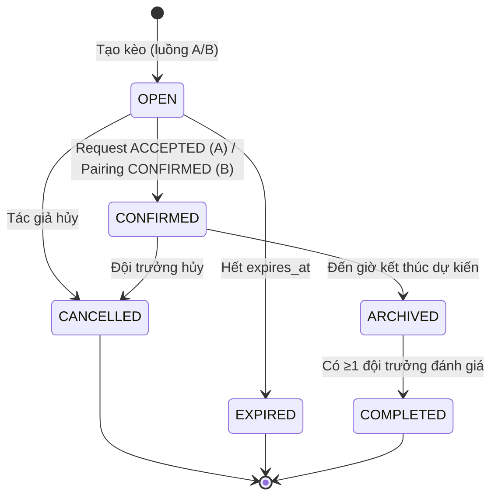
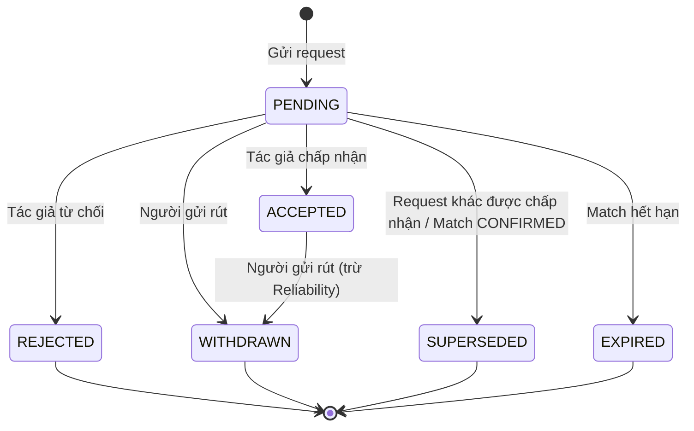
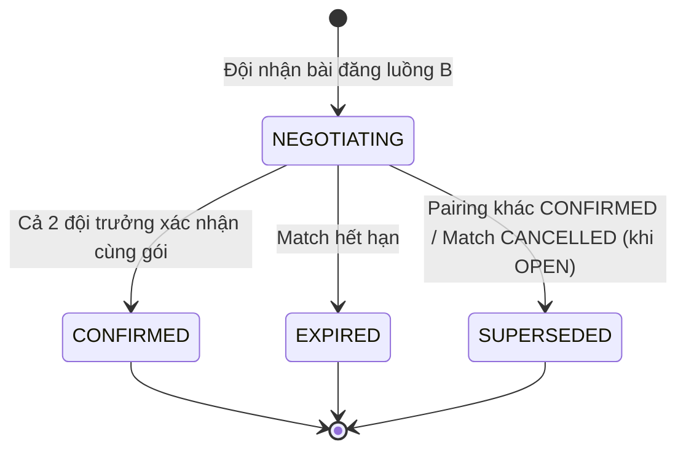
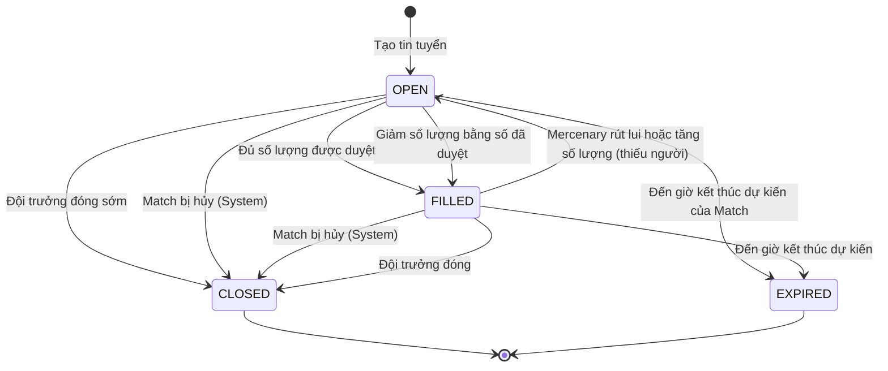
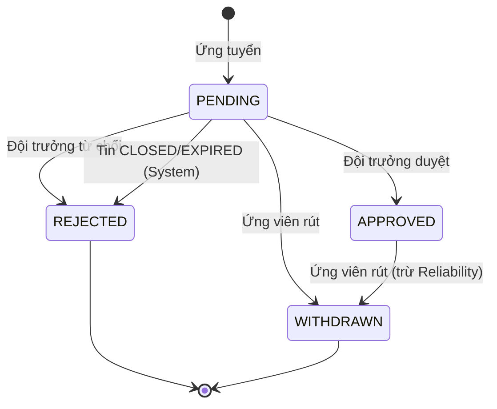
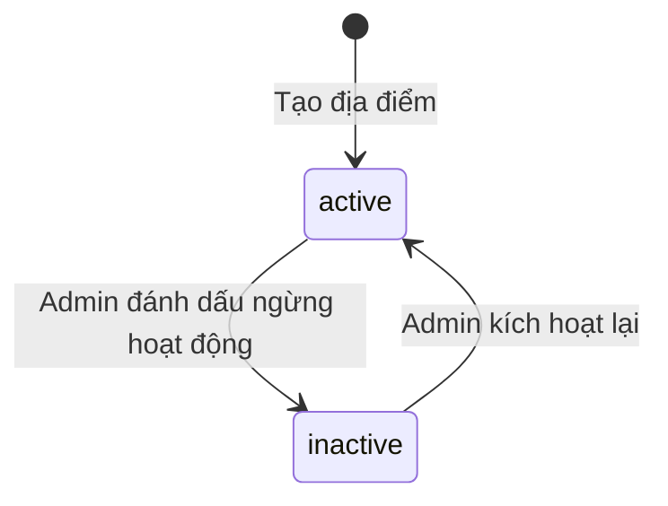

# Business Rules — ArenaFlow System

> Quy tắc nghiệp vụ, validation, state transitions, calculations, constraints, authorization.

---

## 1. Validation Rules

| Rule ID | Mô tả | Khi nào áp dụng |
|---|---|---|
| **USER** | | |
| BR-U01 | Số điện thoại phải là số VN (10 chữ số, bắt đầu 0) | Khi User đăng ký qua Phone OTP hoặc link phone |
| BR-U02 | Email phải hợp lệ (format email chuẩn); email được chuyển về chữ thường trước khi nhận diện tài khoản — khác hoa/thường không tạo tài khoản mới; email có khoảng trắng đầu/cuối không hợp lệ (2026-11-04) | Khi User đăng ký qua Google/Facebook |
| BR-U03 | Tên hiển thị không được để trống, tối đa 100 ký tự | Khi User cập nhật hồ sơ |
| BR-U04 | Ngày sinh phải trong quá khứ và User ≥13 tuổi | Khi User cập nhật hồ sơ |
| BR-U05 | Khu vực phải chọn từ danh mục Vietnam Administrative Units (phường/xã) | Khi User cập nhật hồ sơ |
| BR-U06 | Vị trí chơi ưa thích chọn từ 4 vị trí: Thủ môn, Hậu vệ, Tiền vệ, Tiền đạo | Khi User cập nhật hồ sơ |
| **TEAM** | | |
| BR-T01 | Tên đội không được để trống, tối đa 100 ký tự (cho phép trùng) | Khi tạo/sửa đội |
| BR-T02 | Trình độ đội: chọn tối đa 3 trong 9 nhãn | Khi tạo/sửa đội |
| BR-T03 | Đội trưởng chỉ có thể chuyển quyền cho thành viên đang active | Khi chuyển quyền đội trưởng |
| BR-T04 | Người được mời phải chấp nhận lời mời để trở thành thành viên | Khi mời vào đội |
| BR-T05 | Chuyển đội trưởng: người được chọn bắt buộc nhận (không có quyền từ chối) | Khi chuyển quyền |
| BR-T06 | **Sửa bởi `USER-002`:** trước khi xóa tài khoản, đội trưởng phải chuyển quyền hoặc giải tán mọi đội chưa giải tán, kể cả khi là người duy nhất — chi tiết `USER-002/Business_Rules.md` | Khi User xóa tài khoản |
| **MATCH** | | |
| BR-M01 | Giờ đá phải trong tương lai (≥ thời điểm hiện tại + 1 giờ) | Khi tạo Match |
| BR-M02 | Thời hạn bài đăng luồng A: `expires_at ≤ scheduled_start_time` (giờ bắt đầu trận). Không cho đổi ngày trận sau khi Match OPEN; muốn đổi phải hủy và tạo lại. | Khi tạo Match luồng A |
| BR-M03 | Luồng B: 1–5 lựa chọn địa điểm và 1–5 khung giờ (hai danh sách riêng). Thời hạn bài đăng: sau thời điểm hiện tại, không muộn hơn giờ bắt đầu sớm nhất trong các khung giờ và không sớm hơn giờ bắt đầu sớm nhất − 7 ngày (2026-11-10) | Khi tạo Match luồng B |
| BR-M04 | Match CONFIRMED không được sửa giờ/sân/trình độ | Khi cố gắng sửa Match CONFIRMED |
| BR-M05 | Hủy Match OPEN: phải từ chối tất cả Match_Request PENDING trước | Khi hủy Match OPEN |
| BR-M06 | Tối đa 1 Match_Request ACCEPTED mỗi Match (ràng buộc dữ liệu) | Khi chấp nhận Match_Request |
| BR-M07 | Pairing confirmation: cả 2 đội trưởng phải xác nhận qua UI riêng (không phải chat). Xác nhận áp cho **gói** đang hiển thị (BR-M19); Pairing chưa có phương án chốt → không xác nhận được (2026-11-10) | Khi xác nhận Pairing |
| BR-M08 | Luồng B có thể có nhiều Pairing đồng thời (Match vẫn OPEN trong lúc trao đổi) | Khi tạo Pairing |
| BR-M09 | Hủy Match CONFIRMED hoặc rút Match_Request đã ACCEPTED: chỉ **đội** thực hiện bị trừ Reliability Score của đội; không trừ điểm cá nhân của đội trưởng; đội còn lại không bị trừ (2026-11-09) | Khi hủy Match CONFIRMED, rút request ACCEPTED |
| BR-M10 | Mức trừ tính theo khoảng cách từ lúc hủy/rút đến giờ bắt đầu trận: từ đủ 24 giờ trở lên → -2; từ đủ 4 giờ đến dưới 24 giờ → -5; dưới 4 giờ → -10 (hủy đúng 24 giờ trước → -2; đúng 4 giờ trước → -5) (2026-11-09) | Khi hủy Match CONFIRMED, rút request ACCEPTED |
| BR-M11 | Không được hủy Match CONFIRMED hoặc rút Match_Request đã ACCEPTED khi trận đã bắt đầu (đã đến giờ bắt đầu); hệ thống báo "Trận đã bắt đầu, không thể hủy" (2026-11-09) | Khi hủy/rút |
| BR-M12 | Đội đã ghép rút Match_Request đã ACCEPTED = đội đó hủy kèo: Match chuyển CANCELLED, request chuyển WITHDRAWN, chỉ đội rút bị trừ (BR-M09, BR-M10). Đội đã ghép chọn "Hủy kèo" cho cùng kết quả. Mỗi lần hủy chỉ trừ điểm một lần (2026-11-09) | Khi đội đã ghép rút request / hủy kèo |
| BR-M13 | Khi hủy kèo hoặc rút request, hệ thống so với trạng thái mà đội trưởng **đang thấy** trên màn hình (kèo: đang mở / đã ghép; request: đang chờ / đã được chấp nhận), kể cả khi màn hình đã cũ từ trước lúc bấm. Trạng thái hiện tại khác (vd kèo đang mở đã được ghép; request đang chờ đã được chấp nhận) → hệ thống từ chối, báo "Trạng thái đã thay đổi, vui lòng tải lại", không hủy/rút và không trừ điểm (2026-11-09) | Khi hủy kèo, rút request |
| BR-M14 | Đội tạo kèo hoặc đội gửi request đang tạm ngưng (INACTIVE) hoặc đã giải tán: Match OPEN của đội tạo kèo không hiển thị trong tìm kèo; không gửi được request mới; không chấp nhận được request (cả khi đội gửi không còn hoạt động). Hệ thống không tự hủy Match; Match OPEN hết hạn theo thời hạn bài đăng, Match CONFIRMED tiếp tục vòng đời. Đội tạm ngưng vẫn được hủy kèo, từ chối và rút request (2026-11-09). **Luồng B (2026-11-11):** xem thương lượng luôn được phép. Nhắn tin trong cuộc chat giữa hai đội (luồng A và B): BR-N05. Đội của mình đang tạm ngưng → không nhận kèo, không chốt phương án, không sửa chi phí, không xác nhận ("Đội đang tạm ngưng hoạt động"). Đội còn lại của thương lượng không còn hoạt động → không nhận kèo, không xác nhận ("Đội đối phương hiện không hoạt động"); vẫn chốt phương án và sửa chi phí được | Khi tìm kèo, gửi/chấp nhận/từ chối/rút request, hủy kèo; luồng B: nhận kèo, chốt phương án, sửa chi phí, xác nhận |
| BR-M15 | Chỉ tạo kèo cho bộ môn đang bật. Bộ môn bị tắt: Match OPEN của bộ môn không hiển thị trong tìm kèo, không gửi/chấp nhận được request; không tự hủy; Match CONFIRMED tiếp tục vòng đời (2026-11-09). **Luồng B (2026-11-11):** bộ môn của kèo bị tắt → không ai nhận kèo hay xác nhận được ("Bộ môn hiện không được hỗ trợ"); chốt phương án, sửa chi phí và xem vẫn được (nhắn tin: BR-N05) | Khi tạo kèo, tìm kèo, gửi/chấp nhận request, Admin tắt bộ môn; luồng B: nhận kèo, xác nhận |
| BR-M16 | Giới hạn khi tạo kèo: giờ kết thúc dự kiến sau giờ bắt đầu và không quá 12 giờ; trình độ mong muốn tối đa 3 trong 9 nhãn, không chọn = nhận mọi trình độ; ghi chú độ tuổi ≤100 ký tự; tính chất trận ≤200 ký tự. Lý do hủy/từ chối/rút ≤500 ký tự; bắt buộc nhập lý do khi hủy Match CONFIRMED hoặc rút request ACCEPTED (2026-11-09) | Khi tạo kèo, hủy kèo, từ chối/rút request |
| BR-M17 | Match OPEN đã quá thời hạn bài đăng được hiển thị là EXPIRED ngay khi có người xem, kể cả trước lần cập nhật định kỳ; mọi thao tác trên Match đó (gửi/chấp nhận/từ chối/rút request, hủy, sửa chi phí, nhắn tin trong cuộc chat của đội có request PENDING / Pairing NEGOTIATING — BR-N05; luồng B: nhận kèo, chốt phương án, sửa chi phí của Pairing, xác nhận) bị từ chối với thông báo "Kèo đã hết hạn" và Match chuyển EXPIRED ngay, kể cả trước lần cập nhật định kỳ; các request PENDING (luồng A) và Pairing NEGOTIATING (luồng B) của Match cũng chuyển EXPIRED ngay (2026-11-09, luồng B 2026-11-11, nhắn tin luồng A 2026-11-15) | Khi xem/thao tác trên Match quá hạn |
| BR-M18 | Hai đội khác nhau có cùng một đội trưởng vẫn được gửi/chấp nhận request cho nhau; hệ thống không kiểm trùng lịch thi đấu giữa các Match của một đội (2026-11-09) | Khi gửi/chấp nhận request |
| BR-M19 | **Gói thương lượng** (luồng B) = phương án chốt + thỏa thuận chi phí + tiền cọc (kể cả khoản tự nhập) của một Pairing; mỗi Pairing có gói riêng. Phương án chốt = 1 địa điểm trong danh sách lựa chọn địa điểm + 1 khung giờ trong danh sách khung giờ của Match; một trong hai đội trưởng chốt khi Pairing NEGOTIATING. Mỗi lần gói đổi (chốt phương án khác, lưu chi phí) → **xoá xác nhận của cả hai bên**; chốt lại đúng phương án đang có không làm đổi gói. Chốt phương án, lưu chi phí và xác nhận chỉ áp cho gói mà đội trưởng đang thấy: gói đã đổi → từ chối "Phương án đã thay đổi, vui lòng tải lại", đội trưởng xem gói mới rồi tự thao tác lại (2026-11-10) | Khi chốt phương án, lưu chi phí, xác nhận Pairing |
| BR-M20 | Địa điểm đã ngừng hoạt động không chốt được làm phương án và không xác nhận được phương án đang chứa địa điểm đó ("Địa điểm đã ngừng hoạt động"); hai bên chốt lại địa điểm khác rồi xác nhận lại — nhất quán luồng A (2026-11-10) | Khi chốt phương án, xác nhận Pairing |
| BR-M21 | Mỗi đội chỉ có một Pairing cho một Match. Không có thao tác rút hay kết thúc Pairing; Pairing chỉ kết thúc khi CONFIRMED, SUPERSEDED hoặc EXPIRED (2026-11-10) | Khi nhận kèo luồng B |
| **REPUTATION** | | |
| BR-R01 | Mỗi cặp (Match, đội đánh giá, đội được đánh giá) chỉ được đánh giá 1 lần | Khi đánh giá đối phương |
| BR-R02 | Chỉ hiển thị Completion Rate khi ≥5 trận đã chốt; trước đó hiển thị "Mới tham gia X/5 trận" | Khi hiển thị Completion Rate |
| BR-R03 | Reliability Score chặn trong [0, 100] | Khi cập nhật Reliability Score |
| BR-R04 | Verification Badge yêu cầu đủ 4 điều kiện: (1) có số điện thoại — đội: đội trưởng hiện tại có số điện thoại trong tài khoản; cá nhân: tài khoản có số điện thoại; (2) >5 trận hoàn thành (số trận tính vào tử số Completion Rate — §3.3); (3) sao trung bình nhận được >3 (đánh giá "đội kia không đến" không có sao, không tính vào trung bình); (4) Reliability ≥70. Thời điểm cấp/thu hồi: §8.2 (user chốt 2026-11-12) | Khi cấp/thu hồi Verification Badge |
| BR-R05 | Report bùng có tranh chấp trong 24h; quá 24h tự xác nhận | Khi bị report bùng |
| BR-R06 | Report khác (chơi xấu, giao tiếp tệ, không đúng trình độ) tự động chấp nhận ngay | Khi report |
| BR-R07 | Report giữa hai đội được phép khi: (1) Match ARCHIVED hoặc COMPLETED → cả 4 loại; (2) Match CANCELLED **sau khi đã CONFIRMED** (hủy kèo đã ghép / rút request đã ACCEPTED) → chỉ "giao tiếp tệ"; (3) **qua chat hai đội:** cuộc chat giữa hai đội của kèo (BR-N04) đã có ít nhất 1 tin nhắn (của bất kỳ bên nào) → hai đội trưởng report nhau được loại "giao tiếp tệ", **bất kể** trạng thái request (PENDING, REJECTED, SUPERSEDED, EXPIRED, WITHDRAWN), Pairing (NEGOTIATING, SUPERSEDED, EXPIRED) và kèo (OPEN, CONFIRMED trước trận, CANCELLED, EXPIRED) — hai đội đã ghép report được ngay khi kèo CONFIRMED trước trận. Ngoài các trường hợp trên (vd kèo OPEN/CONFIRMED/EXPIRED hoặc CANCELLED khi còn OPEN mà hai đội chưa có tin nhắn nào) → không report được. Mỗi chiều (đội report → đội bị report) chỉ 1 report "giao tiếp tệ" cho mỗi kèo, dù gửi qua chat hay sau trận. Report qua chat xử lý như report giữa hai đội: tự chấp nhận (BR-R06), trừ Reliability đội bị report theo §3.2, chuỗi trận sạch của đội bị report về 0 (§3.1); BR-R08, BR-R09, BR-R10 áp dụng. Ví dụ: kèo luồng A của Alpha, đội Y gửi request; khi request còn PENDING, đội trưởng Y chửi Alpha trong chat → Alpha report Y "giao tiếp tệ" ngay (Y −2 nếu là lần 1 bị report loại này); sau khi request của Y bị SUPERSEDED, Alpha không report Y loại này lần nữa cho kèo đó; Y vẫn report Alpha được một lần (user chốt 2026-11-12; nhánh chat 2026-11-15) | Khi report |
| BR-R08 | Người là đội trưởng của **cả hai đội** trong trận (BR-M18) không được đánh giá và không được report trận đó (user chốt 2026-11-12) | Khi đánh giá, report |
| BR-R09 | Giới hạn độ dài và bắt buộc nhập: nhận xét khi đánh giá không bắt buộc, nếu có ≤500 ký tự; lý do report bắt buộc, 1–1000 ký tự; bằng chứng tranh chấp bắt buộc, chỉ văn bản (không đính kèm ảnh/tệp), 1–1000 ký tự; ghi chú lý do quyết định của Admin bắt buộc, 1–500 ký tự (user chốt 2026-11-13) | Khi đánh giá, report, tranh chấp, Admin xử lý tranh chấp |
| BR-R10 | Đội của đội trưởng thực hiện thao tác phải đang hoạt động (ACTIVE) khi đánh giá, xem đánh giá của trận, report, xem report của đội; đội bị report phải ACTIVE khi tranh chấp. Đội INACTIVE hoặc DISBANDED không thực hiện được các thao tác này. Trạng thái của đội được đánh giá / bị report không ảnh hưởng — đội đối phương INACTIVE hoặc DISBANDED vẫn bị đánh giá / report được (user chốt 2026-11-13) | Khi đánh giá, xem đánh giá, report, xem report, tranh chấp |
| **MERCENARY** | | |
| BR-ME01 | Tuyển mercenary cho Match trên hệ thống đã CONFIRMED, hoặc cho trận ngoài hệ thống do đội trưởng khai báo (BR-ME19) (user chốt 2026-11-14) | Khi tạo tin tuyển |
| BR-ME02 | Tin tuyển tự động EXPIRED khi đến giờ kết thúc dự kiến của Match | Khi hết hạn |
| BR-ME03 | Tìm kèo mercenary: có GPS → tin tuyển có sân trong bán kính, mặc định 3 km, người dùng chỉnh 1–20 km, sắp theo khoảng cách. Không có GPS → tin tuyển có sân cùng tỉnh với phường trong hồ sơ; sân cùng phường lên đầu, rồi theo giờ đá; không hiển thị khoảng cách (user chốt 2026-11-13) | Khi tìm kèo |
| BR-ME04 | Trước khi được duyệt: chỉ hiển thị khoảng cách (khi có GPS) và khu vực "phường, tỉnh" của sân; không hiển thị tọa độ, tên sân, địa chỉ. Đơn APPROVED: mercenary thấy tên sân, địa chỉ, tọa độ và tên đội trưởng (user chốt 2026-11-13). Ngoại lệ: trong chat của đơn (BR-ME16), tên đội trưởng hiển thị từ khi đơn PENDING (user chốt 2026-11-14) | Khi hiển thị kèo |
| BR-ME05 | Đội tạo kèo và đội đã ghép đều được tuyển cho trận CONFIRMED của đội mình. Đội trưởng chọn nhiều vị trí trong một lần → mỗi vị trí thành một tin tuyển (vị trí + số lượng) với trạng thái riêng (user chốt 2026-11-13). Số lượng mỗi tin 1–10. Mỗi (Match, đội, vị trí) tối đa một tin OPEN/FILLED — muốn thêm người thì tăng số lượng (BR-ME08). Đội phải ACTIVE mới tạo tin, sửa số lượng, duyệt; đội INACTIVE vẫn đóng tin và từ chối đơn; tin của đội không ACTIVE bị ẩn khỏi tìm kèo và không nhận ứng tuyển mới; đơn APPROVED giữ nguyên (user chốt 2026-11-14) | Khi tạo tin tuyển |
| BR-ME06 | Không ứng tuyển / không được duyệt nếu: là thành viên đang hoạt động của một trong hai đội của trận; hoặc đã có đơn APPROVED ở trận khác trùng thời gian (khoảng giờ bắt đầu – giờ kết thúc dự kiến giao nhau). Kiểm cả lúc ứng tuyển và lúc duyệt. Mỗi người tối đa một đơn PENDING/APPROVED cho mỗi tin (user chốt 2026-11-13); tối đa một đơn APPROVED trong cùng một Match (không đá hai vị trí, không đá cho cả hai đội) (user chốt 2026-11-14) | Khi ứng tuyển, duyệt |
| BR-ME07 | Chỉ duyệt khi tin OPEN; đủ số lượng → FILLED. Tin FILLED: đơn PENDING giữ nguyên, không duyệt được cho tới khi tin về OPEN. Tin CLOSED hoặc EXPIRED: đơn PENDING tự chuyển REJECTED, ứng viên nhận thông báo (user chốt 2026-11-13). Từ giờ bắt đầu trận: tin ẩn khỏi tìm kèo, không ứng tuyển, không duyệt được nữa. Khi hệ thống tự đóng tin / tự từ chối đơn, trạng thái hiển thị đổi ngay; thông báo có thể đến trễ tối đa khoảng 5 phút (user chốt 2026-11-14) | Khi duyệt, đóng, hết hạn |
| BR-ME08 | Đội trưởng sửa số lượng khi tin OPEN hoặc FILLED, không thấp hơn số đã duyệt: bằng số đã duyệt → FILLED, lớn hơn → OPEN. Không đổi vị trí (đóng tin và tạo tin mới). Đội trưởng đóng tin sớm (CLOSED) khi tin OPEN hoặc FILLED (user chốt 2026-11-13). Từ giờ bắt đầu trận: không tạo tin mới, không tăng số lượng; vẫn giảm số lượng và đóng tin được (user chốt 2026-11-14) | Khi tạo / sửa / đóng tin |
| BR-ME09 | Match chuyển CANCELLED: mọi tin OPEN/FILLED của trận tự CLOSED; đơn PENDING tự REJECTED; đơn APPROVED giữ nguyên (lịch sử). Ứng viên và mercenary nhận thông báo — với Match trên hệ thống, thông báo có thể đến trễ tối đa khoảng 5 phút kể từ lúc hủy, trạng thái hiển thị đổi ngay; trận ngoài hệ thống bị hủy thì báo ngay (user chốt 2026-11-14). Mercenary không bị trừ điểm, trận không tính Completion Rate cá nhân, đội trưởng và mercenary không đánh giá nhau (user chốt 2026-11-13). Đội trưởng hủy trận ngoài hệ thống (BR-ME19) được xử lý như trên (user chốt 2026-11-14) | Khi Match bị hủy |
| BR-ME10 | Đội trưởng không hủy duyệt / loại mercenary đã APPROVED; chỉ mercenary tự rút (BR-ME11) (user chốt 2026-11-13) | Khi duyệt |
| BR-ME11 | Mercenary rút sau khi APPROVED chỉ được trước giờ bắt đầu trận (như BR-M11); trừ Reliability cá nhân -1/-3/-5 theo khoảng cách đến giờ bắt đầu trận (§3.1), chuỗi trận sạch cá nhân về 0; tin FILLED → OPEN. Rút đơn PENDING không ảnh hưởng uy tín (user chốt 2026-11-13) | Khi rút lui |
| BR-ME12 | Mercenary "đã tham gia trận" = đơn còn APPROVED lúc Match kết thúc (không điểm danh). Mercenary vắng → đội trưởng đánh giá "không đến" và/hoặc report bùng (user chốt 2026-11-13) | Khi đánh giá, report, tính uy tín |
| BR-ME13 | Đánh giá khi Match ARCHIVED/COMPLETED: đội trưởng đánh giá từng mercenary đã tham gia (sao nguyên 1–5 hoặc "không đến"); mercenary đánh giá đội thuê mình (sao nguyên 1–5). Mercenary nhận 5 sao → +1 Reliability cá nhân. Đánh giá của mercenary dành cho đội chỉ hiển thị riêng trên hồ sơ đội — và chỉ sau khi đội đã đánh giá lại mercenary đó (BC-R03, user chốt 2026-11-14) — không tính vào sao trung bình đội, không cộng Reliability đội. Đánh giá liên quan mercenary không làm Match chuyển COMPLETED (chỉ đánh giá giữa hai đội). Áp dụng BC-R02..R04, BR-R09 (user chốt 2026-11-13) | Khi đánh giá |
| BR-ME14 | Report hai chiều: đội trưởng report từng mercenary đã tham gia; mercenary report đội thuê mình. Cùng 4 loại, tự chấp nhận, mức trừ theo số lần (§3.2, trừ vào Reliability cá nhân khi người bị report là mercenary), report bùng tranh chấp được trong 24 giờ, Admin quyết định (BR-R05, BR-R06, BR-R09, §6) trong hàng chờ tranh chấp riêng cho mercenary. Report của mercenary dành cho đội tác động lên đội như report giữa hai đội: trừ Reliability đội, report bùng loại trận khỏi tử số Completion Rate và cắt chuỗi trận sạch của đội (user chốt 2026-11-14). Đội của đội trưởng phải ACTIVE (BR-R10). Ngoài ra, đội trưởng và ứng viên report nhau được loại "giao tiếp tệ" khi đơn ứng tuyển đã có tin nhắn chat (BR-ME16), bất kể trạng thái đơn và trận (user chốt 2026-11-13) | Khi report, tranh chấp |
| BR-ME15 | Reliability, chuỗi trận sạch, reset bộ đếm report và Completion Rate của mercenary theo luật đội (§3.1–§3.3), với thời điểm hoàn thành riêng: mercenary đã tham gia được tính hoàn thành (+2, tử số Completion Rate, xét chuỗi trận sạch) vào lúc đội trưởng đánh giá mercenary bằng sao — áp cho cả Match trên hệ thống và trận ngoài hệ thống. Không bị report (chưa bị Admin bác) trong trận → chuỗi trận sạch +1 và bonus mốc bội số 5/10; bị report → chuỗi về 0. Bị đánh giá "không đến" hoặc chưa được đánh giá → không +2, không tính hoàn thành (user chốt 2026-11-13, sửa 2026-11-14) | Khi tính uy tín cá nhân |
| BR-ME16 | Chat 1–1 theo đơn ứng tuyển: mỗi đơn một cuộc chat giữa đội trưởng hiện tại của đội tuyển và ứng viên, mở từ khi đơn PENDING. Gửi tin được khi đơn PENDING hoặc APPROVED — đơn APPROVED nhắn được cả sau khi Match kết thúc hoặc bị hủy, đến khi tin nhắn hết hạn lưu; đơn REJECTED/WITHDRAWN chỉ xem. Đội tuyển đã giải tán → người đã giải tán đội vẫn đọc lịch sử nhưng không gửi được, ứng viên vẫn xem / nhắn theo trạng thái đơn (như BR-N05; user chốt 2026-11-15). Nội dung 1..1000 ký tự; mỗi tin hiển thị người thực sự gửi (như BR-N03); lưu 90 ngày sau khi Match kết thúc (BR-N01) (user chốt 2026-11-13) | Khi chat |
| BR-ME17 | Tìm kèo khi không có GPS và hồ sơ chưa chọn phường → hệ thống báo lỗi, nhắc bật GPS hoặc cập nhật khu vực trong hồ sơ (user chốt 2026-11-14) | Khi tìm kèo |
| BR-ME18 | User xoá tài khoản: mọi đơn PENDING/APPROVED của trận chưa bắt đầu (Match CONFIRMED hoặc trận ngoài hệ thống chưa hủy) tự chuyển WITHDRAWN (đơn APPROVED của Match đã bị hủy giữ nguyên làm lịch sử — BR-ME09), không trừ Reliability; tin FILLED về OPEN; đội trưởng nhận thông báo (user chốt 2026-11-14) | Khi xoá tài khoản |
| BR-ME19 | Trận ngoài hệ thống: đội trưởng đội ACTIVE khai báo sân (chọn từ danh sách địa điểm; chưa có thì thêm địa điểm trước), giờ bắt đầu, giờ kết thúc, trình độ, tên đối thủ (tùy chọn), rồi vị trí + số lượng như BR-ME05. Tin tuyển, ứng tuyển, duyệt, rút lui, chat, tìm kiếm và hiển thị theo cùng quy tắc như Match trên hệ thống. Giới hạn như khi tạo kèo: giờ bắt đầu ≥ hiện tại + 1 giờ, giờ kết thúc sau giờ bắt đầu và không quá 12 giờ (BR-M01, BR-M16), tên đối thủ ≤100 ký tự. Sửa sân / giờ / trình độ chỉ trước giờ bắt đầu và khi chưa có đơn APPROVED; đội trưởng hủy trận ngoài chỉ trước giờ bắt đầu (như BR-M11) → như BR-ME09, không trừ điểm đội. Sau giờ kết thúc: đánh giá / report hai chiều như BR-ME13, BR-ME14; đội không được cộng hay trừ Reliability vì trận ngoài, trừ report của mercenary (BR-ME14) (user chốt 2026-11-14) | Khi tuyển cho trận ngoài hệ thống |
| **VENUE** | | |
| BR-V01 | Tên địa điểm không được để trống, tối đa 200 ký tự | Khi thêm/sửa địa điểm |
| BR-V02 | Ảnh sân: tối đa 5 ảnh mỗi địa điểm | Khi upload ảnh |
| BR-V03 | Chỉ 1 ảnh is_primary=true mỗi venue | Khi upload ảnh hoặc đổi ảnh chính |
| BR-V04 | Report địa điểm không tự ẩn địa điểm; cần admin xác minh | Khi report địa điểm |
| BR-V05 | Loại sân (không bắt buộc) chỉ nhận: sân 5, sân 7, sân 11 | Khi thêm/sửa địa điểm |
| BR-V06 | Chỉ người tạo địa điểm hoặc Admin được sửa thông tin địa điểm và xóa ảnh sân; địa điểm đã ngừng hoạt động chỉ Admin được sửa | Khi sửa địa điểm, xóa ảnh |
| BR-V07 | Mọi user đã đăng nhập được thêm ảnh và đổi ảnh chính; địa điểm đã ngừng hoạt động chỉ Admin được thêm/đổi ảnh chính/xóa ảnh | Khi upload ảnh, đổi ảnh chính, xóa ảnh |
| BR-V08 | Xóa ảnh chính khi địa điểm còn ảnh khác → ảnh còn lại có thứ tự hiển thị nhỏ nhất thành ảnh chính | Khi xóa ảnh |
| BR-V09 | Mỗi user chỉ có tối đa 1 report chờ xử lý cho mỗi (địa điểm, lý do); không report địa điểm đã ngừng hoạt động | Khi report địa điểm |
| BR-V10 | Kèo chỉ tham chiếu địa điểm; luôn hiển thị thông tin địa điểm mới nhất (không lưu bản sao) | Khi sửa địa điểm, hiển thị kèo |
| BR-V11 | Địa điểm có phường/xã chọn từ danh mục Vietnam Administrative Units; bắt buộc khi thêm hoặc sửa địa điểm. Địa điểm tạo trước đó chưa có phường vẫn hoạt động, tìm bằng GPS bình thường, nhưng không hiển thị khu vực và không xuất hiện trong tìm kèo mercenary không GPS cho tới khi được bổ sung phường (cho MERCENARY-001 — BR-ME03, BR-ME04) (user chốt 2026-11-14) | Khi thêm/sửa địa điểm, tìm kèo mercenary |
| **COST** | | |
| BR-C01 | Tiền tệ mặc định VND trong MVP | Khi nhập thỏa thuận chi phí |
| BR-C02 | Số tiền phải > 0 | Khi nhập thỏa thuận chi phí |
| BR-C03 | Luồng A: chỉ đội trưởng đội tạo kèo nhập/sửa thỏa thuận chi phí, và chỉ khi Match đang OPEN; mỗi lần lưu thay toàn bộ thỏa thuận cũ (kể cả danh sách khoản tự nhập) (2026-11-09) | Khi nhập thỏa thuận chi phí luồng A |
| BR-C04 | Loại chi phí chỉ gồm: tiền sân, tiền nước, hoặc cả hai (không có loại "tùy chỉnh"). Khoản tự nhập là danh sách riêng, tối đa 10 khoản; tên khoản ≤100 ký tự; mọi số tiền > 0 và ≤ 1.000.000.000 VND. Cách chia "đội thua trả toàn bộ tiền nước" chỉ chọn được khi có tiền nước (2026-11-09) | Khi nhập thỏa thuận chi phí |
| BR-C05 | Luồng B: thỏa thuận chi phí thuộc Pairing trong lúc thương lượng; hai đội trưởng của Pairing đều nhập/sửa được khi Pairing NEGOTIATING; mỗi lần lưu thay toàn bộ thỏa thuận cũ (kể cả khoản tự nhập) và xoá xác nhận của cả hai bên (BR-M19). Tiền cọc (chỉ luồng B): số tiền cọc 1..1.000.000.000 VND hoặc không có cọc; "ai giữ tiền cọc" (văn bản ≤100 ký tự) chỉ nhập khi có số tiền cọc; không chia tiền cọc. Khi Pairing CONFIRMED, chi phí + tiền cọc + khoản tự nhập được **chép** sang Match (Pairing giữ nguyên thỏa thuận của mình) (2026-11-10, chép khoản tự nhập 2026-11-11) | Khi nhập thỏa thuận chi phí luồng B, khi ghép kèo luồng B |
| **NOTIFICATION** | | |
| BR-N01 | Chat lưu 90 ngày sau khi Match kết thúc (COMPLETED/ARCHIVED/CANCELLED/EXPIRED) — vd kèo hết hạn 12/11/2026 → mọi cuộc chat giữa hai đội của kèo đó (BR-N04) bị xóa ngày 10/02/2027 (EXPIRED bổ sung 2026-11-11; áp cho cả luồng A 2026-11-15) | Khi lưu chat |
| BR-N02 | Notification lưu 30 ngày kể từ lúc tạo. Thông báo quá 30 ngày không còn hiển thị với người nhận (danh sách, số chưa đọc — BR-N11), kể cả khi chưa đọc và ngay cả trước lượt xóa hằng ngày; lượt xóa hằng ngày xóa hẳn (user chốt 2026-11-16) | Khi tạo, hiển thị, xóa notification |
| BR-N03 | Tin nhắn trong cuộc chat giữa hai đội (BR-N04, luồng A và B): nội dung 1..1000 ký tự. Mỗi tin hiển thị tên đội gửi (tên hiện tại của đội) + tên và ảnh của **người thực sự đã gửi**; tin cũ giữ người gửi lúc đó dù đội đã chuyển quyền đội trưởng; người gửi đã xóa tài khoản → "Người dùng đã xóa", không ảnh. Đầu phòng chat hiển thị tên hai đội + đội trưởng hiện tại của mỗi đội (2026-11-10) | Khi gửi và hiển thị tin nhắn |
| BR-N04 | **Cuộc chat giữa hai đội trong một kèo:** mỗi cặp (kèo, đội tham gia) có đúng một cuộc chat giữa đội tạo kèo và đội tham gia đó. Luồng A: mở khi đội gửi Match Request — mỗi đội gửi có một cuộc chat riêng với đội tạo kèo, kể cả khi request còn PENDING. Luồng B: mở khi đội nhận kèo — mỗi Pairing một cuộc chat. Sau khi ghép, hai đội nhắn tiếp trong chính cuộc chat đó (không mở cuộc chat mới). Chỉ **đội trưởng hiện tại** của mỗi đội xem và nhắn; thành viên đội và các đội khác không thấy cuộc chat (vd X không thấy chat Alpha–Y). Đội gửi lại request sau khi đã rút hoặc request đã hết hạn (UC-M03): theo "mỗi cặp một cuộc chat", dùng tiếp cuộc chat cũ (giữ lịch sử, nhắn được lại khi request mới PENDING — BR-N05) (user chốt 2026-11-13; gửi lại request: 2026-11-15) | Khi gửi request, nhận kèo, xem/nhắn chat |
| BR-N05 | **Nhắn được / chỉ xem** trong cuộc chat giữa hai đội (BR-N04): (1) **Nhắn được** khi đội tham gia chưa có kết quả — request PENDING (luồng A) / Pairing NEGOTIATING (luồng B) và kèo chưa quá thời hạn bài đăng (quá hạn → BR-M17); hoặc khi hai đội **đã ghép** — request đã được chấp nhận (kể cả khi sau đó đội gửi rút = hủy kèo, BR-M12) / Pairing CONFIRMED: nhắn được trước, trong, sau trận và cả khi kèo bị hủy, đến khi chat bị xóa (BR-N01). (2) **Chỉ xem** (cả hai đội đọc lịch sử, không gửi được) khi đội tham gia **không được ghép**: request REJECTED, SUPERSEDED, EXPIRED hoặc WITHDRAWN khi còn PENDING; Pairing SUPERSEDED hoặc EXPIRED. (3) Trạng thái đội và bộ môn — áp dụng như luồng B hiện tại: đội tạm ngưng (INACTIVE), đội còn lại không hoạt động hoặc bộ môn của kèo đang tắt → vẫn nhắn được; đội đã giải tán → người đã giải tán đội (đội trưởng cuối của đội) vẫn mở cuộc chat và đọc lịch sử nhưng không gửi được; thành viên khác của đội đó không xem được; đội còn lại vẫn xem / nhắn theo (1)–(2) (`USER-002` BR-T11; user chốt 2026-11-15). Ví dụ: kèo luồng A của Alpha có 3 đội X, Y, Z gửi request → 3 cuộc chat Alpha–X, Alpha–Y, Alpha–Z, đều nhắn được khi request còn PENDING; Alpha chấp nhận X → chat Alpha–X vẫn nhắn được, kể cả sau trận hoặc khi kèo bị hủy, đến 90 ngày sau khi kèo kết thúc; Alpha–Y, Alpha–Z (SUPERSEDED) thành chỉ xem. Luồng B: Beta và Gamma nhận kèo của Alpha → chat Alpha–Beta, Alpha–Gamma; Pairing của Beta CONFIRMED → Alpha–Beta nhắn tiếp, Alpha–Gamma (SUPERSEDED) chỉ xem (user chốt 2026-11-13) | Khi gửi tin nhắn |
| BR-N06 | **Danh sách tin nhắn của tôi:** gồm mọi cuộc chat người dùng xem được tại thời điểm xem. (1) Cuộc chat giữa hai đội (BR-N04): người dùng là đội trưởng hiện tại của một trong hai đội, hoặc là người đã giải tán một trong hai đội (chỉ xem — BR-N05). (2) Chat theo đơn ứng tuyển (BR-ME16): người dùng là đội trưởng hiện tại của đội tuyển, người đã giải tán đội tuyển (chỉ xem), hoặc là ứng viên. Gồm cả cuộc chat chỉ xem và cuộc chat chưa có tin nhắn nào (dòng không có tin cuối). Đội trưởng mới sau khi chuyển quyền thấy mọi cuộc chat của đội; đội trưởng cũ không còn thấy. Cuộc chat đã bị xóa theo BR-N01 không hiển thị. Sắp xếp: tin cuối mới nhất trước; cuộc chat chưa có tin: chat hai đội luồng A xếp theo lúc đội tham gia gửi request gần nhất (gửi lại sau khi rút / hết hạn đẩy cuộc chat lên), chat luồng B và chat theo đơn ứng tuyển xếp theo lúc mở cuộc chat. "Chưa đọc" = bên kia có tin mà phía mình chưa xem. Vd: Minh là đội trưởng Alpha; kèo luồng A của Alpha có Beta và Gamma gửi request; Alpha có ứng viên mercenary Trần Văn C → danh sách của Minh có 3 dòng Alpha–Beta, Alpha–Gamma, Alpha–Trần Văn C; Nam giải tán Beta → danh sách của Nam vẫn có Alpha–Beta, đánh dấu chỉ xem (user chốt 2026-11-15) | Khi xem màn hình Tin nhắn |
| BR-N07 | **Loại thông báo:** hệ thống tạo thông báo trong app cho đúng 35 loại sự kiện ở §8.6 (mỗi loại: khi nào, ai nhận). Không có thông báo cho: tin nhắn chat (BR-N12); đội trưởng cũ khi chuyển quyền đội trưởng; ứng viên tự rút đơn PENDING; Match chuyển ARCHIVED → COMPLETED; từng report địa điểm (Admin chỉ nhận cảnh báo theo BC-V05) (user chốt 2026-11-16) | Khi có sự kiện |
| BR-N08 | **Người nhận:** (1) Sự kiện nhắm vào một đội → **đội trưởng của đội tại lúc hệ thống tạo thông báo** — có thể vài giây sau sự kiện, không phải đội trưởng đúng lúc sự kiện xảy ra: đội chuyển quyền đội trưởng trong khoảng đó thì đội trưởng mới nhận. Thành viên thường không nhận; đội đã giải tán (không còn đội trưởng) → không ai nhận. (2) Sự kiện nhắm vào một người dùng (người được mời, ứng viên / mercenary, người bị report cá nhân…) → chính người đó. (3) Sự kiện cho Admin (cảnh báo địa điểm — BC-V05; tranh chấp report bùng mới, giữa hai đội hoặc liên quan mercenary) → **mỗi** Admin đang hoạt động nhận một thông báo riêng, đọc riêng. (4) Chuyển quyền đội trưởng không chuyển thông báo: thông báo đã tạo ở lại người nhận cũ; đội trưởng mới chỉ nhận thông báo tạo từ lúc nhận quyền. (5) Người đã xóa tài khoản không nhận thông báo mới. (6) Một người là đội trưởng của cả hai đội trong cùng sự kiện (BR-M18) nhận một thông báo cho mỗi loại. Vd: Beta hủy kèo đã ghép với Alpha lúc 10:00:00, Minh chuyển quyền đội trưởng Alpha cho Lan lúc 10:00:02, hệ thống tạo thông báo lúc 10:00:03 → Lan nhận "Kèo bị hủy", Minh không nhận (user chốt 2026-11-16) | Khi tạo thông báo |
| BR-N09 | **Nội dung thông báo:** tiêu đề và nội dung tiếng Việt do hệ thống soạn tại lúc tạo — là ảnh chụp tại thời điểm đó: đội đổi tên, kèo đổi giờ sau này không cập nhật thông báo cũ. Nội dung chỉ có tên đội, tên sân, giờ, vị trí, loại report — **không** có tên cá nhân; không đưa lý do Admin tạm ngưng đội. Thông báo kèm màn hình liên quan (kèo, thương lượng, đội, lời mời, hồ sơ, địa điểm, report, tranh chấp, đơn ứng tuyển) để người nhận mở xem; lúc mở, đối tượng có thể đã đổi trạng thái hoặc người nhận không còn quyền xem (vd đã chuyển quyền đội trưởng) (user chốt 2026-11-16) | Khi tạo, hiển thị thông báo |
| BR-N10 | **Thời điểm tạo và nhận:** thông báo của thao tác người dùng được tạo vài giây sau khi thao tác thành công; thao tác thất bại không tạo thông báo. Thông báo do hệ thống tự chuyển trạng thái (hết hạn, kết thúc trận, tự đóng tin tuyển…) tạo theo chu kỳ của tác vụ đó (phần lớn trễ tối đa khoảng 5 phút; huy hiệu đối soát và cảnh báo địa điểm 180 ngày: hằng ngày). App đang mở nhận thông báo mới ngay (tín hiệu realtime); mất kết nối thì khi kết nối lại app cập nhật lại số chưa đọc. Không bảo đảm tuyệt đối mọi thông báo được tạo: sự cố máy chủ đúng lúc vừa thao tác có thể làm mất thông báo của thao tác đó; trạng thái thật luôn xem ở chức năng tương ứng. Push điện thoại khi app đóng: chưa có (§8.6) (user chốt 2026-11-16) | Khi tạo, khi nhận thông báo |
| BR-N11 | **Người dùng xem thông báo:** chỉ thấy thông báo của chính mình trong 30 ngày gần nhất (BR-N02): xem danh sách (mới nhất trước, lọc "chỉ chưa đọc"), xem số chưa đọc (không tính tin nhắn chat — BR-N12), đánh dấu một thông báo đã đọc, đánh dấu tất cả đã đọc (mọi thông báo chưa đọc có tại lúc thao tác; thông báo đến sau vẫn chưa đọc). Không xóa thủ công (tự xóa sau 30 ngày), không đánh dấu lại chưa đọc (user chốt 2026-11-16) | Khi xem thông báo |
| BR-N12 | **Tin nhắn chat không tạo thông báo:** tin nhắn mới (chat giữa hai đội — BR-N04; chat theo đơn ứng tuyển — BR-ME16) không tạo thông báo và không tính vào số thông báo chưa đọc. Mỗi tin mới, những người xem được cuộc chat (BR-N06) trừ người gửi, nếu đang mở app, nhận tín hiệu realtime để cập nhật dấu "chưa đọc" của màn hình "Tin nhắn". Push điện thoại cho tin nhắn quyết khi làm push (§8.6) (user chốt 2026-11-16) | Khi gửi tin nhắn |
| BR-N13 | **Nhắc trước trận:** một lần, khoảng 2 giờ trước giờ bắt đầu (trễ tối đa khoảng 5 phút). Match CONFIRMED: đội trưởng hai đội + mọi mercenary APPROVED của trận. Trận ngoài hệ thống (BR-ME19) chưa hủy: chỉ mercenary APPROVED (không nhắc đội trưởng đội khai báo). Kèo được ghép / trận ngoài hệ thống được khai báo khi còn dưới 2 giờ trước giờ bắt đầu → không nhắc. Mỗi trận chỉ nhắc một lần: mercenary được duyệt sau lần nhắc không được nhắc bù. Vd: kèo 18:00 → nhắc khoảng 16:00–16:05; kèo được ghép lúc 16:30 cho trận 18:00 → không nhắc (user chốt 2026-11-16) | Trước giờ bắt đầu trận |
| BR-N14 | **Nhắc đánh giá và thông báo nhận đánh giá:** (1) Match chuyển ARCHIVED (trễ tối đa khoảng 5 phút sau giờ kết thúc dự kiến) → đội trưởng hai đội nhận nhắc nhập tỷ số và đánh giá; mercenary APPROVED của trận nhận nhắc đánh giá đội thuê mình. Match chuyển ARCHIVED → COMPLETED không có thông báo. (2) Trận ngoài hệ thống: mercenary APPROVED nhận nhắc đánh giá đội trong khoảng 5 phút sau giờ kết thúc; chỉ nhắc cho trận kết thúc trong 24 giờ gần nhất — trận đã kết thúc quá 24 giờ mà chưa được nhắc (vd hệ thống gián đoạn) → không nhắc bù. (3) "Nhận đánh giá": bên được đánh giá chỉ nhận thông báo khi chính họ **đã đánh giá** bên kia trước (bên kia đánh giá sau); bên chưa đánh giá không nhận — không lộ "đối phương đã đánh giá" (BC-R04). Áp cho đánh giá giữa hai đội và giữa đội trưởng ↔ mercenary (BC-R03, BR-ME13) (user chốt 2026-11-16) | Khi trận kết thúc, khi đánh giá |

---

## 2. State Transitions

### 2.1. Match Lifecycle



**Quy tắc chuyển trạng thái Match:**

| Từ | Đến | Điều kiện | Actor | Ghi chú |
|---|---|---|---|---|
| — | OPEN | Tạo kèo luồng A hoặc B | Team Captain | Khởi tạo |
| OPEN | CONFIRMED | 1 Match_Request ACCEPTED (A) hoặc 1 Pairing CONFIRMED (B) | Team Captain | Không sửa giờ/sân/trình độ sau CONFIRMED |
| OPEN | EXPIRED | `expires_at` ≤ now | System | Scheduled job + lazy check (BR-M17) |
| OPEN | CANCELLED | Tác giả hủy (phải từ chối mọi request PENDING trước) | Team Captain | Không trừ uy tín |
| CONFIRMED | ARCHIVED | `scheduled_end_time` ≤ now | System | Gửi thông báo nhắc cho 2 đội trưởng: "Trận đấu hôm nay thế nào? Hãy nhập tỷ số và đánh giá đồng đội!"; mercenary APPROVED nhận nhắc đánh giá đội thuê mình (BR-N14) |
| CONFIRMED | CANCELLED | Đội trưởng đội tạo kèo hoặc đội đã ghép hủy, hoặc đội đã ghép rút request đã ACCEPTED (BR-M12); chỉ trước giờ bắt đầu trận (BR-M11) | Team Captain | Trừ Reliability của đội hủy theo khoảng cách giờ trận (BR-M09, BR-M10) |
| ARCHIVED | COMPLETED | ≥1 đội trưởng đánh giá, kể cả đánh giá "đội kia không đến" (user chốt 2026-11-12) | Team Captain | Đội trưởng còn lại vẫn có thể đánh giá sau, không giới hạn. Không có thông báo cho lần chuyển trạng thái này (BR-N14) |

**Trạng thái terminal:** CANCELLED, EXPIRED, COMPLETED

---

### 2.2. Match_Request Lifecycle



**Quy tắc chuyển trạng thái Match_Request:**

| Từ | Đến | Điều kiện | Actor | Ghi chú |
|---|---|---|---|---|
| — | PENDING | Đội gửi request cho Match OPEN | Team Captain | Khởi tạo; mở cuộc chat giữa hai đội (BR-N04) |
| PENDING | ACCEPTED | Tác giả chấp nhận | Team Captain (tác giả) | Tối đa 1 request ACCEPTED mỗi Match |
| PENDING | REJECTED | Tác giả từ chối | Team Captain (tác giả) | Không ảnh hưởng uy tín |
| PENDING | WITHDRAWN | Người gửi rút | Team Captain (người gửi) | Không trừ uy tín khi PENDING |
| PENDING | SUPERSEDED | Request khác được ACCEPTED hoặc Match chuyển CONFIRMED/CANCELLED | System | Tự động khi có request thắng |
| PENDING | EXPIRED | Match hết hạn | System | Theo expires_at của Match |
| ACCEPTED | WITHDRAWN | Người gửi rút, hoặc đội gửi hủy Match (BR-M12); chỉ trước giờ bắt đầu trận (BR-M11) | Team Captain (người gửi) | Match chuyển CANCELLED; trừ Reliability của đội gửi: -2/-5/-10 (BR-M09, BR-M10) |

**Trạng thái terminal:** REJECTED, WITHDRAWN, SUPERSEDED, EXPIRED

---

### 2.3. Pairing Lifecycle



**Quy tắc chuyển trạng thái Pairing:**

| Từ | Đến | Điều kiện | Actor | Ghi chú |
|---|---|---|---|---|
| — | NEGOTIATING | Đội nhận bài đăng luồng B (mỗi đội một Pairing cho một Match — BR-M21) | Team Captain | Khởi tạo; mở cuộc chat giữa hai đội (BR-N04) |
| NEGOTIATING | CONFIRMED | Cả 2 đội trưởng xác nhận cùng gói qua UI riêng; Pairing đã có phương án chốt (BR-M07, BR-M19) | Team Captain (cả 2) | Match chuyển CONFIRMED |
| NEGOTIATING | EXPIRED | Match hết hạn (`expires_at` ≤ now) | System | Theo expires_at của Match |
| NEGOTIATING | SUPERSEDED | Pairing khác của Match CONFIRMED, hoặc Match bị hủy khi OPEN | System | Race condition: Pairing hoàn tất trước thắng (xem dưới). Pairing không có trạng thái CANCELLED; đội tạo kèo không phải đóng Pairing trước khi hủy (BC-M04) |

**Race condition:** Nếu 2 pairing của cùng Match được hoàn tất gần đồng thời, pairing **hoàn tất trước** (lần xác nhận của bên thứ hai được ghi nhận trước) thắng; thời điểm hoàn tất được lưu trên pairing thắng. Pairing kia chuyển SUPERSEDED; lần xác nhận của nó bị từ chối với "Thương lượng đã kết thúc".

> **Implementation note:** FE gửi `revision` (phiên bản gói) đang hiển thị khi chốt phương án, lưu chi phí, xác nhận; lệch → từ chối "Phương án đã thay đổi, vui lòng tải lại". Pairing cập nhật bằng CAS trên trạng thái + `revision`, Match bằng CAS trên version; retry tối đa 3 lần khi xung đột (ADR-0003 Sửa đổi 2026-11-10).

**Trạng thái terminal:** CONFIRMED, EXPIRED, SUPERSEDED

---

### 2.4. Mercenary Posting Lifecycle



**Quy tắc chuyển trạng thái tin tuyển:**

| Từ | Đến | Điều kiện | Actor |
|---|---|---|---|
| — | OPEN | Tạo tin tuyển sau khi Match CONFIRMED | Team Captain |
| OPEN | FILLED | Đủ số lượng ứng viên APPROVED | System |
| OPEN | EXPIRED | Đến `Match.scheduled_end_time` | System |
| OPEN | CLOSED | Đội trưởng đóng tin sớm | Team Captain |
| FILLED | OPEN | Mercenary rút lui → thiếu người | System |
| FILLED | OPEN | Đội trưởng tăng số lượng (BR-ME08) | Team Captain |
| OPEN | FILLED | Đội trưởng giảm số lượng bằng số đã duyệt (BR-ME08) | Team Captain |
| FILLED | EXPIRED | Đến `Match.scheduled_end_time` | System |
| FILLED | CLOSED | Đội trưởng đóng tin | Team Captain |
| OPEN, FILLED | CLOSED | Match chuyển CANCELLED (BR-ME09) | System |

Tin chuyển CLOSED / EXPIRED → đơn PENDING tự REJECTED (BR-ME07) (user chốt 2026-11-13).

**Trạng thái terminal:** CLOSED, EXPIRED

---

### 2.5. Mercenary Application Lifecycle



**Quy tắc chuyển trạng thái đơn ứng tuyển:**

| Từ | Đến | Điều kiện | Actor | Ghi chú |
|---|---|---|---|---|
| — | PENDING | Cá nhân ứng tuyển | User | Khởi tạo |
| PENDING | APPROVED | Đội trưởng duyệt | Team Captain | |
| PENDING | REJECTED | Đội trưởng từ chối | Team Captain | Không ảnh hưởng uy tín |
| PENDING | REJECTED | Tin CLOSED hoặc EXPIRED, kể cả do Match bị hủy (BR-ME07, BR-ME09) | System | Không ảnh hưởng uy tín; báo ứng viên |
| PENDING | WITHDRAWN | Ứng viên rút | User | Không trừ uy tín khi PENDING |
| APPROVED | WITHDRAWN | Ứng viên rút | User | Trừ Reliability cá nhân: -1/-3/-5 theo khoảng cách giờ trận; chuỗi trận sạch cá nhân về 0 (BR-ME11) |

Đội trưởng không chuyển được đơn APPROVED sang trạng thái khác (BR-ME10). Match bị hủy → đơn APPROVED giữ nguyên (BR-ME09).

**Trạng thái terminal:** REJECTED, WITHDRAWN

---

### 2.6. Venue Status



**Quy tắc:**
- Địa điểm `inactive` bị loại khỏi gợi ý mặc định
- Match cũ giữ tham chiếu đến địa điểm `inactive`
- Admin cảnh báo 1 lần khi địa điểm không được chọn trong 180 ngày hoặc có báo cáo ngừng hoạt động

---

## 3. Calculation Rules

### 3.1. Reliability Score

**Thang điểm:** 0–100, điểm khởi đầu 80

**Công thức cập nhật:**
```
newScore = Math.max(0, Math.min(100, currentScore + delta))
```

**Các thay đổi điểm (delta):**

| Sự kiện | Delta | Điều kiện |
|---|---|---|
| **Cộng điểm** | | |
| Hoàn thành trận | +2 | Match chuyển COMPLETED: cả hai đội +2; nếu đánh giá làm Match chuyển COMPLETED là "đội kia không đến" → đội đánh giá +2, đội vắng 0 (user chốt 2026-11-12) |
| Chuỗi trận sạch chạm bội số của 5 (trừ bội số của 10) | +5 bonus | Lặp ở trận sạch thứ 5, 15, 25…; cộng dồn với +2 → +7 (user chốt 2026-11-12) |
| Chuỗi trận sạch chạm bội số của 10 | +10 bonus | Lặp ở trận sạch thứ 10, 20, 30…; cộng dồn với +2 → +12 (user chốt 2026-11-12) |
| Nhận đánh giá 5 sao (sao nguyên 1–5) | +1 | Nhận đánh giá từ đối phương (user chốt 2026-11-12) |
| **Trừ điểm** | | |
| Hủy Match CONFIRMED (≥24 giờ trước) | -2 | Tính từ lúc hủy đến giờ bắt đầu trận |
| Hủy Match CONFIRMED (4-24 giờ) | -5 | |
| Hủy Match CONFIRMED (<4 giờ) | -10 | |
| Rút Match_Request đã ACCEPTED (≥24 giờ) | -2 | |
| Rút Match_Request đã ACCEPTED (4-24 giờ) | -5 | |
| Rút Match_Request đã ACCEPTED (<4 giờ) | -10 | |
| Mercenary rút sau khi APPROVED (≥24 giờ) | -1 | Chỉ trừ Reliability cá nhân |
| Mercenary rút sau khi APPROVED (4-24 giờ) | -3 | |
| Mercenary rút sau khi APPROVED (<4 giờ) | -5 | |
| Bị report (xem bảng §3.2) | -1 đến -15 | Tăng dần theo số lần |

**Cá nhân (mercenary):** các dòng trên áp dụng cho Reliability cá nhân theo BR-ME11, BR-ME13, BR-ME15 — +2 và bonus chuỗi khi được đội trưởng đánh giá bằng sao, +1 khi nhận 5 sao, trừ khi rút sau APPROVED hoặc bị report. Hủy kèo / rút Match_Request chỉ trừ điểm đội (BR-M09) (user chốt 2026-11-13).

Admin xác nhận report bùng đúng qua tranh chấp **không** trừ thêm — giữ nguyên mức đã trừ lúc report (user chốt 2026-11-12).

**Trận sạch (user chốt 2026-11-12):**
- Xét lúc Match chuyển COMPLETED: đội không bị report nào (chưa bị Admin bác) trong trận bởi đội đối phương của trận hoặc mercenary đã được duyệt (APPROVED) đá thuê trong trận đó → chuỗi trận sạch +1; có → chuỗi về 0. Report "giao tiếp tệ" qua chat của đội không được ghép (BR-R07 trường hợp 3) chỉ đưa chuỗi về 0 lúc report, không làm trận bị tính là có report; tương tự report "giao tiếp tệ" qua chat của ứng viên bị từ chối / đã rút đơn (BR-ME14) — vd Alpha chuỗi 4, Y (request bị thay thế) report Alpha qua chat → chuỗi 0; Alpha đá xong với X, không ai report → chuỗi 1 (user chốt 2026-11-15). Điểm +2 và bonus chuỗi chốt tại thời điểm này.
- Đội bị report ở bất kỳ trận nào, kể cả sau khi trận đã COMPLETED → chuỗi về 0; +2 và bonus đã cộng **không** bị thu hồi.
- Hủy Match CONFIRMED hoặc rút Match_Request đã ACCEPTED → chuỗi của đội hủy về 0.
- Đánh giá "đội kia không đến" (không kèm report bùng) không đổi chuỗi của đội vắng (không +1, không về 0); chỉ report bùng mới cắt chuỗi.
- Admin bác report không khôi phục chuỗi đã bị cắt.
- Mercenary rút sau khi APPROVED → không phải trận sạch (cá nhân).

**Reset số lần bị report:** Sau khi hoàn thành 5 trận sạch liên tiếp, tất cả bộ đếm số lần bị report được reset về 0.

**Mức hiển thị:**
- 95–100: Lời khen / badge đặc biệt
- 70–94: Không có cảnh báo đặc biệt
- 50–69: Cảnh báo (vd: màu vàng, icon warning)
- 0–49: Cảnh báo mạnh (vd: màu đỏ)
- Mức hiển thị chỉ để hiển thị, không hạn chế chức năng (2026-11-12)

---

### 3.2. Report Penalty

**Mức trừ Reliability Score tăng dần theo số lần bị report từng loại:**

| Loại report | Lần 1 | Lần 2 | Lần 3 | Lần 4+ |
|---|---|---|---|---|
| Bùng | -5 | -8 | -12 | -15 |
| Chơi xấu | -3 | -5 | -8 | -10 |
| Giao tiếp tệ | -2 | -4 | -6 | -8 |
| Không đúng trình độ | -1 | -2 | -3 | -4 |

**Ghi chú:**
- Mỗi loại report đếm số lần riêng
- Ví dụ: bị report bùng 2 lần và chơi xấu 1 lần → áp dụng mức lần 2 cho bùng (-8), lần 1 cho chơi xấu (-3)
- **Giao tiếp tệ bao gồm:** chửi bới/thiếu tôn trọng trong chat, không phản hồi tin nhắn sau khi ghép kèo, thái độ thiếu hợp tác, ngôn từ khiếm nhã

---

### 3.3. Completion Rate

**Công thức:**
```
Completion Rate = (Tử số / Mẫu số) × 100%
```

**Tính khi hiển thị, không lưu** (user chốt 2026-11-12). Tính riêng cho từng đội.

**Mẫu số (trận được tính) — sửa 2026-11-12 (user chốt):**
- Match COMPLETED của đội
- Match CANCELLED sau khi đã CONFIRMED mà hủy **dưới 24 giờ** trước giờ bắt đầu trận — **chỉ tính cho đội hủy** (gồm cả đội rút Match_Request đã ACCEPTED); đội còn lại không tính trận này
- Match ARCHIVED (chưa ai đánh giá) mà đội bị report bùng (chưa bị Admin bác)

Không tính: Match CONFIRMED chưa đá, EXPIRED, CANCELLED khi còn OPEN, CANCELLED từ đủ 24 giờ trở lên trước trận, ARCHIVED mà đội không bị report bùng.

**Tử số (trận hoàn thành) — sửa 2026-11-12 (user chốt):** Match COMPLETED mà đội **không** bị report bùng (chưa bị Admin bác).
- Report bùng loại trận khỏi tử số **ngay khi report** (kể cả trong lúc chờ tranh chấp); Admin bác report → trận được tính lại vào tử số.
- Đội bị đánh giá "đội kia không đến" nhưng không bị report bùng → trận vẫn tính vào tử số của đội đó.

**Hiển thị:**
- Nếu mẫu số < 5: "Mới tham gia X/5 trận" (vd: "Mới tham gia 2/5 trận")
- Nếu mẫu số ≥ 5: hiển thị phần trăm (vd: "Completion Rate: 87%")

**Áp dụng:**
- Completion Rate áp dụng riêng cho đội và cá nhân
- Completion Rate cá nhân chỉ tính các trận cá nhân tham gia với vai trò mercenary (Match trên hệ thống hoặc trận ngoài hệ thống — BR-ME19). **Mẫu số:** trận mercenary được đội trưởng đánh giá bằng sao; trận đã kết thúc mà mercenary còn APPROVED và bị report bùng (chưa bị Admin bác); trận mercenary rút lui sau APPROVED dưới 24 giờ trước giờ bắt đầu (trừ khi trận sau đó bị hủy). **Tử số:** trận được đánh giá bằng sao và không bị report bùng (chưa bị Admin bác). Không tính: trận bị hủy (BR-ME09), rút từ 24 giờ trở lên trước trận, trận chưa được đánh giá hoặc bị đánh giá "không đến" mà không bị report bùng (BR-ME15) (user chốt 2026-11-13, sửa 2026-11-14)
- Đội bùng không làm giảm uy tín cá nhân thành viên

---

## 4. Constraints (Ràng buộc nghiệp vụ)

| Constraint ID | Mô tả |
|---|---|
| **USER & TEAM** | |
| BC-U01 | User ≥13 tuổi mới được đăng ký |
| BC-U02 | Soft-delete tài khoản: giữ mãi trong DB, có thể khôi phục; endpoint thường hiển thị "Người dùng đã xóa" và ảnh `null`. Ngoại lệ: mọi endpoint `/api/v1/admin/**` trả tên thật; trả ảnh thật nếu response đã có field ảnh user và còn đường dẫn. Mỗi field tên user có cờ `is…Deleted`; FE Admin gắn nhãn "đã xóa" theo cờ. Không tự thêm field ảnh user vào response chưa có field đó. Quy tắc xét theo path, không theo role: endpoint ngoài `/api/v1/admin/**` vẫn che, kể cả khi người gọi là Admin (user chốt 2026-11-11, mở rộng 2026-11-12). |
| BC-T01 | Tên đội được phép trùng (không có unique constraint) |
| BC-T02 | **Sửa bởi `USER-002`:** chỉ admin khoá đội (INACTIVE); đội trưởng giải tán đội (UC-T06); hệ thống không tự chuyển trạng thái đội — chi tiết `USER-002/Business_Rules.md` |
| BC-T03 | Chuyển đội trưởng: người được chọn bắt buộc nhận, không có quyền từ chối |
| BC-T04 | Lưu lịch sử thành viên; không xóa cứng quan hệ cá nhân–đội |
| BC-T05 | Lưu lịch sử chuyển quyền đội trưởng |
| **MATCH** | |
| BC-M01 | Match CONFIRMED: không được sửa giờ/sân/trình độ; muốn thay đổi phải hủy |
| BC-M02 | Hủy Match OPEN: phải từ chối mọi Match_Request PENDING trước khi Match có thể chuyển CANCELLED |
| BC-M03 | Tối đa 1 Match_Request ACCEPTED mỗi Match (ràng buộc dữ liệu: unique constraint hoặc check) |
| BC-M04 | Khi Match chuyển CONFIRMED: mọi Pairing đang NEGOTIATING khác và mọi Match_Request PENDING tự chuyển SUPERSEDED. Khi Match bị hủy lúc OPEN (luồng B): mọi Pairing đang NEGOTIATING tự chuyển **SUPERSEDED**; đội tạo kèo không phải đóng Pairing trước khi hủy. **Làm rõ 2026-11-09:** Match_Request không có trạng thái CANCELLED; luồng A không còn request PENDING khi Match bị hủy (OPEN phải từ chối hết trước — BR-M05; CONFIRMED đã không còn request PENDING). **Sửa 2026-11-10:** Pairing không có trạng thái CANCELLED |
| BC-M05 | **Giờ Việt Nam (UTC+7) cho mọi thời điểm** (sửa 2026-11-21, user chốt — thay "lưu UTC, frontend đổi theo múi giờ thiết bị"): mọi thời điểm trong hệ thống ghi và hiển thị theo giờ Việt Nam, không kèm múi giờ. (1) Hiển thị **nguyên giá trị**, không đổi theo múi giờ của thiết bị — vd kèo 19:00 ngày 20/11 hiển thị 19:00 trên mọi máy, kể cả máy đặt múi giờ khác. (2) Ngày thuần (ngày sinh) là ngày lịch, không có giờ. (3) Mốc thời gian nghiệp vụ (hết hạn bài đăng, 24 giờ, 180 ngày, nhắc trước trận, xóa chat sau 90 ngày, ẩn thông báo sau 30 ngày…) tính theo giờ Việt Nam. (4) Dữ liệu đã có giữ đúng thời điểm, chỉ đổi cách ghi sang giờ Việt Nam — vd 12:00 UTC thành 19:00 |
| BC-M06 | Pairing hết hạn theo `expires_at` của bài đăng |
| BC-M07 | Match_Request hết hạn theo `expires_at` của bài đăng; không có timeout riêng |
| **REPUTATION** | |
| BC-R01 | Reliability Score chặn trong [0, 100] |
| BC-R02 | Mỗi cặp (Match, rater_type, rater_id, ratee_type, ratee_id) chỉ được đánh giá 1 lần (unique constraint) |
| BC-R03 | Rating không hiển thị cho bên được đánh giá trước khi bên đánh giá gửi đánh giá của mình |
| BC-R04 | Không hiển thị trạng thái "đối phương đã/chưa đánh giá"; bên nào đã đánh giá mới được xem rating đối phương dành cho mình |
| BC-R05 | Đội bị report bùng (chưa bị Admin bác) → Match tính vào mẫu số của đội đó (kể cả khi ARCHIVED) nhưng không tính tử số Completion Rate, ngay từ lúc report (§3.3 — user chốt 2026-11-12) |
| BC-R06 | Reset số lần report sau 5 trận sạch liên tiếp |
| BC-R07 | Verification Badge: đủ 4 điều kiện BR-R04 — số điện thoại (đội: đội trưởng hiện tại có số điện thoại; cá nhân: tài khoản có số điện thoại) + >5 trận hoàn thành (tử số Completion Rate) + sao trung bình >3 + Reliability ≥70 |
| **MERCENARY** | |
| BC-ME01 | Chỉ có thể tuyển mercenary sau khi Match đã CONFIRMED |
| BC-ME02 | Tin tuyển tự động EXPIRED khi đến giờ kết thúc dự kiến của Match |
| BC-ME03 | Trước khi được duyệt: không hiển thị tọa độ, tên sân, địa chỉ; chỉ khoảng cách (vd "2.3 km từ bạn") và khu vực "phường, tỉnh" (vd "Phường Sài Gòn, TP. Hồ Chí Minh") — BR-ME04 |
| BC-ME04 | GPS ưu tiên (1–20 km, mặc định 3 km); không có GPS → tin tuyển cùng tỉnh với phường trong hồ sơ, cùng phường lên đầu — BR-ME03 |
| BC-ME05 | Truy cập GPS dựa vào quyền hệ điều hành; không lưu consent riêng trong DB |
| **VENUE** | |
| BC-V01 | Ảnh sân tối đa 5 mỗi địa điểm |
| BC-V02 | Chỉ 1 ảnh is_primary=true mỗi venue (unique constraint hoặc check) |
| BC-V03 | Report địa điểm không tự ẩn địa điểm; admin xác minh rồi đánh dấu ngừng hoạt động |
| BC-V04 | Địa điểm ngừng hoạt động bị loại khỏi gợi ý mặc định; Match cũ giữ tham chiếu |
| BC-V05 | Admin cảnh báo 1 lần khi địa điểm không được chọn trong 180 ngày hoặc có báo cáo ngừng hoạt động; không nhắc định kỳ. Luồng B: địa điểm "được chọn" = địa điểm của phương án đã chốt, tính tại lúc kèo được ghép (không tính các lựa chọn địa điểm lúc tạo kèo) (2026-11-10). Khai báo trận ngoài hệ thống (BR-ME19) ở địa điểm nào cũng tính là địa điểm đó "được chọn" (user chốt 2026-11-14) |
| BC-V06 | Chỉ người tạo địa điểm hoặc Admin được sửa địa điểm và xóa ảnh; người khác dùng report "thông tin sai" |
| BC-V07 | Không trùng report chờ xử lý cho cùng (user, địa điểm, lý do) |
| **COST** | |
| BC-C01 | ArenaFlow chỉ lưu thỏa thuận để hiển thị; không thu/giữ tiền hay xử lý thanh toán |
| BC-C02 | Tiền tệ mặc định VND trong MVP |
| **NOTIFICATION & CHAT** | |
| BC-N01 | Mọi cuộc chat giữa hai đội của một kèo (luồng A và B — BR-N04) lưu 90 ngày sau khi Match kết thúc (COMPLETED, ARCHIVED, CANCELLED hoặc EXPIRED) |
| BC-N02 | Notification lưu 30 ngày; quá 30 ngày không còn hiển thị, kể cả trước lượt xóa hằng ngày (BR-N02) |
| BC-N03 | Thời điểm bắt đầu retention chat: khi Match chuyển sang COMPLETED, ARCHIVED, CANCELLED (tính từ lúc hủy) hoặc EXPIRED (tính từ lúc hết hạn — bổ sung 2026-11-11) |
| BC-N04 | Mỗi cặp (kèo, đội tham gia) có tối đa một cuộc chat giữa hai đội (BR-N04) |
| BC-N05 | Mỗi trận (Match hoặc trận ngoài hệ thống) có tối đa một lượt nhắc trước trận (BR-N13); mỗi trận ngoài hệ thống có tối đa một lượt nhắc mercenary đánh giá (BR-N14) |

---

## 5. Authorization Rules (Quyền)

### 5.1. User (Individual)

| Có thể | Không thể |
|---|---|
| Quản lý hồ sơ cá nhân | Xem/sửa hồ sơ của người khác |
| Tạo đội (trở thành đội trưởng) | Tham gia đội mà chưa được mời |
| Chấp nhận/Từ chối lời mời vào đội | Mời người khác vào đội (chỉ đội trưởng) |
| Rời đội | Giải tán đội (chỉ đội trưởng — `USER-002`); xóa cứng đội |
| Ứng tuyển mercenary (trừ thành viên hai đội của trận, trùng giờ đơn APPROVED khác — BR-ME06); rút đơn PENDING; rút lui sau khi APPROVED (bị trừ điểm) | Duyệt ứng viên mercenary (chỉ đội trưởng) |
| Tranh chấp report bùng nhắm vào mình (vai trò mercenary — BR-ME14) | Tranh chấp report loại khác |
| Chat 1–1 với đội trưởng của tin mình ứng tuyển (BR-ME16) | Chat với đội trưởng của tin mình chưa ứng tuyển |
| Xem danh sách tin nhắn của mình: chat theo đơn mình ứng tuyển; với người đã giải tán đội: các cuộc chat của đội đó, chỉ xem (BR-N06) | Xem cuộc chat mình không tham gia |
| Đánh giá đội sau trận mercenary (1-5 sao) | Đánh giá đội khác khi không tham gia trận |
| Report đội sau trận mercenary | Report đội khác khi không tham gia trận |
| Xóa tài khoản (soft-delete) | Hard-delete tài khoản (để sau, có chính sách retention) |
| Thêm địa điểm, thêm ảnh sân, đổi ảnh chính | Sửa địa điểm / xóa ảnh của địa điểm do người khác tạo |
| Sửa địa điểm và xóa ảnh của địa điểm do mình tạo | — |
| Report địa điểm đang hoạt động | Report trùng khi report cùng lý do còn chờ xử lý; report địa điểm đã ngừng hoạt động |
| Xem thông báo của mình trong 30 ngày, xem số chưa đọc, đánh dấu một / tất cả đã đọc (BR-N11) | Xem thông báo của người khác; xóa thông báo; đánh dấu lại chưa đọc |

### 5.2. Team Captain

| Có thể | Không thể |
|---|---|
| Tất cả quyền của User | — |
| Mời thành viên vào đội | Bắt buộc người khác tham gia (phải chấp nhận lời mời) |
| Quản lý đội (sửa tên, avatar, trình độ); giải tán đội của mình (`USER-002` UC-T06) | Xóa cứng đội; kích hoạt lại đội đã giải tán |
| Chuyển quyền đội trưởng cho thành viên khác | Chuyển cho người không phải thành viên |
| Tạo kèo (luồng A hoặc B) | Tạo kèo cho đội khác |
| Gửi Match Request cho kèo của đội khác | Chấp nhận request cho kèo của đội khác |
| Chấp nhận/Từ chối Match Request cho kèo của mình | Chấp nhận nhiều request (tối đa 1 ACCEPTED) |
| Tạo Pairing (luồng B) | Tạo Pairing cho kèo của đội mình; tạo Pairing thứ hai cho cùng kèo (BR-M21) |
| Chốt phương án, nhập/sửa thỏa thuận chi phí + tiền cọc của Pairing mà đội mình tham gia, khi Pairing NEGOTIATING — cả đội tạo kèo lẫn đội nhận (luồng B — BR-M19, BR-C05) | Thao tác trên Pairing mà đội mình không tham gia |
| Xác nhận Pairing (cả 2 bên phải xác nhận) | Xác nhận 1 bên (cần cả 2) |
| Hủy kèo đội mình tạo (OPEN hoặc CONFIRMED) hoặc kèo đội mình đã ghép (CONFIRMED), trước giờ bắt đầu trận (BR-M11) | Hủy kèo không liên quan đến đội mình |
| Nhập/sửa thỏa thuận chi phí kèo đội mình tạo khi kèo đang OPEN (luồng A — BR-C03) | Sửa thỏa thuận chi phí kèo của đội khác |
| Tuyển mercenary (sau khi Match CONFIRMED) | Tuyển trước khi Match CONFIRMED |
| Duyệt/Từ chối ứng viên mercenary | Duyệt ứng viên cho đội khác |
| Đánh giá đối phương sau trận (1-5 sao hoặc "không đến") | Đánh giá nhiều lần cùng Match |
| Report đối phương sau trận; report "giao tiếp tệ" đội đã có tin nhắn với đội mình trong cuộc chat của một kèo, bất kể trạng thái request/Pairing/kèo (BR-R07) | Report đội chưa từng thi đấu và chưa có tin nhắn với đội mình trong kèo nào; report loại khác "giao tiếp tệ" khi trận chưa ARCHIVED/COMPLETED (BR-R07) |
| Đánh giá / report từng mercenary đã tham gia trận (BR-ME12..BR-ME14) | Đánh giá / report mercenary không thuộc trận của đội mình |
| Sửa số lượng, đóng tin tuyển của đội mình (BR-ME08) | Đổi vị trí của tin; hủy duyệt mercenary đã APPROVED (BR-ME10) |
| Chat 1–1 với từng ứng viên của tin đội mình (BR-ME16) | Chat với ứng viên của đội khác |
| Chat với đội tạo kèo của kèo đội mình đã gửi request / nhận kèo; chat với từng đội gửi request / nhận kèo của kèo đội mình (BR-N04, BR-N05) | Xem/nhắn cuộc chat của kèo mà đội mình không tham gia; nhắn trong cuộc chat chỉ xem (BR-N05) |
| Xem danh sách mọi cuộc chat của đội mình (chat hai đội + chat theo đơn ứng tuyển — BR-N06) | Xem cuộc chat của đội mình không còn làm đội trưởng |

### 5.3. Team Member (không phải đội trưởng)

| Có thể | Không thể |
|---|---|
| Xem thông tin đội | Quản lý đội (chỉ đội trưởng) |
| Rời đội | Mời/xóa thành viên (chỉ đội trưởng) |
| Được chọn làm đội trưởng mới (bắt buộc nhận) | Từ chối khi được chuyển quyền |
| — | Tạo kèo, duyệt request, đánh giá (chỉ đội trưởng) |
| — | Xem/nhắn cuộc chat giữa hai đội trong kèo (chỉ đội trưởng hiện tại — BR-N04) |

### 5.4. Admin

| Có thể | Không thể |
|---|---|
| Bật/tắt bộ môn qua admin panel (ảnh hưởng: BR-M15) | Tạo kèo cho User |
| Đánh dấu đội INACTIVE | Xóa cứng đội |
| Thêm địa điểm sân | Xóa cứng địa điểm |
| Sửa mọi địa điểm, xóa mọi ảnh sân | — |
| Xem chi tiết report địa điểm | Tự xóa địa điểm khi có report (phải xác minh trước); report địa điểm (dùng sửa/đánh dấu ngừng hoạt động trực tiếp) |
| Xác minh report địa điểm và đánh dấu ngừng hoạt động | — |
| Xử lý tranh chấp report bùng (quyết định cuối cùng) | Tự report thay User |
| Xem thống kê hệ thống | Sửa Reliability Score thủ công (chỉ qua tranh chấp) |

### 5.5. System (Tự động)

| Có thể | Không thể |
|---|---|
| Cập nhật trạng thái hết hạn (Match, Request, Pairing, tin tuyển) | Tạo kèo/đội/user |
| Đóng tin tuyển khi Match bị hủy; tự REJECTED đơn PENDING khi tin CLOSED/EXPIRED (BR-ME07, BR-ME09) | Chuyển đơn APPROVED sang trạng thái khác |
| Gửi notification | Xóa notification trước retention |
| Tính Reliability Score | Sửa Reliability Score ngoài quy tắc |
| Tính Completion Rate | — |
| Chuyển Match sang ARCHIVED khi đến giờ kết thúc dự kiến | Chuyển sang COMPLETED (phải có đánh giá) |
| Gửi thông báo nhắc trước trận (BR-N13) và nhắc đánh giá khi Match ARCHIVED / trận ngoài hệ thống kết thúc (BR-N14) | Push điện thoại khi app đóng (chưa có — §8.6) |
| Tự động chấp nhận report và trừ Reliability Score | Tự bác report (chỉ admin qua tranh chấp) |
| Chuyển Pairing/Request PENDING sang SUPERSEDED khi Match CONFIRMED; chuyển Pairing NEGOTIATING sang SUPERSEDED khi Match bị hủy lúc OPEN (BC-M04) | — |
| Xóa chat/notification hết retention | Xóa trước retention |
| Reset bộ đếm số lần report sau 5 trận sạch | — |
| Cấp/thu hồi Verification Badge | — |

---

## 6. Report Types & Handling

### 6.1. Report Types

| Loại | Mô tả | Xử lý | Tranh chấp |
|---|---|---|---|
| **Bùng** | Đội không đến trận đã CONFIRMED | Tự động chấp nhận và trừ điểm; Match bị loại khỏi tử số Completion Rate của đội bị report ngay khi report (§3.3) | ✅ Có (trong 24h) |
| **Chơi xấu** | Đá xấu, cố ý phạm lỗi nguy hiểm, gây chấn thương | Tự động chấp nhận và trừ điểm | ❌ Không |
| **Giao tiếp tệ** | Chửi bới, thiếu tôn trọng trong chat, không phản hồi sau ghép kèo, thái độ thiếu hợp tác, ngôn từ khiếm nhã | Tự động chấp nhận và trừ điểm | ❌ Không |
| **Không đúng trình độ** | Trình độ thực tế không khớp với trình độ đăng ký (quá cao hoặc quá thấp) | Tự động chấp nhận và trừ điểm | ❌ Không |

### 6.2. Report Workflow

**Luồng report thông thường (chơi xấu, giao tiếp tệ, không đúng trình độ):**
1. Team Captain report đối phương sau trận, hoặc report "giao tiếp tệ" qua cuộc chat hai đội đã có tin nhắn (BR-R07)
2. System tự động chấp nhận report
3. System tra số lần bị report loại này của đội bị report
4. System trừ Reliability Score theo mức tăng dần (xem §3.2)
5. System gửi notification cho đội bị report
6. **Không có tranh chấp**

**Luồng report bùng:**
1. Team Captain report đối phương bùng kèo
2. System tự động chấp nhận report và trừ điểm
3. System gửi notification cho đội bị report: "Đội [X] report bạn bùng kèo. Bạn có 24h để tranh chấp."
4a. **Nếu đội bị report KHÔNG phản hồi trong 24h:** report được xác nhận tự động; Match tiếp tục không tính tử số Completion Rate (đã loại từ lúc report — §3.3)
4b. **Nếu đội bị report phản hồi trong 24h:** tranh chấp được chuyển admin xem xét; đội đã report và mỗi Admin nhận thông báo (BR-N08)
5. Admin xem bằng chứng từ cả 2 bên và đưa ra quyết định cuối cùng:
   - **Xác nhận report đúng:** giữ nguyên mức trừ Reliability, không trừ thêm; Match không tính tử số Completion Rate (user chốt 2026-11-12)
   - **Bác report:** hoàn đúng số điểm đã thực trừ của report đó (có thể ít hơn mức trong bảng §3.2 nếu lúc trừ điểm đã chạm 0) và giảm 1 lần bị report bùng; Match tính lại vào tử số Completion Rate (nếu đã COMPLETED); chuỗi trận sạch đã bị cắt **không** được khôi phục (user chốt 2026-11-12)
6. System gửi notification cho cả 2 bên về quyết định

---

## 7. Reliability Score Detailed Rules

### 7.1. Thang điểm & Khởi đầu

- **Thang:** 0–100
- **Khởi đầu:** 80 (khi tạo đội hoặc tài khoản cá nhân)
- **Chặn:** `Math.max(0, Math.min(100, currentScore + delta))`

### 7.2. Các sự kiện cộng điểm

| Sự kiện | Delta | Ghi chú |
|---|---|---|
| Hoàn thành trận | +2 | Match chuyển COMPLETED: cả hai đội +2; nếu đánh giá làm Match chuyển COMPLETED là "đội kia không đến" → đội đánh giá +2, đội vắng 0 (user chốt 2026-11-12) |
| Chuỗi trận sạch chạm bội số của 5 (trừ bội số của 10) | +5 | Lặp ở trận sạch thứ 5, 15, 25…; cộng dồn với +2 → +7 (user chốt 2026-11-12) |
| Chuỗi trận sạch chạm bội số của 10 | +10 | Lặp ở trận sạch thứ 10, 20, 30…; cộng dồn với +2 → +12 (user chốt 2026-11-12) |
| Nhận đánh giá 5 sao (sao nguyên 1–5) | +1 | Nhận đánh giá từ đối phương (user chốt 2026-11-12) |

**Trận sạch:** xem §3.1 (user chốt 2026-11-12).

### 7.3. Các sự kiện trừ điểm

| Sự kiện | Delta | Khoảng cách đến giờ trận |
|---|---|---|
| **Hủy Match CONFIRMED** | -2 | ≥24 giờ |
| | -5 | 4-24 giờ |
| | -10 | <4 giờ |
| **Rút Match_Request ACCEPTED** | -2 | ≥24 giờ |
| | -5 | 4-24 giờ |
| | -10 | <4 giờ |
| **Mercenary rút sau APPROVED** (cá nhân) | -1 | ≥24 giờ |
| | -3 | 4-24 giờ |
| | -5 | <4 giờ |
| **Report** (mọi loại, kể cả bùng) | Xem §3.2 | Mức trừ tăng dần theo số lần; Admin xác nhận report bùng đúng không trừ thêm (user chốt 2026-11-12) |

**Bên bị trừ và biên khung giờ (2026-11-09, `MATCH-001`):** hủy Match CONFIRMED và rút Match_Request ACCEPTED trừ Reliability của **đội** thực hiện, không trừ cá nhân đội trưởng (BR-M09); chuỗi trận sạch của đội hủy về 0 (user chốt 2026-11-12). Khoảng cách = giờ bắt đầu trận − thời điểm hủy/rút; "≥24 giờ" = từ đủ 24 giờ trở lên, "4-24 giờ" = từ đủ 4 giờ đến dưới 24 giờ, "<4 giờ" = dưới 4 giờ (BR-M10). Không hủy/rút khi trận đã bắt đầu (BR-M11).

### 7.4. Reset bộ đếm số lần report

Sau khi hoàn thành **5 trận sạch liên tiếp**, tất cả bộ đếm số lần bị report được reset về 0. Lần report tiếp theo sẽ áp dụng mức trừ "Lần 1".

---

## 8. Quyết định bổ sung đã chốt

### 8.1. Cost Agreement (Luồng B)
- **Quyết định:** Một trong hai đội trưởng nhập/sửa thỏa thuận chi phí trên Pairing, bên kia xem trên màn hình thương lượng. Không cần xác nhận riêng; sửa chi phí xoá xác nhận của cả hai bên (BR-C05, BR-M19 — sửa 2026-11-10).
- **Lý do:** Xác nhận Pairing đã là đồng ý cả gói (giờ/sân/chi phí/tiền cọc). Thêm bước xác nhận riêng cho chi phí làm phức tạp UX không cần thiết.

### 8.2. Verification Badge Revocation
- **Quyết định:** Thu hồi badge ngay lập tức khi điều kiện không còn đủ (Reliability <70, sao trung bình ≤3, không có số điện thoại, hoặc ≤5 trận hoàn thành — BR-R04).
- **Đội:** badge được cấp/thu hồi ngay sau mỗi đánh giá, report, quyết định tranh chấp liên quan đến đội. Các thay đổi sau chỉ được cập nhật ở lần đối soát hằng ngày (trễ tối đa khoảng 1 ngày): đội bị trừ điểm do hủy kèo đã ghép hoặc rút Match_Request đã ACCEPTED; đổi đội trưởng; đội trưởng thêm/bỏ số điện thoại.
- **Cá nhân:** badge được cấp/thu hồi ngay sau mỗi đánh giá, report, quyết định tranh chấp liên quan đến cá nhân và khi mercenary rút lui sau APPROVED; thêm/bỏ số điện thoại trong tài khoản chỉ được cập nhật ở lần đối soát hằng ngày (trễ tối đa khoảng 1 ngày) (user chốt 2026-11-13).
- **Lý do:** Badge phản ánh trạng thái hiện tại. Thu hồi ngay làm hệ thống minh bạch và đơn giản.

### 8.3. GPS Permission Revocation
- **Quyết định:** Khi User thu hồi GPS permission trong Settings, hệ thống fallback sang khu vực hồ sơ (phường/xã) ngay lập tức để tìm kèo mercenary.
- **Lý do:** Không block tính năng. Hiển thị thông báo "Bật GPS để tìm kèo gần bạn hơn" nhắc user bật lại nếu muốn kết quả chính xác hơn.

### 8.4. Report Cooldown
- **Quyết định:** Không giới hạn số lần report trong 1 khoảng thời gian.
- **Lý do:** Mỗi report gắn với trận cụ thể; một trận chỉ report đối phương 1 lần mỗi loại. Đủ để chống spam mà không cản user hợp lệ (user chơi nhiều trận/ngày có thể gặp nhiều vấn đề).

### 8.5. Hard-Delete Policy
- **Quyết định:** Tài khoản soft-deleted giữ mãi trong DB, không bao giờ hard-delete.
- **Lý do:** Đơn giản (không cần scheduled job purge), lịch sử/đánh giá luôn khả dụng. Dung lượng DB tăng theo thời gian nhưng không đáng kể cho hầu hết quy mô.

### 8.6. Thông báo trong app (push điện thoại để sau)
- **Quyết định (user chốt 2026-11-16 — thay quyết định cũ "FCM + APNs, push tất cả 11 loại"):** bản hiện tại chỉ có thông báo trong app (lưu, xem, đánh dấu đã đọc — BR-N11) và tín hiệu realtime khi app đang mở (BR-N10). Push điện thoại khi app đóng (FCM/APNs) và đăng ký thiết bị làm sau, trọn gói cùng lúc tích hợp FCM; loại nào được push (kể cả tin nhắn chat — BR-N12) quyết khi đó.
- **Lý do:** Tách phần thông báo dùng được ngay (trong app) khỏi phần tích hợp dịch vụ push bên ngoài.
- **35 loại thông báo** (người nhận theo BR-N08; "đội trưởng" = đội trưởng của đội tại lúc tạo thông báo):

| # | Loại (mã) | Khi nào | Người nhận |
|---|---|---|---|
| 1 | Chào mừng (`WELCOME`) | Đăng ký tài khoản mới (UC-U01) | Người vừa đăng ký |
| 2 | Lời mời vào đội (`TEAM_INVITATION`) | Đội trưởng mời (UC-T02) | Người được mời |
| 3 | Lời mời được chấp nhận (`TEAM_INVITATION_ACCEPTED`) | Người được mời chấp nhận (UC-T03) | Đội trưởng |
| 4 | Lời mời bị từ chối (`TEAM_INVITATION_REJECTED`) | Người được mời từ chối (UC-T03) | Đội trưởng |
| 5 | Được chuyển quyền đội trưởng (`CAPTAIN_TRANSFERRED`) | Đội trưởng chuyển quyền (UC-T04) | **Chỉ** đội trưởng mới (đội trưởng cũ — người thao tác — không nhận) |
| 6 | Đội bị tạm ngưng (`TEAM_MARKED_INACTIVE`) | Admin đánh dấu đội INACTIVE (UC-T05) — không kèm lý do | Đội trưởng |
| 7 | Đội được kích hoạt lại (`TEAM_REACTIVATED`) | Admin kích hoạt lại đội INACTIVE (UC-T05) | Đội trưởng |
| 8 | Yêu cầu ghép kèo mới (`MATCH_REQUEST_RECEIVED`) | Đội khác gửi Match Request (UC-M03) | Đội trưởng đội tạo kèo |
| 9 | Yêu cầu bị rút (`REQUEST_WITHDRAWN`) | Đội gửi rút request còn PENDING | Đội trưởng đội tạo kèo |
| 10 | Yêu cầu được chấp nhận (`REQUEST_ACCEPTED`) | Request được chấp nhận — kèo luồng A đã ghép (UC-M04) | Đội trưởng đội được chấp nhận |
| 11 | Yêu cầu bị từ chối (`REQUEST_REJECTED`) | Đội tạo kèo từ chối request | Đội trưởng đội gửi |
| 12 | Yêu cầu bị thay thế (`REQUEST_SUPERSEDED`) | Kèo luồng A ghép với đội khác khi request của đội còn PENDING | Đội trưởng mỗi đội có request bị thay thế |
| 13 | Yêu cầu hết hạn (`REQUEST_EXPIRED`) | Kèo luồng A hết hạn khi request của đội còn PENDING (UC-M09) | Đội trưởng mỗi đội có request hết hạn |
| 14 | Có đội nhận kèo (`PAIRING_NEW`) | Đội khác nhận kèo luồng B — mở thương lượng (UC-M05) | Đội trưởng đội tạo kèo |
| 15 | Thương lượng bị thay thế (`PAIRING_SUPERSEDED`) | Kèo luồng B ghép với đội khác khi Pairing của đội còn NEGOTIATING | Đội trưởng mỗi đội có Pairing bị thay thế |
| 16 | Thương lượng hết hạn (`PAIRING_EXPIRED`) | Kèo luồng B hết hạn khi Pairing của đội còn NEGOTIATING (UC-M09) | Đội trưởng mỗi đội có Pairing hết hạn |
| 17 | Kèo đã ghép (`MATCH_CONFIRMED`) | Pairing hoàn tất — kèo luồng B đã ghép (UC-M07) | Đội trưởng **cả hai** đội |
| 18 | Kèo bị hủy (`MATCH_CANCELLED`) | Kèo đã ghép bị hủy / đội đã ghép rút request đã ACCEPTED → đội còn lại; kèo luồng B chưa ghép bị hủy → các đội đang thương lượng (UC-M08) | Đội trưởng đội còn lại / đội trưởng mỗi đội đang thương lượng |
| 19 | Kèo hết hạn (`MATCH_EXPIRED`) | Kèo hết hạn mà chưa ghép (UC-M09) | Đội trưởng đội tạo kèo |
| 20 | Nhắc trước trận (`REMINDER_BEFORE_MATCH`) | Khoảng 2 giờ trước giờ bắt đầu (BR-N13) | Đội trưởng hai đội của kèo đã ghép; mọi mercenary APPROVED của trận (kèo hoặc trận ngoài hệ thống) |
| 21 | Trận đã xong — nhắc nhập tỷ số và đánh giá (`MATCH_COMPLETED`) | Match chuyển ARCHIVED (BR-N14) | Đội trưởng hai đội |
| 22 | Nhắc mercenary đánh giá (`MERCENARY_RATING_REMINDER`) | Trận của đơn đã duyệt kết thúc (BR-N14) | Mercenary APPROVED |
| 23 | Nhận đánh giá (`RATING_RECEIVED`) | Bên kia đánh giá **sau khi** người nhận đã đánh giá họ (BR-N14) | Đội trưởng đội được đánh giá / mercenary được đánh giá |
| 24 | Bị report (`REPORT_RECEIVED`) | Bị report (UC-R02, UC-ME08); report bùng: nội dung nhắc hạn 24 giờ tranh chấp | Đội trưởng đội bị report / người bị report |
| 25 | Report bị tranh chấp (`REPORT_DISPUTED`) | Bên bị report bùng gửi tranh chấp (UC-R03, UC-ME08) | Bên đã report (đội trưởng đội đã report / người đã report) |
| 26 | Tranh chấp đã có quyết định (`DISPUTE_RESOLVED`) | Admin quyết định tranh chấp (UC-R04, UC-ME08) | Bên report và bên bị report |
| 27 | Được cấp huy hiệu xác minh (`VERIFICATION_BADGE_GRANTED`) | UC-R07 | Đội trưởng đội / người dùng được cấp |
| 28 | Bị thu hồi huy hiệu xác minh (`VERIFICATION_BADGE_REVOKED`) | UC-R07 | Đội trưởng đội / người dùng bị thu hồi |
| 29 | Có người ứng tuyển (`MERCENARY_APPLICATION`) | Ứng tuyển tin tuyển của đội (UC-ME03) | Đội trưởng đội tuyển |
| 30 | Đơn được duyệt (`MERCENARY_APPLICATION_APPROVED`) | UC-ME04 | Ứng viên |
| 31 | Đơn bị từ chối (`MERCENARY_APPLICATION_REJECTED`) | Đội trưởng từ chối (UC-ME04), hoặc tin đóng / hết hạn / trận bị hủy khi đơn còn PENDING (BR-ME07, BR-ME09) | Ứng viên |
| 32 | Mercenary rút lui (`MERCENARY_WITHDRAWN`) | Mercenary đã APPROVED rút lui (UC-ME05); ứng viên xóa tài khoản (BR-ME18) | Đội trưởng đội tuyển |
| 33 | Trận của mercenary bị hủy (`MERCENARY_GAME_CANCELLED`) | Trận của đơn đã duyệt bị hủy — Match hoặc trận ngoài hệ thống (BR-ME09) | Mercenary APPROVED |
| 34 | Cảnh báo địa điểm (`VENUE_ADMIN_ALERT`) | Địa điểm bị report ngừng hoạt động hoặc 180 ngày không được chọn — một lần mỗi đợt cảnh báo, **không** báo từng report (BC-V05) | Mỗi Admin |
| 35 | Tranh chấp mới (`DISPUTE_CREATED`) | Có tranh chấp report bùng mới cần xử lý — giữa hai đội hoặc liên quan mercenary (UC-R03, UC-ME08) | Mỗi Admin |

Không có thông báo: xem BR-N07.
