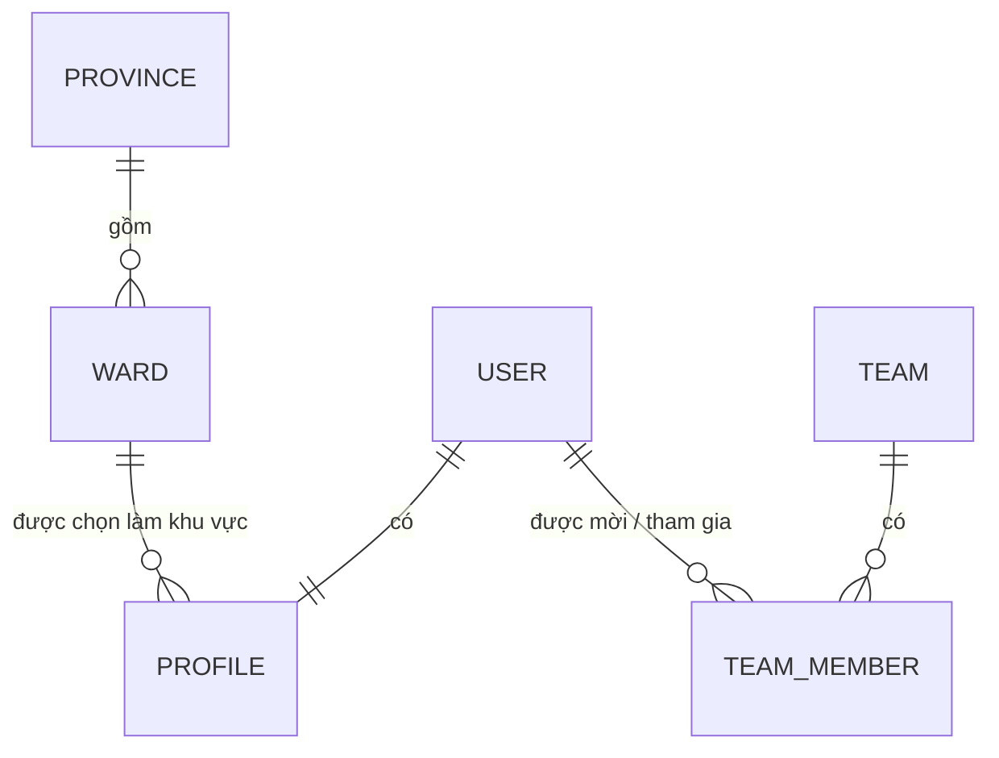

# Data Model (Conceptual) — Tra cứu cho người dùng (USER-003)

> Mô hình dữ liệu **nghiệp vụ**. USER-003 **không thêm entity, thuộc tính hay trạng thái** so với `SYSTEM-001/Data_Model_Conceptual.md` và `USER-002/Data_Model_Conceptual.md`; file này chỉ ghi các entity được **đọc** và các "cách xem" suy ra từ chúng. KHÔNG có DB schema.

## 1. Entity Overview (được đọc)

| Entity | Dùng ở | Ghi chú |
|---|---|---|
| Khu vực hành chính (tỉnh/thành, phường/xã) | UC-U04 | Danh mục chuẩn, chỉ đọc (BR-U08). SYSTEM-001 chỉ nêu như giá trị chọn của Profile; USER-003 mô tả rõ cấu trúc 2 cấp |
| User / Profile | UC-U05 | Đọc tên hiển thị, ảnh đại diện, số điện thoại (chỉ để so khớp, không hiển thị — BR-U11), trạng thái tài khoản |
| Team | UC-T07, UC-T08 | Đọc tên, ảnh, trình độ, trạng thái, đội trưởng hiện tại, số thành viên đang hoạt động |
| Team_Member (lời mời / tư cách thành viên) | UC-T07, UC-T08, UC-U05 (`[cần xác nhận Q-05]`) | Đọc vai trò, trạng thái (đang chờ / đang hoạt động / đã rời / bị từ chối), ngày mời / ngày tham gia |

## 2. Entity Details

### Khu vực hành chính

**Attributes:**
- Tên
- Cấp: tỉnh/thành hoặc phường/xã
- Tỉnh/thành chứa nó (chỉ với phường/xã)

**Relationships:**
- 1 tỉnh/thành có nhiều phường/xã; 1 phường/xã thuộc đúng 1 tỉnh/thành (BR-U07).
- 1 phường/xã được nhiều Profile chọn làm khu vực; Profile chỉ chọn phường/xã (BR-U05).

**Lifecycle:** không có — danh mục chỉ đọc trong ArenaFlow (BR-U08). Phạm vi dữ liệu: `[cần xác nhận Q-01]`.

---

### Các cách xem (không lưu trữ riêng)

| Cách xem | Suy ra từ | Điều kiện chọn |
|---|---|---|
| Kết quả tìm người dùng | User + Profile | Tài khoản đang hoạt động (BR-U12); khớp SĐT chính xác hoặc khớp tên (BR-U10) |
| Lời mời của tôi | Team_Member + Team | Người được mời = người đang xem; trạng thái "đang chờ" (BR-T15); đội không giải tán (BR-T16); đội bị khoá: `[cần xác nhận Q-13]` |
| Đội của tôi | Team_Member + Team | Thành viên = người đang xem; trạng thái "đang hoạt động"; đội đang hoạt động hoặc bị khoá (BR-T19) |
| Đội tôi làm đội trưởng | Đội của tôi | Vai trò = đội trưởng (BR-T21) |

## 3. Entity Relationship Diagram (phần được đọc)

## 4. Key Relationships

- **Tỉnh/thành – Phường/xã:** 1-N.
- **Phường/xã – Profile:** 1-N (Profile có tối đa 1 khu vực).
- **User – Team_Member – Team:** N-N; một người có thể có nhiều lời mời đang chờ và nhiều đội đang tham gia cùng lúc; có thể là đội trưởng của nhiều đội (SYSTEM-001 Data_Model §9 #8).

## 5. Thay đổi lưu trữ có điều kiện

- Nếu Q-14 chọn **"hiển thị người đã gửi lời mời"**: lời mời cần ghi thêm **người mời** (đội trưởng tại thời điểm mời). Đây là thuộc tính mới của Team_Member; lời mời tạo trước thay đổi không có thông tin này.
- Các phương án khác của Q-01 … Q-16 không thêm thông tin lưu trữ.

## 6. Danh sách [cần xác nhận]

Q-01, Q-05, Q-13, Q-14 — chi tiết `Acceptance_Criteria.md` §5.
