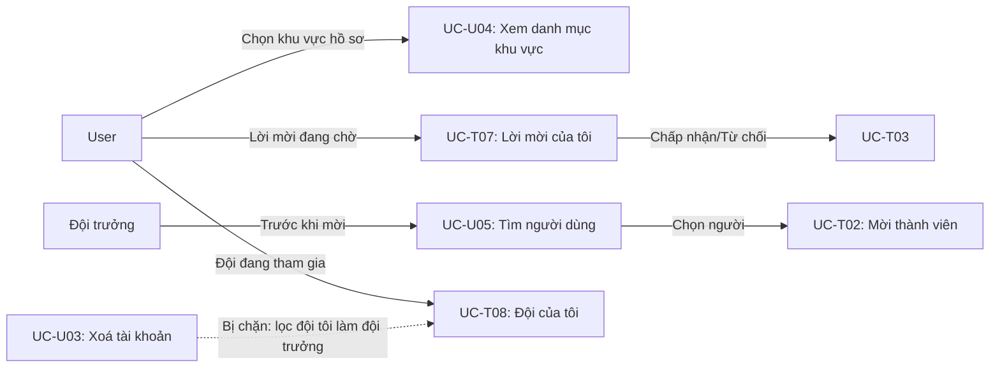

# Use Cases — Tra cứu cho người dùng (USER-003)

> Quy tắc được trích bằng mã (`BR-U*`, `BR-T*`) — chi tiết trong `Business_Rules.md`. Mã UC tiếp nối SYSTEM-001 (UC-U01..U03) và USER-002 (UC-T06).
> Quyết định đã chốt (Q-01..Q-16, user chốt 2026-11-17): `Acceptance_Criteria.md` §5.

## UC-U04: Xem danh mục khu vực (mới)

**Actor:** User

**Preconditions:**
- User đã đăng nhập (BR-U09).

**Main Flow:**
1. User chọn ô "Khu vực" khi sửa hồ sơ (UC-U02).
2. Hệ thống hiển thị **toàn bộ** tỉnh/thành, sắp theo tên (BR-U07).
3. User chọn một tỉnh/thành.
4. Hệ thống hiển thị **toàn bộ** phường/xã thuộc tỉnh/thành đó, sắp theo tên (BR-U07).
5. User chọn một phường/xã.
6. Khu vực vừa chọn (phường/xã kèm tên tỉnh/thành) được điền vào hồ sơ đang sửa; hồ sơ được lưu theo UC-U02 (BR-U05).

**Postconditions:**
- Danh mục không thay đổi (chỉ xem — BR-U08).
- Hồ sơ chỉ thay đổi khi User lưu theo UC-U02.

**Alternative Flows:**

**1a. Hồ sơ đã có khu vực:**
- 1a1. Hệ thống hiển thị khu vực hiện tại (phường/xã, tỉnh/thành); User có thể chọn lại từ bước 2.

**2a. User gõ tên để lọc tỉnh/thành hoặc phường/xã** (vd gõ "ben" trong danh sách phường/xã của TP. Hồ Chí Minh):
- 2a1. Ứng dụng tự lọc trong danh sách đang hiển thị; hệ thống không có chức năng tìm khu vực theo tên (BR-U07).

**2b. Tỉnh/thành của User không có trong danh mục** (danh mục chưa đủ toàn quốc — BR-U08):
- 2b1. User không chọn được khu vực đúng; các thông tin hồ sơ khác vẫn lưu được (UC-U02). Nạp đủ danh mục là điều kiện trước khi phát hành cho người dùng thật (BC-U05).

**3a. User đổi tỉnh/thành sau khi đã chọn phường/xã:**
- 3a1. Lựa chọn phường/xã trước đó bị bỏ; quay về bước 4 với tỉnh/thành mới.

**Exception Flows:**

**4a. Tỉnh/thành không còn trong danh mục** (danh sách User đang xem đã cũ):
- 4a1. Hệ thống báo "Không tìm thấy tỉnh/thành". Quay về bước 2.

**4b. Tỉnh/thành chưa có phường/xã nào trong danh mục:**
- 4b1. Hệ thống hiển thị danh sách trống kèm "Chưa có dữ liệu phường/xã cho tỉnh/thành này". Quay về bước 2.

**6a. User lưu hồ sơ với khu vực không phải phường/xã hoặc không còn trong danh mục:**
- 6a1. Hệ thống báo "Khu vực không hợp lệ" (UC-U02 5a, BR-U05). Quay về bước 2.

---

## UC-U05: Tìm người dùng để mời vào đội (mới)

**Actor:** Đội trưởng của **một đội cụ thể** (BR-U15)

**Preconditions:**
- Đội trưởng đã đăng nhập.
- Người tìm đang là đội trưởng của đội được mời vào, và đội đó đang hoạt động (BR-U15) — cùng điều kiện để được mời (UC-T02).

**Main Flow:**
1. Đội trưởng mở đội của mình và chọn "Mời thành viên" (UC-T02).
2. Đội trưởng nhập số điện thoại hoặc tên hiển thị của người cần mời vào **một ô duy nhất** (BR-U10).
3. Hệ thống nhận biết cách tìm (BR-U10) và tìm:
   - Theo **số điện thoại**: so khớp chính xác, cho ra **tối đa một** người (BR-U13).
   - Theo **tên hiển thị**: khi đã nhập **ít nhất 2 ký tự**, cho ra **tối đa 20** gợi ý (BR-U10).
4. Hệ thống hiển thị kết quả: mỗi người chỉ có tên hiển thị và ảnh đại diện, **không** có số điện thoại (BR-U11); không gồm người đã xoá tài khoản (BR-U12), chính người tìm và tài khoản Admin (BR-U15). Người đã là thành viên đang hoạt động / đang có lời mời chờ từ đội này vẫn hiện, kèm nhãn (BR-U15).
5. Đội trưởng chọn một người **không** có nhãn trong kết quả.
6. Tiếp tục UC-T02 (gửi lời mời cho người đã chọn).

**Postconditions:**
- Tìm kiếm không thay đổi dữ liệu. Lời mời chỉ được tạo ở UC-T02 (BR-U14).

**Alternative Flows:**

**2a. Tên hiển thị nhập vào có ít hơn 2 chữ cái/chữ số** (không tính khoảng trắng, dấu chấm, gạch ngang và ký tự khác — BR-U10):
- 2a1. Hệ thống không tìm, nhắc "Nhập ít nhất 2 ký tự". Quay về bước 2.

**2b. Số điện thoại nhập theo dạng khác** (vd `+84 901 234 567`, `84901234567`, `0901.234.567`, `0901-234-567`):
- 2b1. Hệ thống quy về dạng 10 chữ số bắt đầu bằng 0 (`0901234567`) rồi tìm như bước 3 (BR-U13).
- 2b2. Quy đổi xong không phải số điện thoại VN hợp lệ (BR-U01) → báo "Số điện thoại không hợp lệ". Quay về bước 2.

**3a. Có hơn 20 người khớp tên:**
- 3a1. Hệ thống chỉ hiển thị 20 gợi ý đầu (BR-U10) kèm nhắc "Nhập thêm để thu hẹp kết quả". Quay về bước 2 nếu Đội trưởng nhập thêm.

**4a. Người tìm thấy đã là thành viên đang hoạt động hoặc đang có lời mời chờ từ đội này:**
- 4a1. Người đó vẫn hiện, kèm nhãn "Đã là thành viên" hoặc "Đã được mời"; Đội trưởng không mời được người đó từ kết quả (BR-U15).

**Exception Flows:**

**1a. Người tìm không còn là đội trưởng của đội, hoặc đội không còn hoạt động** (vừa chuyển quyền, đội vừa bị admin khoá hoặc giải tán):
- 1a1. Hệ thống không cho tìm và báo theo quy tắc mời hiện hành (UC-T02 — chỉ đội trưởng của đội đang hoạt động mới mời được).

**1b. Người tìm đã tìm đủ 30 lần trong một phút** (BR-U15):
- 1b1. Hệ thống không tìm, báo "Bạn tìm quá nhanh, vui lòng thử lại sau". Quay về bước 2 khi hết thời gian chờ.

**4c. Không có người nào phù hợp** (gồm số điện thoại chưa đăng ký, thuộc người đã xoá tài khoản, thuộc chính người tìm hoặc thuộc tài khoản Admin):
- 4c1. Hệ thống báo "Không tìm thấy người dùng". Quay về bước 2.

**6a. Người đã chọn xoá tài khoản, hoặc vừa trở thành thành viên / vừa được mời, trong khoảng giữa lúc tìm và lúc gửi lời mời:**
- 6a1. Xử lý theo ngoại lệ hiện có của UC-T02 ("Không tìm thấy người dùng" / "Người này đã là thành viên hoặc đã được mời") (BR-U14).

---

## UC-T07: Xem lời mời của tôi (mới)

**Actor:** User (người được mời)

**Preconditions:**
- User đã đăng nhập.

**Main Flow:**
1. User mở "Lời mời của tôi".
2. Hệ thống hiển thị tổng số lời mời **đang chờ** gửi tới chính User và danh sách các lời mời đó, mới nhất trước, có phân trang (BR-T15, BR-T16, BR-T17); mỗi lời mời kèm thông tin đội để quyết định (BR-T17).
3. User chọn "Chấp nhận" hoặc "Từ chối" một lời mời.
4. Tiếp tục UC-T03 (SYSTEM-001) cho lời mời đó.
5. Lời mời đã xử lý không còn trong danh sách (BR-T18). Nếu chấp nhận, đội xuất hiện trong "Đội của tôi" (UC-T08).

**Postconditions:**
- Xem danh sách không thay đổi dữ liệu; thay đổi chỉ xảy ra ở UC-T03.

**Alternative Flows:**

**2a. User không có lời mời đang chờ:**
- 2a1. Hệ thống hiển thị "Bạn chưa có lời mời nào". Use case kết thúc.

**2b. User muốn xem thêm về đội trước khi quyết định:**
- 2b1. User mở chi tiết đội từ lời mời (chức năng xem chi tiết đội đã có). Quay về bước 2.

**2c. Lời mời của đội đang bị admin khoá:**
- 2c1. Lời mời vẫn hiển thị, kèm "Đội đang tạm ngưng — chưa thể chấp nhận/từ chối" (BR-T16). Khi đội được kích hoạt lại, User chấp nhận/từ chối bình thường.

**Exception Flows:**

**3a. Đội bị admin khoá** (kể cả vừa bị khoá sau khi User mở danh sách):
- 3a1. Hệ thống báo "Đội đang tạm ngưng hoạt động"; lời mời vẫn chờ, User thử lại sau (hành vi hiện hành, BR-T18).

**3b. Đội vừa bị giải tán:**
- 3b1. Hệ thống báo "Đội đã giải tán"; lời mời đã tự bị từ chối (USER-002 BR-T10) và không còn trong danh sách.

**3c. Lời mời đã được xử lý ở nơi khác** (vd User đã chấp nhận/từ chối từ thông báo):
- 3c1. Hệ thống báo lời mời đã được xử lý; danh sách được tải lại.

---

## UC-T08: Xem đội của tôi (mới)

**Actor:** User (gồm cả Đội trưởng)

**Preconditions:**
- User đã đăng nhập.

**Main Flow:**
1. User mở "Đội của tôi".
2. Hệ thống hiển thị **một** danh sách các đội User đang là thành viên đang hoạt động, gồm đội đang hoạt động và đội bị admin khoá, không có lọc theo trạng thái đội (BR-T19); đội User làm đội trưởng xếp trước, sau đó theo thời điểm User tham gia đội mới nhất trước, có phân trang (BR-T20). Mỗi đội kèm vai trò của User và trạng thái đội (BR-T20).
3. (Tuỳ chọn) User bật lọc "Chỉ đội tôi làm đội trưởng" (BR-T21).
4. Hệ thống chỉ hiển thị các đội User đang là đội trưởng.
5. User chọn một đội để mở chi tiết đội (chức năng đã có).

**Postconditions:**
- Không thay đổi dữ liệu.

**Alternative Flows:**

**1a. User vừa bị chặn xoá tài khoản vì còn là đội trưởng** (UC-U03 4a, USER-002):
- 1a1. User mở "Đội của tôi" với lọc "Chỉ đội tôi làm đội trưởng" (BR-T21).
- 1a2. Với từng đội: chuyển quyền (UC-T04) hoặc giải tán (UC-T06). Đội đã giải tán biến khỏi danh sách; đội đã chuyển quyền chuyển sang vai trò thành viên và biến khỏi danh sách đang lọc.
- 1a3. Khi danh sách lọc trống, User xoá tài khoản lại (UC-U03).

**2a. User không tham gia đội nào:**
- 2a1. Hệ thống hiển thị "Bạn chưa tham gia đội nào". Use case kết thúc.

**4a. Lọc "Chỉ đội tôi làm đội trưởng" không có đội nào:**
- 4a1. Hệ thống hiển thị "Bạn không làm đội trưởng đội nào".

**Exception Flows:**

**5a. Đội đã thay đổi giữa lúc xem và lúc thao tác** (vd đội vừa bị khoá, User vừa bị chuyển quyền):
- 5a1. Thao tác tiếp theo trên đội tuân theo quy tắc hiện hành của thao tác đó; User tải lại danh sách để thấy trạng thái mới.

---

## Use Case Diagram

---

## Danh sách [cần xác nhận]

Không còn — Q-01..Q-16 đã chốt 2026-11-17 (`Acceptance_Criteria.md` §5).
