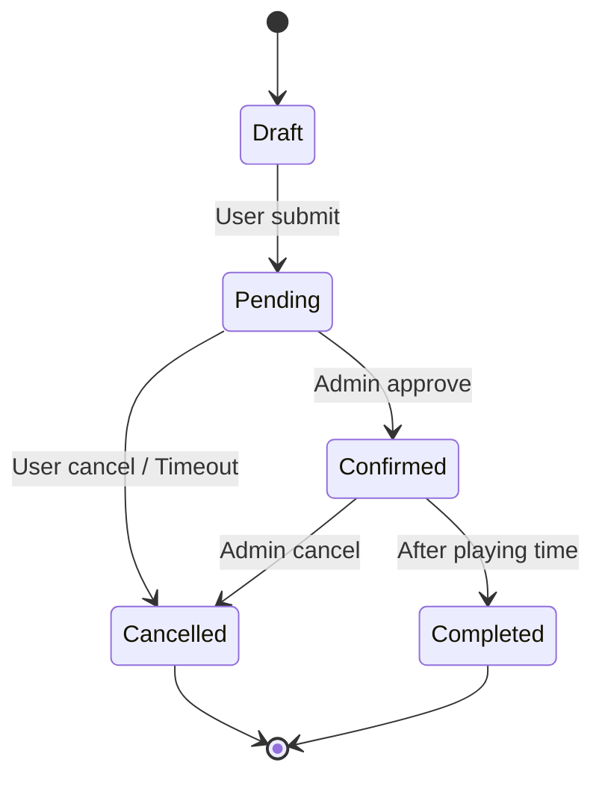

# Business Rules — [TÊN CHỨC NĂNG]

> Quy tắc nghiệp vụ, validation, constraints, tính toán.

## 1. Validation Rules

| Rule ID | Mô tả | Khi nào áp dụng |
|---|---|---|
| BR-001 | Số điện thoại phải là số VN (10 chữ số, bắt đầu 0) | Khi User đăng ký/cập nhật profile |
| BR-002 | Booking phải đặt tối thiểu 2h trước giờ chơi | Khi User tạo booking |
| BR-003 | [Rule khác] | [Khi nào] |

## 2. State Transitions (Chuyển trạng thái)

### Booking Lifecycle



**Quy tắc chuyển trạng thái:**

| Từ | Đến | Điều kiện | Actor |
|---|---|---|---|
| Draft | Pending | User submit + thanh toán thành công | User |
| Pending | Confirmed | Admin duyệt | Admin |
| Pending | Cancelled | Quá timeout (30 phút) | System |
| Pending | Cancelled | User hủy | User |
| Confirmed | Completed | Sau giờ chơi + 1h | System |
| Confirmed | Cancelled | Admin hủy (với lý do) | Admin |

## 3. Calculation Rules (Quy tắc tính toán)

### BR-CALC-001: Tính giá booking

```
Giá booking = Giá sân × Số giờ × Hệ số khung giờ

Hệ số khung giờ:
- 06:00-17:00 (ngày thường): 1.0
- 17:00-22:00 (ngày thường): 1.5
- 06:00-22:00 (cuối tuần): 1.8
```

**[cần xác nhận]:** Hệ số chính xác? Cuối tuần tính từ thứ mấy?

### BR-CALC-002: [Tính toán khác]

[Công thức]

## 4. Constraints (Ràng buộc nghiệp vụ)

| Constraint ID | Mô tả |
|---|---|
| BC-001 | Một User chỉ được đặt tối đa 3 booking pending cùng lúc |
| BC-002 | Một sân không được đặt chồng lấn slot thời gian |
| BC-003 | [Constraint khác] |

## 5. Authorization Rules (Quyền)

| Actor | Có thể | Không thể |
|---|---|---|
| User | Xem sân, đặt sân, xem booking của mình, hủy booking pending của mình | Xem booking của người khác, duyệt booking |
| Admin | Xem tất cả, duyệt booking, hủy booking, quản lý sân | [Giới hạn nếu có] |
| System | Tự động hủy booking timeout, gửi thông báo | Duyệt booking (cần Admin) |

## 6. Danh sách [cần xác nhận]

1. [Điểm chưa rõ 1]
2. [Điểm chưa rõ 2]
