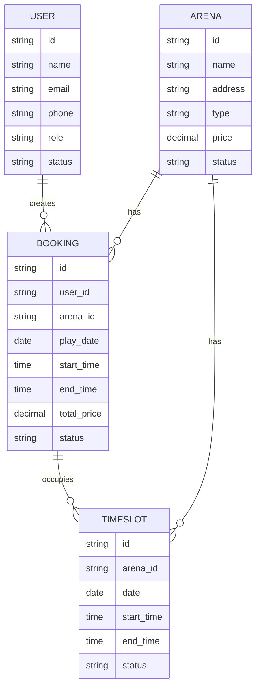

# Data Model (Conceptual) — [TÊN CHỨC NĂNG]

> Mô hình dữ liệu **NGHIỆP VỤ** — entity, quan hệ, lifecycle. KHÔNG có DB schema/SQL/kiểu dữ liệu kỹ thuật.

## 1. Entity Overview

| Entity | Mô tả | Lifecycle |
|---|---|---|
| Arena | Sân thể thao | Tồn tại lâu dài, có thể active/inactive |
| Booking | Đặt lịch sân | Draft → Pending → Confirmed/Cancelled → Completed |
| User | Người dùng | Active/Suspended/Deleted |
| TimeSlot | Khung giờ khả dụng | Được sinh tự động, có thể booked/available |

## 2. Entity Details

### Arena (Sân)

**Attributes:**
- ID
- Tên sân
- Địa chỉ
- Loại (bóng đá, cầu lông, bóng rổ...)
- Giá cơ bản / giờ
- Mô tả
- Ảnh (danh sách URL)
- Trạng thái (active, inactive, maintenance)
- Chủ sân (Owner)

**Relationships:**
- 1 Arena có nhiều TimeSlot
- 1 Arena có nhiều Booking

---

### Booking (Đặt lịch)

**Attributes:**
- ID
- User (người đặt)
- Arena (sân đặt)
- Ngày chơi
- Giờ bắt đầu
- Giờ kết thúc
- Tổng giá
- Trạng thái (draft, pending, confirmed, cancelled, completed)
- Ngày tạo
- Ngày cập nhật
- Lý do hủy (nếu cancelled)
- Ghi chú

**Relationships:**
- N Booking thuộc về 1 User
- N Booking thuộc về 1 Arena
- 1 Booking chiếm nhiều TimeSlot

**Lifecycle:** Xem `Business_Rules.md` §2

---

### User (Người dùng)

**Attributes:**
- ID
- Tên
- Email
- Số điện thoại
- Avatar
- Vai trò (user, admin)
- Trạng thái (active, suspended, deleted)
- Ngày tạo

**Relationships:**
- 1 User có nhiều Booking

---

### TimeSlot (Khung giờ)

**Attributes:**
- ID
- Arena
- Ngày
- Giờ bắt đầu
- Giờ kết thúc
- Trạng thái (available, booked)

**Relationships:**
- N TimeSlot thuộc về 1 Arena
- 1 TimeSlot có thể được chiếm bởi 1 Booking

---

## 3. Entity Relationship Diagram

## 4. Key Relationships

- **User - Booking:** 1-N (một user có nhiều booking)
- **Arena - Booking:** 1-N (một sân có nhiều booking)
- **Arena - TimeSlot:** 1-N (một sân có nhiều slot thời gian)
- **Booking - TimeSlot:** M-N (một booking chiếm nhiều slot, một slot chỉ thuộc một booking)

## 5. Danh sách [cần xác nhận]

1. [Điểm chưa rõ 1]
2. [Điểm chưa rõ 2]
