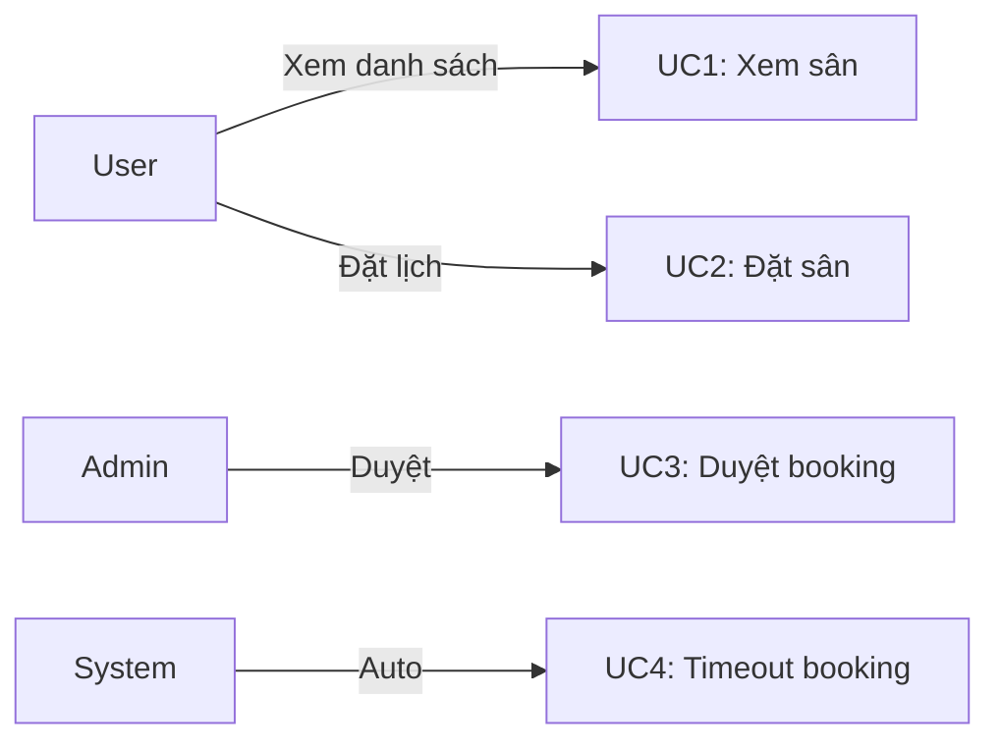

# Use Cases — [TÊN CHỨC NĂNG]

> Mô tả chi tiết các use case của chức năng.

## Use Case 1: [TÊN USE CASE]

**Actor:** [User/Admin/System]

**Preconditions (Điều kiện trước):**
- [Điều kiện 1, vd: User đã đăng nhập]
- [Điều kiện 2, vd: Sân có slot khả dụng]

**Main Flow (Luồng chính — happy path):**

1. [Actor] [hành động 1]
2. Hệ thống [phản hồi 1]
3. [Actor] [hành động 2]
4. Hệ thống [phản hồi 2]
5. Hệ thống [kết quả cuối]

**Postconditions (Điều kiện sau):**
- [Kết quả 1, vd: Booking được tạo với trạng thái pending]
- [Kết quả 2, vd: User nhận thông báo]

**Alternative Flows (Luồng thay thế):**

**3a. [Actor] chọn [lựa chọn khác]:**
- 3a1. Hệ thống [xử lý khác]
- 3a2. Quay về bước 4

**Exception Flows (Luồng ngoại lệ):**

**4a. Slot không còn khả dụng:**
- 4a1. Hệ thống hiển thị lỗi "Slot đã được đặt"
- 4a2. Use case kết thúc

**4b. [Ngoại lệ khác]:**
- 4b1. [Xử lý]

---

## Use Case 2: [TÊN USE CASE 2]

[Lặp lại cấu trúc trên]

---

## Use Case Diagram (tuỳ chọn)

---

## Danh sách [cần xác nhận]

1. [Điểm chưa rõ 1]
2. [Điểm chưa rõ 2]
