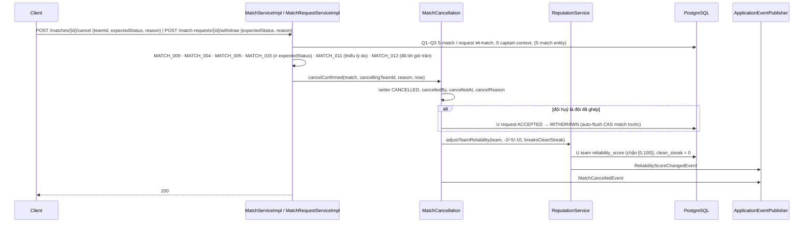
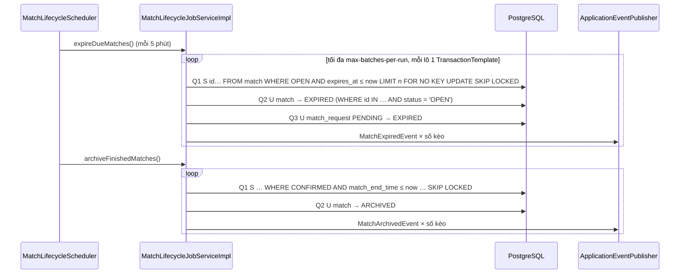

# Processing Flow — Kèo (luồng A, luồng B) & vòng đời kèo

| Mục | Giá trị |
|---|---|
| Mã chức năng | `MATCH-001` |
| Phạm vi tầng | Backend (Spring Boot REST API). Frontend: ngoài phạm vi repo này |
| Repo/stack | ArenaFlow-be · Spring Boot 4.0.9 · PostgreSQL · Flyway |
| Quy ước áp dụng | `docs/agent/non-functional-standards.md` (N_DETAIL=3, N_LIST=4, N_WRITE=6; §4.1 flush; §5 tác vụ dài) · ADR-0003 (+ Sửa đổi 2026-11-09) · retrier: USER-001 `Processing_Flow.md` §5 + VENUE-001 `Component_Class_Design.md` §4.9 · ADR-0011, ADR-0012, ADR-0013 (`Proposed`) |
| Ràng buộc dữ liệu | V1 + V5 + `V6__match_flow_a_lifecycle.sql` (`Component_Class_Design.md` §5.1) + `V7__match_flow_b_pairing.sql` (MATCH-002 `Component_Class_Design.md` §5.1) |
| Tác giả / Ngày / Phiên bản | solution-architect · 2026-11-09 · v1.0 (baseline) · hiện tại **v2.2** (solution-architect · 2026-11-12) — lịch sử thay đổi: `CHANGELOG.md` |

## 1. Tổng quan

15 endpoint + 1 scheduled job (2 tác vụ). Mã lỗi: `API_Spec.md` §5; thứ tự guard: §1.1; cấu hình: `Component_Class_Design.md` §8. Số truy vấn tính cho **một lần thử**; JWT không truy vấn DB. Ký hiệu: **S** SELECT, **I** INSERT, **U** UPDATE, **D** DELETE. `now` lấy từ `Clock` một lần ở đầu mỗi lần thử. Không gọi HTTP ra ngoài.

**Lazy check (UC-M09 1a):** API đọc tính trạng thái hiệu lực trong SQL (`Component_Class_Design.md` §5.2), không ghi. API ghi gặp kèo `OPEN` quá `expiresAt` → `MatchExpiry.expireIfDue` (U kèo + U yêu cầu `PENDING` (kèo A) hoặc U pairing `NEGOTIATING` (kèo B), phát `MatchExpiredEvent`) → lần thử **commit** và trả `Expired` → service ném `MATCH_004` sau commit (`Component_Class_Design.md` §4.7). Ký hiệu **[lazy]** dưới đây là nhánh này.

### 1.1. Thứ tự guard (nguồn duy nhất)

Chuyển từ `API_Spec.md` v1.0 §2.0 (nội bộ BE; `API_Spec.md` chỉ giữ hệ quả FE thấy được — vd kiểm trạng thái trước lý do ở 2.5/2.10). Sau JWT (401/403 ở filter) và Bean Validation (400). Tồn tại → đội (trạng thái rồi quyền, như USER-002 §2.1a) → trạng thái kèo → trạng thái yêu cầu. Quyền đứng trước trạng thái kèo để người không có quyền không kích hoạt chuyển `EXPIRED` (nhánh [lazy]). `MATCH_014` (hết lượt thử của retrier) có thể xảy ra ở 2.4–2.6, 2.8–2.10.

| Endpoint | Thứ tự guard |
|---|---|
| 2.1 | `TEAM_001` → `TEAM_016` → `TEAM_015` → `TEAM_002` → `SPORT_001` → `SPORT_002` → `VENUE_001` → `VENUE_002` (kèo B: trên toàn bộ `venueOptionIds`) |
| 2.3 | `MATCH_001` |
| 2.4 | `MATCH_001` → `TEAM_016` → `TEAM_015` → `TEAM_002` (đội tác giả) → `MATCH_016` (kèo B) → `MATCH_004` → `MATCH_003` → `MATCH_005` |
| 2.5 | `MATCH_001` → `TEAM_001` → `TEAM_016` → `TEAM_002` (đội `teamId`) → `MATCH_009` → `MATCH_004` → `MATCH_005` (`CANCELLED`/`ARCHIVED`/`COMPLETED`) → `MATCH_015` (≠ `expectedStatus`) → `OPEN`: `MATCH_010` (chỉ kèo A) · `CONFIRMED`: `MATCH_011` → `MATCH_012` |
| 2.6 | `MATCH_001` → `TEAM_001` → `TEAM_016` → `TEAM_015` → `TEAM_002` (đội `teamId`) → `MATCH_007` → `MATCH_016` (kèo B) → `MATCH_004` → `MATCH_003` → `MATCH_005` → `MATCH_013` (đội tác giả không `ACTIVE`) → `SPORT_002` → `MATCH_006` (khi INSERT) |
| 2.7 | `MATCH_001` → `TEAM_002` (đội tác giả; đội giải tán → `TEAM_016`) → `MATCH_016` (kèo B) |
| 2.8 | `MATCH_002` → `TEAM_016` → `TEAM_015` → `TEAM_002` (đội tác giả) → `MATCH_004` → `MATCH_003` → `MATCH_005` → `MATCH_008` → `MATCH_013` (đội gửi không `ACTIVE`) → `SPORT_002` |
| 2.9 | `MATCH_002` → `TEAM_016` → `TEAM_002` (đội tác giả) → `MATCH_004` (kể cả kèo đã `EXPIRED` trong DB) → `MATCH_008` |
| 2.10 | `MATCH_002` → `TEAM_016` → `TEAM_002` (đội gửi) → `MATCH_004` → `MATCH_008` (yêu cầu không ở `PENDING`/`ACCEPTED`) → `MATCH_015` (≠ `expectedStatus`) → `PENDING`: `MATCH_015` (khi ghi — yêu cầu đổi trạng thái sau lúc đọc) · `ACCEPTED`: `MATCH_005` (kèo không `CONFIRMED`) → `MATCH_011` → `MATCH_012` |
| 2.11 | `TEAM_001` |
| 2.12 | `TEAM_001` → `TEAM_002` (đội giải tán → `TEAM_016`) |
| 2.15 | `SPORT_001` |

`TEAM_001` của đội tác giả / đội gửi suy ra từ tài nguyên không xảy ra (FK). Đội đã giải tán không còn đội trưởng ACTIVE → trả `TEAM_016` (không phải `TEAM_002`) ở mọi endpoint, gồm cả đọc (2.7, 2.12) — như USER-002 §2.1a.

## 2. Sequence

### 2.1. Chấp nhận yêu cầu (2.8)

```mermaid
sequenceDiagram
    participant C as Client
    participant RS as MatchRequestServiceImpl
    participant R as ConcurrencyConflictRetrier
    participant DB as PostgreSQL
    participant EP as ApplicationEventPublisher
    C->>RS: POST /match-requests/{id}/accept (callerId)
    RS->>R: execute(MATCH_014, lambda)
    Note over R,DB: mỗi lần thử = 1 transaction
    R->>DB: Q1 S request ⋈ match ⋈ đội gửi (MATCH_002)
    R->>DB: Q2 S match entity (version)
    R->>DB: Q3 S captain context đội tác giả (TEAM_016/015/002)
    alt kèo OPEN quá expiresAt
        R->>DB: U match EXPIRED, U request PENDING → EXPIRED
        R->>EP: MatchExpiredEvent
        R-->>RS: Expired (commit) → MATCH_004
    else
        R->>R: requireOpen (MATCH_003/004/005) · request PENDING (MATCH_008) · đội gửi ACTIVE (MATCH_013) · bộ môn bật (SPORT_002)
        R->>DB: Q4 U match CAS version → CONFIRMED (auto-flush trước Q5)
        R->>DB: Q5 U request PENDING → ACCEPTED (0 dòng → MATCH_008, rollback)
        R->>DB: Q6 U các request PENDING còn lại → SUPERSEDED
        R->>EP: MatchConfirmedEvent
    end
    Note over DB: CAS 0 dòng → retry; hết 3 lần → MATCH_014
    RS-->>C: 200 AcceptMatchRequestResponse
```

### 2.2. Huỷ kèo đã ghép (2.5 `CONFIRMED`) / rút yêu cầu đã chấp nhận (2.10 `ACCEPTED`)



### 2.3. Job hết hạn / ARCHIVED (mỗi lô)



## 3. Luồng chi tiết

### Bảng số truy vấn

| # | Endpoint | Truy vấn (một lần thử) | Tổng / Ngưỡng |
|---|---|---|---|
| 2.1 | `POST /matches` (kèo A) | S captain ctx, S sport, S venue status (port), I match, U venue `markSelected` (port), S detail | 6 / W6 ✅ (= ngưỡng) |
| 2.1 | `POST /matches` (kèo B) | S captain ctx (+ tên/ảnh/điểm đội), S sport, S lựa chọn địa điểm (port, thông tin hiển thị), I match, I lựa chọn địa điểm (1 câu `unnest`), I khung giờ (1 câu `unnest … RETURNING`) | 6 / W6 ✅ (= ngưỡng) |
| 2.2 | `GET /matches` | S trang, S count | 2 / L4 ✅ |
| 2.3 | `GET /matches/{id}` | S detail, S khoản tự nhập theo `match_id` (kèo B `confirmedPairingId = null`: bỏ) · kèo B: + S lựa chọn (1 câu `UNION ALL`) | 2 / D3 ✅ · kèo B chưa ghép 2, đã ghép 3 / D3 ✅ |
| 2.4 | `PUT …/cost-agreement` | S match, S captain ctx, U match (CAS + version), D khoản tự nhập, I khoản tự nhập (1 câu `unnest`, id DB sinh), S khoản tự nhập (lấy `itemId`); bỏ I + S khi rỗng · [lazy] S, S, U, U | 6 / W6 ✅ (= ngưỡng; 4 khi rỗng) · [lazy] 4 |
| 2.5 | `POST …/cancel` `OPEN` | S match, S captain ctx, S tồn tại `PENDING`, U match CAS · [lazy] S, S, U, U | 4 / W6 ✅ |
| 2.5 | `POST …/cancel` `OPEN` kèo B | S match, S captain ctx, U match CAS, U pairing `NEGOTIATING` → `SUPERSEDED` | 4 / W6 ✅ |
| 2.5 | `POST …/cancel` `CONFIRMED` | S match, S captain ctx, U match CAS, (U request → `WITHDRAWN` khi đội đã ghép kèo A huỷ), U team điểm | 4–5 / W6 ✅ |
| 2.6 | `POST …/requests` | S match, S captain ctx, S trạng thái đội tác giả + bộ môn, I request, U match version (lúc commit) · [lazy] S, S, U, U | 5 / W6 ✅ |
| 2.7 | `GET …/requests` | S quyền tác giả, S trang, S count | 3 / L4 ✅ |
| 2.8 | `POST …/accept` | S request ctx, S match, S captain ctx, U match CAS, U request → `ACCEPTED`, U còn lại → `SUPERSEDED` · [lazy] S, S, S, U, U | 6 / W6 ✅ (= ngưỡng) |
| 2.9 | `POST …/reject` | S request ctx, S captain ctx, U request · [lazy] S, S, U, U | 3 / W6 ✅ |
| 2.10 | `POST …/withdraw` `PENDING` | S request ctx, S captain ctx, U request · [lazy] S, S, U, U | 3 / W6 ✅ · [lazy] 4 |
| 2.10 | `POST …/withdraw` `ACCEPTED` | S request ctx, S captain ctx, S match, U match CAS, U request → `WITHDRAWN`, U team điểm | 6 / W6 ✅ (= ngưỡng) |
| 2.11 | `GET /teams/{id}/matches` | S đội tồn tại, S trang, S count | 3 / L4 ✅ |
| 2.12 | `GET /teams/{id}/match-requests` | S captain ctx, S trang, S count | 3 / L4 ✅ |
| 2.13 / 2.14 | `GET /sports`, `GET /admin/sports` | S trang, S count | 2 / L4 ✅ |
| 2.15 | `PATCH /admin/sports/{id}` | S sport, (U sport) | 1–2 / W6 ✅ |
| Job | hết hạn (mỗi lô) | S claim, U match, U request (kèo A), U pairing (kèo B) — bỏ câu khi không có kèo loại đó | 3–4 / lô |
| Job | `ARCHIVED` (mỗi lô) | S claim, U match | 2 / lô |

**NFS gate:** 15/15 trong ngưỡng. **2.1 (cả kèo A và kèo B), 2.4 (có khoản tự nhập — giữ 6, không dùng `INSERT … RETURNING`, user chốt 2026-11-09), 2.8, 2.10 (`ACCEPTED`) chạm đúng W6** — mọi truy vấn thêm (vd đọc lại response, kiểm thêm trạng thái) phải gộp hoặc xin duyệt. Đã gộp: trạng thái đội + quyền captain thành 1 câu (`findCaptainContext`); request + match + đội gửi thành 1 câu (`findContextById`); response 2.8/2.10 dựng từ dữ liệu đã nạp, không đọc lại. 2.1 kèo A đọc lại detail sau INSERT: lệch NFS §3 có chủ đích (`Component_Class_Design.md` §10); 2.1 kèo B **không** đọc lại (response dựng từ dữ liệu đã nạp + `RETURNING`) để giữ W6 — `INSERT … RETURNING` không `@Modifying` là MATCH-002 `[cần xác nhận #4]`, **chặn code — bước đầu phase 1**; không chạy được → dừng, hỏi user — mọi truy vấn thêm cho kèo B (vd `markSelected`, đọc lại detail) vượt ngưỡng. Không truy vấn trong vòng lặp (sự kiện của job phát trong bộ nhớ). Retry nhân số truy vấn tối đa 3 (ADR-0003).

### 3.1. `POST /matches` (`@Transactional`)
Bean Validation (`@ValidMatchSchedule`, `@ValidSkillLevels`, `@OneOf`) → Q1 `teamGuard.requireActiveCaptain(teamId, callerId)` → Q2 `sportRepository.findById` → `SPORT_001`; `!isActive` → `SPORT_002` → Q3 `venueSelectionService.requireSelectable({venueId})` (`VENUE_001`, `VENUE_002`) → Q4 `Match.builder()` (`HAS_VENUE`, `OPEN`, `skillLevels` rỗng nếu vắng) → `save` → Q5 `markSelected({venueId}, now)` (bulk native — Hibernate tự flush INSERT trước) → Q6 `findDetailById(id, now)` → `toResponse(view, List.of())`. Một địa điểm → không có vấn đề thứ tự khoá nhiều dòng `venue` (VENUE-001 §3.15). Không phát event (spec không có thông báo khi tạo kèo).

**Kèo B (`type = NEED_VENUE`):** Bean Validation (`@ValidMatchSchedule` nhánh B) → Q1 `requireActiveCaptain` (trả tên/ảnh/điểm) → Q2 sport (`SPORT_001`/`SPORT_002`) → Q3 `venueSelectionService.requireSelectable(venueOptionIds)` (`VENUE_001`/`VENUE_002`, trả `SelectableVenueView`) → Q4 `Match.builder()` (`NEED_VENUE`, `OPEN`, `venueId = null`, `matchStartTime`/`matchEndTime` = khung giờ có `startsAt` nhỏ nhất, `expiresAt`) `save` → Q5 `matchVenueOptionRepository.insertAll(matchId, venueOptionIds, now)` (Hibernate tự flush INSERT `match` trước câu native — comment tại chỗ) → Q6 `matchTimeOptionRepository.insertAllReturning(matchId, starts, ends, now)` → `toCreatedNeedVenue(…)`. Không `markSelected` (MATCH-002 §4.4), không đọc lại. CHECK `expires_at <= match_start_time` thực thi BR-M03 ở DB.

### 3.2. `GET /matches` (readOnly)
Bean Validation (`SearchMatchRequest` + mặc định, `@ValidMatchSearch`, `type` tuỳ chọn) → không toạ độ: `searchOpen`; có toạ độ: tính hộp giới hạn → `searchOpenNearby` (`Component_Class_Design.md` §5.2: kèo B lọc giờ bằng `EXISTS` khung giờ, khoảng cách = lựa chọn địa điểm gần nhất). Q1 trang + Q2 count.

### 3.3. `GET /matches/{id}` (readOnly)
Q1 `findDetailById(id, now)` → `MATCH_001` → Q2 khoản tự nhập `findByMatchIdOrderByDisplayOrderAsc` (kèo A và kèo B đã ghép — kèo B được chép khoản khi ghép, MATCH-002 `Processing_Flow.md` §3.7); kèo B có `confirmedPairingId == null` bỏ (kèo B huỷ sau `CONFIRMED` vẫn đọc) → kèo B: Q3 `matchVenueOptionRepository.findOptionRows(id)` → mapper.

### 3.4. `PUT …/cost-agreement` (retrier `MATCH_014`)
Bean Validation (`@ValidCostAgreement`, ≤10 khoản) → lần thử: Q1 `matchGuard.findMatch` → Q2 `requireActiveCaptain(match.authorTeamId, callerId)` → `isExpiryDue` → [lazy] → `requireOpen` (`MATCH_004/003/005`) → setter `costType`, `costSplit`, `costVenueAmount`, `costDrinksAmount` + `setUpdatedAt(now)` (chỉ để entity dirty → Hibernate chạy `UPDATE match` CAS (tăng `version`, kích `@PreUpdate`) kể cả khi chỉ đổi khoản tự nhập; giá trị gán bị `@PreUpdate` ghi đè bằng `OffsetDateTime.now()`, nhất quán các entity khác (user chốt không đổi, 2026-11-09) → Q3 `UPDATE match` CAS tuần tự hoá với chấp nhận; không dùng force-increment) → Q4 `deleteByMatchIdBulk` (Hibernate tự flush Q3 trước — comment tại chỗ) → Q5 `insertAll(matchId, names, amounts, now)` (một câu `unnest`, id do `uuidv7()` của PostgreSQL ≥ 18 sinh) → Q6 `findByMatchIdOrderByDisplayOrderAsc` (lấy `itemId`); bỏ Q5, Q6 khi rỗng → response từ entity + danh sách vừa đọc. CAS 0 dòng → retry: bản PUT sau áp lại toàn bộ trên dữ liệu mới.

### 3.5. `POST …/cancel` (retrier `MATCH_014`)
Lần thử: Q1 `findMatch` → Q2 `requireCaptainAllowInactive(r.teamId, callerId)` → vai trò: `teamId == authorTeamId` → tác giả; `teamId == confirmedOpponentTeamId` (khác null) → đội đã ghép; khác → `MATCH_009` → `isExpiryDue` → [lazy] → `requireNotExpired` (`MATCH_004`) → `CANCELLED`/`ARCHIVED`/`COMPLETED` → `MATCH_005` → `match.status ≠ r.expectedStatus` → `MATCH_015` (kiểm ở **mọi** lần thử, so với giá trị client gửi — bắt cả màn hình cũ trước khi request tới, không chỉ thay đổi giữa các lần thử; không ghi, không trừ điểm).
- `OPEN` (chỉ tác giả — đội đã ghép không tồn tại khi `OPEN`): kèo A: Q3 `existsByMatchIdAndStatus(id, PENDING)` → `MATCH_010` (kèo B bỏ Q3) → setter `CANCELLED`, `cancelledByTeamId`, `cancelledAt = now`, `cancelReason` (trim, `""` → null) → kèo A: Q4 CAS lúc commit; kèo B: Q3 CAS `match` (Hibernate tự flush trước câu sau — comment tại chỗ) → Q4 `pairingRepository.supersedeNegotiating(id, now)` (pairing tạo đồng thời bị CAS chặn) → `MatchCancelledEvent(previousStatus = OPEN, otherTeamId = null)`. Penalty 0.
- `CONFIRMED`: `reason` blank → `MATCH_011` → `now ≥ matchStartTime` → `MATCH_012` → `matchCancellation.cancelConfirmed(match, teamId, reason, now)` (`Component_Class_Design.md` §4.13).
- Penalty theo `TimeBandPenaltyPolicy.MATCH_CANCELLATION` (`API_Spec.md` §1.5); cùng câu `UPDATE team` đặt `clean_streak = 0` cho đội huỷ (v2.2, Q3 REPUTATION-001). Completion Rate tính khi đọc (REPUTATION-001) — không ghi bộ đếm ở đây.

### 3.6. `POST …/requests` (retrier `MATCH_014`)
Lần thử: Q1 `findMatch` → Q2 `requireActiveCaptain(r.teamId, callerId)` → `teamId == authorTeamId` → `MATCH_007` → `isExpiryDue` → [lazy] → `requireOpen` (`MATCH_003` — UC-M03 3a) → Q3 `matchRepository.findAvailability(matchId)`: đội tác giả ≠ `ACTIVE` → `MATCH_013`; bộ môn tắt → `SPORT_002` → Q4 `MatchRequest.builder()` (`PENDING`, `requestedAt = now`) `saveAndFlush`; `idx_match_request_active` → `MATCH_006` (flush tường minh để đổi lỗi ràng buộc, comment tại chỗ) → `matchRepository.forceIncrementVersion(match)` → `MatchRequestSentEvent` → Q5 `UPDATE match SET version = version + 1 WHERE id = ? AND version = ?` lúc commit (lệch → retry).

### 3.7. `GET …/requests` (readOnly)
Q1 `findAuthorAccess(matchId, callerId)` → `MATCH_001`; `!callerIsCaptain` → `authorTeamStatus = DISBANDED` ? `TEAM_016` : `TEAM_002` (cùng câu, không thêm truy vấn) → Q2/Q3 `findByMatch(matchId, status == PENDING, now, p)`. Đọc không chặn đội `INACTIVE`.

### 3.8. `POST …/accept` (retrier `MATCH_014`)
Lần thử: Q1 `findContextById(requestId)` → `MATCH_002` → Q2 `findMatch(ctx.matchId)` → Q3 `requireActiveCaptain(match.authorTeamId, callerId)` → `isExpiryDue` → [lazy] → `requireOpen` → `ctx.status ≠ PENDING` → `MATCH_008` → `ctx.requesterTeamStatus ≠ ACTIVE` → `MATCH_013` → `!ctx.sportActive` → `SPORT_002` → setter `status = CONFIRMED`, `confirmedOpponentTeamId = ctx.requesterTeamId` → Q5 `acceptIfPending(requestId, now)` (Hibernate tự flush Q4 CAS `match` trước — comment): 0 dòng → `MATCH_008` (exception → rollback cả Q4); vi phạm `idx_match_request_accepted` (chỉ khi lỗi lập trình) → `MATCH_003` → Q6 `supersedePending(matchId, now)` → `MatchConfirmedEvent`. Response từ `ctx` + `now`.

### 3.9. `POST …/reject` (retrier `MATCH_014`)
Lần thử: Q1 `findContextById` → `MATCH_002` → Q2 `requireCaptainAllowInactive(ctx.authorTeamId, callerId)` → kèo `OPEN` quá hạn → [lazy: `expireIfDue(ctx.matchId, …)`] → `ctx.matchStatus = EXPIRED` → `MATCH_004` (không để rơi xuống `MATCH_008` vì yêu cầu đã `EXPIRED`) → Q3 `rejectIfPending(id, reason, now)`: 0 dòng → `MATCH_008` → `MatchRequestRejectedEvent`. Không đụng `match` → không CAS.

### 3.10. `POST …/withdraw` (retrier `MATCH_014`)
Lần thử: Q1 `findContextById` → `MATCH_002` → Q2 `requireCaptainAllowInactive(ctx.requesterTeamId, callerId)` → kèo `OPEN` quá hạn → [lazy] → `ctx.matchStatus = EXPIRED` → `MATCH_004` → `ctx.status ∉ {PENDING, ACCEPTED}` → `MATCH_008` → `ctx.status ≠ r.expectedStatus` → `MATCH_015` (mọi lần thử; màn hình còn `PENDING` mà yêu cầu vừa được chấp nhận → không rút, không trừ điểm) →
- `PENDING`: Q3 `withdrawIfPending(id, reason, now)`: 0 dòng (yêu cầu đổi trạng thái sau Q1 — vd chấp nhận commit chen giữa) → `MATCH_015` (khớp AC-M11; rút lặp lại trên yêu cầu đã `WITHDRAWN` đã dừng ở guard `MATCH_008` lúc đọc) → `MatchRequestWithdrawnEvent`; `matchStatus` trong response = trạng thái hiệu lực từ `ctx`; penalty 0.
- `ACCEPTED`: Q3 `findMatch` → `status ≠ CONFIRMED` → `MATCH_005` → `reason` blank → `MATCH_011` → `now ≥ matchStartTime` → `MATCH_012` (cùng thứ tự 2.5: trạng thái trước, lý do sau) → `matchCancellation.cancelConfirmed(match, requesterTeamId, reason, now)` (Q4 CAS, Q5 `withdrawAccepted`, Q6 điểm; phát **một** `MatchCancelledEvent(cause = REQUEST_WITHDRAWN, withdrawnRequestId)`, không phát `MatchRequestWithdrawnEvent`).

### 3.11. `GET /teams/{id}/matches` (readOnly)
Q1 `teamRepository.existsById` → `TEAM_001` → Q2/Q3 `findTeamMatches(teamId, role, status, now, p)`.

### 3.12. `GET /teams/{id}/match-requests` (readOnly)
Q1 `requireCaptainAllowInactive(teamId, callerId)` → Q2/Q3 `findByRequesterTeam(teamId, status, now, p)`.

### 3.13. Job `MatchLifecycleScheduler`
`now` cố định ở đầu lần chạy. Mỗi tác vụ: tối đa `max-batches-per-run` lô, mỗi lô một `TransactionTemplate`; dừng khi lô < `batch-size`. Lỗi một lô → rollback lô đó, log `ERROR`, dừng tác vụ đó (tác vụ còn lại vẫn chạy); lần sau làm tiếp (điều kiện trạng thái là cổng chống trùng). Log `INFO` số kèo chuyển.
- **Hết hạn:** Q1 `claimDueForExpiry(now, n)` (+ `type`) → Q2 `markExpired(ids, now)` (= số id vì đã khoá) → Q3 `expirePendingByMatchIds(idsA)` (bỏ khi rỗng) → Q4 `pairingRepository.expireNegotiatingByMatchIds(idsB, now)` (bỏ khi rỗng) → mỗi dòng `MatchExpiredEvent`.
- **ARCHIVED:** Q1 `claimDueForArchive(now, n)` → Q2 `markArchived(ids, now)` → mỗi dòng `MatchArchivedEvent`. Không đụng `match_request`.
- Event phát trong transaction của lô; listener `AFTER_COMMIT` (ADR-0011) nên lô rollback không gửi thông báo.
- Độ trễ: kèo chuyển trạng thái trễ tối đa ~5 phút + thời gian chạy; API đọc đã thấy `EXPIRED` ngay nhờ trạng thái hiệu lực; `ARCHIVED` chỉ qua job (spec không yêu cầu lazy).

### 3.14. Admin bộ môn
2.13/2.14: `SportRepository` page (sort trong tên method). 2.15 (`@Transactional`): Q1 `findById` → `SPORT_001` → khác giá trị → setter → Q2 UPDATE lúc commit → `adminAuditLog.afterCommit("SET_SPORT_ACTIVE", …)`; giống giá trị → không ghi, không audit.

## 4. Transaction Boundary

Bảng theo method: `Component_Class_Design.md` §4.12. `READ_COMMITTED`. Event phát trong transaction, listener `AFTER_COMMIT` (ADR-0011) → lần thử bị rollback không phát. Nhánh [lazy] **commit** việc chuyển `EXPIRED` rồi báo lỗi sau commit (`Component_Class_Design.md` §4.7). Không I/O ngoài trong transaction.

## 5. Concurrency & Locking (ADR-0003 + ADR-0012)

- `@Version` mới trên `Match`. Mọi ghi `match` bởi người dùng là CAS qua entity + retrier (`MATCH_014`); ghi bulk (lazy, job) tự `version + 1`. Tạo yêu cầu (2.6) tăng `match.version` lúc commit (`OPTIMISTIC_FORCE_INCREMENT` qua `MatchRepository.forceIncrementVersion`, tiền lệ invite USER-002); sửa chi phí (2.4) luôn `UPDATE match` CAS (gán `updatedAt`) — cả hai tuần tự hoá với chấp nhận / huỷ.
- `MatchRequest` không version: chuyển trạng thái bằng `UPDATE … WHERE status = '<nguồn>'` (0 dòng = đã bị đổi); bất biến "≤ 1 `ACCEPTED`" giữ bằng CAS `match` + unique `idx_match_request_accepted`.
- `reliability_score`: `UPDATE` nguyên tử, không version (ADR-0013).
- Job: `FOR NO KEY UPDATE SKIP LOCKED` (ADR-0012) — tương thích `FOR KEY SHARE` do INSERT yêu cầu lấy qua FK; dòng đang bị người dùng giữ khoá được bỏ qua, lần sau xử lý.

| Race | Kết quả bất biến |
|---|---|
| Chấp nhận 2 yêu cầu khác nhau cùng lúc (2 tab tác giả) | CAS `match`: bên sau retry → `MATCH_003`. Đúng 1 `ACCEPTED` (unique là lớp chặn cuối) |
| Chấp nhận cùng yêu cầu 2 lần | Bên sau retry → `MATCH_003` (không trả 200 lặp) |
| Chấp nhận vs đội gửi rút (`PENDING`) / tác giả từ chối cùng yêu cầu | `UPDATE … WHERE status = 'PENDING'` chờ khoá dòng rồi đánh giá lại: bên sau 0 dòng → chấp nhận / từ chối thua: `MATCH_008`, rút thua: `MATCH_015`; chấp nhận thua thì rollback cả CAS `match` (kèo vẫn `OPEN`) |
| Chấp nhận vs gửi yêu cầu mới | Gửi tăng version lúc commit. Gửi commit trước → chấp nhận retry, `supersedePending` gồm yêu cầu mới. Chấp nhận commit trước → gửi lệch version → retry → `MATCH_003`. Không còn `PENDING` trên kèo `CONFIRMED` |
| Hai đội gửi yêu cầu cùng lúc | Cả hai tăng version → một bên retry rồi thành công; tranh chấp cao → có thể `MATCH_014` |
| Cùng đội gửi 2 lần | INSERT thứ hai chờ entry index chưa commit → vi phạm `idx_match_request_active` → `MATCH_006` |
| Chấp nhận vs huỷ `OPEN` (`expectedStatus = OPEN`) | CAS: huỷ thua → retry thấy `CONFIRMED` ≠ `expectedStatus` → `MATCH_015` (không trừ điểm); chấp nhận thua → `MATCH_005` |
| Chấp nhận đã commit **trước** khi request huỷ tới (màn hình tác giả cũ còn `OPEN`) | Lần thử đầu đã thấy `CONFIRMED` ≠ `expectedStatus = OPEN` → `MATCH_015`, không trừ điểm (BR-M13, AC-M11) |
| Đội gửi rút (màn hình `PENDING`) vs tác giả chấp nhận | Chấp nhận commit trước lúc rút đọc (Q1) → rút thấy `ACCEPTED` ≠ `expectedStatus = PENDING` → `MATCH_015`; chấp nhận commit giữa Q1 và Q3 của rút → `withdrawIfPending` 0 dòng → `MATCH_015`. Cả hai: không huỷ kèo, không trừ điểm. Rút commit trước → chấp nhận `MATCH_008` |
| Huỷ `OPEN` vs gửi yêu cầu mới | Gửi commit trước → huỷ retry → `MATCH_010`; huỷ commit trước → gửi retry → `MATCH_005` |
| Chấp nhận / gửi / huỷ vs job hết hạn | Job khoá dòng (claim) → CAS bên người dùng chờ rồi 0 dòng → retry → `MATCH_004`. Người dùng flush trước → job `SKIP LOCKED` bỏ qua; sau commit kèo không còn `OPEN` → không chọn lại |
| Chấp nhận vs lazy-expire của request khác | Bulk `version + 1` → CAS lệch → retry → `MATCH_004` |
| Tác giả huỷ vs đội đã ghép huỷ / rút (`CONFIRMED`) | CAS: bên thua retry → huỷ: `MATCH_005` (kèo đã `CANCELLED`); rút: yêu cầu vẫn `ACCEPTED`, kèo `CANCELLED` → `MATCH_005`. Trừ điểm đúng một đội, một lần |
| Rút `ACCEPTED` 2 lần | Bên sau → yêu cầu `WITHDRAWN` → `MATCH_008` |
| Sửa chi phí vs chấp nhận | Cả hai CAS `match`: chi phí thua → `MATCH_003`; chấp nhận thua → retry, ghép với chi phí mới |
| Hai lần sửa chi phí | Bên thua retry, áp toàn bộ bản của mình (PUT thay toàn bộ) |
| Từ chối vs chấp nhận yêu cầu khác | `supersedePending` và `rejectIfPending` cùng điều kiện `PENDING`: bên sau 0 dòng → từ chối nhận `MATCH_008` hoặc supersede bỏ qua dòng đã `REJECTED` |
| Trừ điểm vs sửa đội / giải tán đội | `UPDATE` nguyên tử không đổi version; entity `Team` không ghi cột điểm → không mất cập nhật; chỉ chờ khoá dòng ngắn |
| Hai kèo khác nhau cùng trừ điểm một đội | `UPDATE` nguyên tử tuần tự trên dòng `team`; cộng dồn đúng, chặn [0,100] |
| Admin tắt bộ môn vs tạo kèo / gửi / chấp nhận | Thao tác đã đọc `isActive = true` trước khi tắt commit → vẫn thành công (cửa sổ ngắn, chấp nhận; `sport` không khoá) |

Race của kèo B (pairing: tạo, xác nhận, hoàn tất vs huỷ `OPEN` / job): MATCH-002 `Processing_Flow.md` §5.

**Thứ tự khoá** [Inference — suy từ thứ tự câu lệnh, chưa tái hiện]: luồng người dùng `match` → `match_request` / `pairing` → `team` (Hibernate flush CAS `match` trước native query sau nó); job `match` → `match_request`; gửi yêu cầu INSERT (khoá `FOR KEY SHARE` `match`/`team` qua FK) rồi `UPDATE match` lúc commit — `KEY SHARE` tương thích `NO KEY UPDATE` nên không chờ chéo. Không thấy vòng chờ với USER-002 (giải tán khoá `team` → `team_member`, không chạm `match`). Nếu xuất hiện `40P01`, retrier thử lại phía người dùng; lô job bị huỷ → log, lần sau làm tiếp `[cần xác nhận #8]`.

**Test bắt buộc** (integration, commit thật, không `@Transactional` mức test; `Clock` cố định khi cần): 2 chấp nhận song song (đúng 1 `ACCEPTED`, `MATCH_003`); chấp nhận vs rút `PENDING` (chấp nhận commit giữa lúc đọc và lúc ghi của rút → `MATCH_015`, kèo vẫn `CONFIRMED`, điểm không đổi; rút lặp lại → `MATCH_008`); chấp nhận vs gửi mới (không `PENDING` sót trên kèo `CONFIRMED`); chấp nhận vs huỷ `OPEN` (`MATCH_015`, không trừ điểm); **màn hình cũ**: chấp nhận commit xong rồi mới gửi huỷ `expectedStatus = OPEN` → `MATCH_015`, điểm không đổi; rút `expectedStatus = PENDING` sau khi đã được chấp nhận → `MATCH_015`, kèo vẫn `CONFIRMED`, điểm không đổi; huỷ / rút / từ chối trên kèo đã `EXPIRED` trong DB → `MATCH_004`; huỷ / rút sau ghép → đúng một `MatchCancelledEvent`, không có `MatchRequestWithdrawnEvent`; 2.4 giữ thứ tự khoản tự nhập và `updatedAt` tăng khi chỉ đổi khoản tự nhập (chỉ assert tăng so với trước, **không** assert bằng giờ `Clock` vì `@PreUpdate` dùng `OffsetDateTime.now()`); 2.7 với đội tác giả đã giải tán → `TEAM_016`; huỷ `OPEN` vs gửi mới (`MATCH_010`); tác giả huỷ vs đội đã ghép rút (một lần trừ điểm); chấp nhận vs job hết hạn (`MATCH_004`, không 500); gửi trùng (`MATCH_006`); lazy: 2.8 trên kèo quá hạn → `MATCH_004` **và** DB đã `EXPIRED` + yêu cầu `EXPIRED` + 1 event; 2.3 trên kèo quá hạn → `status = EXPIRED`, DB không đổi; biên khung trừ điểm (Δ = 24h, 24h − 1s, 4h, 4h − 1s) và chặn [0,100] (điểm 3 trừ 5 → 0); job: 2 lô, SKIP LOCKED (dòng đang khoá bị bỏ qua), event chỉ cho dòng đã chuyển, lô lỗi không phát event; `reliability_score` không bị `updateTeam` ghi đè sau khi trừ điểm; audit 2.15 ghi đúng một lần khi commit; double-submit 2.8 qua MockMvc (retry trên đường HTTP thật với `open-in-view` — `[cần xác nhận #9]`); `NfsQueryCountTest`: 2.1 = 6 (kèo A và kèo B), 2.4 = 6 (có khoản tự nhập; 4 khi rỗng; 1 câu `INSERT` cho mọi khoản), 2.6 = 5, 2.8 = 6, 2.10 (`ACCEPTED`) = 6, 2.3 = 2 (kèo B ≤ 3), 2.5 `OPEN` kèo B = 4, 2.2/2.7/2.11/2.12 ≤ 4. Kèo B (v2.0): tạo kèo trả `timeOptionId` khớp DB và không cập nhật `lastSelectedAt`; 2.2 kèo B khớp khi chỉ một khung giờ nằm trong `startsAtFrom..startsAtTo`, `distanceKm` = lựa chọn gần nhất; 2.4/2.6/2.7 trên kèo B → `MATCH_016`; huỷ kèo B `OPEN` khi có pairing `NEGOTIATING` → tất cả `SUPERSEDED`, không `MATCH_010`; job hết hạn lô lẫn kèo A và B → yêu cầu `EXPIRED` và pairing `EXPIRED` đúng loại.

## 6. Error Handling

Như USER-001 §6. Bổ sung trong service: `DataIntegrityViolationException` của `idx_match_request_active` → `MATCH_006`; `idx_match_request_accepted` → `MATCH_003`. Vi phạm CHECK khác (lỗi lập trình) → handler hiện có → 500 `SYS_005`. `IllegalStateException` (`withdrawAccepted` ≠ 1 dòng, `adjustReliability` 0 dòng) → 500 — dấu hiệu bất biến bị phá, log `ERROR`. Job: log `ERROR` kèm exception mỗi lô lỗi; không log payload.

## 7. Idempotency

| Endpoint | Gọi lặp |
|---|---|
| 2.1, 2.6 | 2.1 không idempotent (`Idempotency-Key` hoãn); 2.6 khoá tự nhiên → `MATCH_006` |
| 2.4 | PUT thay toàn bộ → kết quả giống nhau (id khoản tự nhập đổi mỗi lần) |
| 2.5 | Lặp → `MATCH_005` (đã `CANCELLED`); trừ điểm một lần |
| 2.8 / 2.9 / 2.10 | Lặp → `MATCH_003` / `MATCH_008` / `MATCH_008`; client `GET` để xác định kết quả. 2.10 rút `PENDING`: lặp tuần tự → `MATCH_008` (guard lúc đọc); hai lần đồng thời (cả hai đọc `PENDING`) → lần sau `withdrawIfPending` 0 dòng → `MATCH_015`. FE xử lý như nhau (tải lại trạng thái); chỉ một lần rút, không trừ điểm |
| 2.15 | Đặt giá trị đang có → 200, không ghi |
| Job, lazy | Điều kiện trạng thái (`OPEN` / `CONFIRMED`) là cổng: một kèo chuyển một lần, một event |

## 8. Performance & Index

Native projection + JOIN (sport, team, venue, ảnh chính), không N+1; trạng thái hiệu lực tính trong SQL.

| Bảng | Index | Dùng cho | Nguồn |
|---|---|---|---|
| `match` | `(match_start_time, id) WHERE status = 'OPEN'` | 2.2 không lọc môn | V6 |
| `match` | `(sport_id, status, match_start_time)` | 2.2 lọc môn | V1 |
| `match` | `(author_team_id, status)` | 2.11 vai trò tác giả | V1 |
| `match` | `(confirmed_opponent_team_id, status)` | 2.11 vai trò đối thủ | V6 |
| `match` | `(status, expires_at)` | job hết hạn | V1 |
| `match` | `(status, match_end_time)` | job `ARCHIVED` | V1 |
| `match_request` | `(match_id, status)` | 2.5 tồn tại `PENDING`, 2.7, supersede, job | V1 |
| `match_request` | `(requester_team_id, status)` | 2.12 | V1 |
| `match_request` | unique `(match_id, requester_team_id) WHERE status NOT IN ('WITHDRAWN','EXPIRED')` | 2.6 chống trùng | V1 |
| `match_request` | unique `(match_id) WHERE status = 'ACCEPTED'` | BR-M06 | V6 |
| `cost_custom_item` | unique `(match_id, display_order)` | 2.3 (đọc theo thứ tự), 2.4 (xoá theo `match_id`) | V6 (thay `(match_id)` của V1) |

Index cho lựa chọn kèo B (`match_venue_option`, `match_time_option`) và `pairing`: MATCH-002 `Processing_Flow.md` §8. 2.2 với toạ độ không bảo đảm index (≤ 1000 kèo `OPEN` theo AC §3.1); lọc `skillLevel` dùng `jsonb_exists` trên cột TEXT (quét các dòng `OPEN` còn lại sau lọc index). Đo SQL thật bằng `NfsQueryCountTest` trước khi merge.

## 9. Rủi ro vận hành

| Rủi ro | Ảnh hưởng | Xử lý |
|---|---|---|
| Event không bền (không outbox) | Crash giữa commit và listener → mất thông báo | Chấp nhận MVP (ADR-0011) |
| Job dừng / chậm | Kèo `OPEN` quá hạn vẫn đúng ở API (trạng thái hiệu lực); `ARCHIVED` và thông báo trễ | Log `INFO`/`ERROR` mỗi lần chạy; theo dõi |
| Nhiều instance | Job chạy song song | `SKIP LOCKED` → không xử lý trùng, không event trùng (ADR-0012) |
| Đội tác giả bị khoá / giải tán khi có kèo | Kèo `OPEN` treo tới hết hạn; `CONFIRMED` tới `ARCHIVED` | (user chốt 2026-11-09) |

## 10. Danh sách [cần xác nhận]

Đánh số toàn thiết kế: 1–5, 10, 11 ở `Component_Class_Design.md` §12, 6–9 ở đây.

| # | Nội dung | Loại |
|---|---|---|
| 6 | Thông báo hết hạn / thay thế: event chỉ mang id kèo; NOTIFICATION-001 tự truy vấn yêu cầu `EXPIRED`/`SUPERSEDED` để tìm đội cần báo (giữ W6 cho 2.8) | Không chặn |
| 7 | Native `SELECT … FOR NO KEY UPDATE SKIP LOCKED` trả interface projection qua Spring Data (không `@Lock`) chạy đúng trên PostgreSQL/Hibernate 7.2 [Inference] | Không chặn — kiểm bằng integration test job đầu tiên |
| 8 | Deadlock giữa job và luồng người dùng / USER-002 chưa tái hiện (§5) | Không chặn |
| 9 | Retry + nhánh commit-rồi-báo-lỗi trên đường HTTP với `open-in-view` bật (USER-002 §5 đã nêu cho disband) | Không chặn — test MockMvc |
