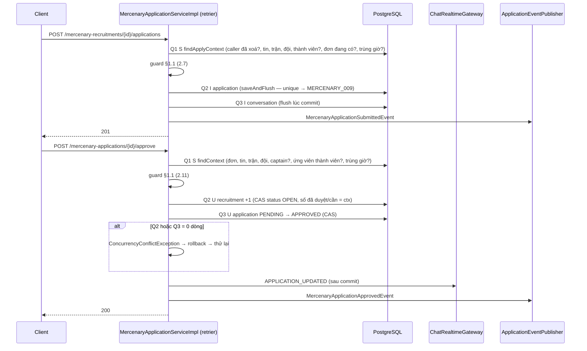
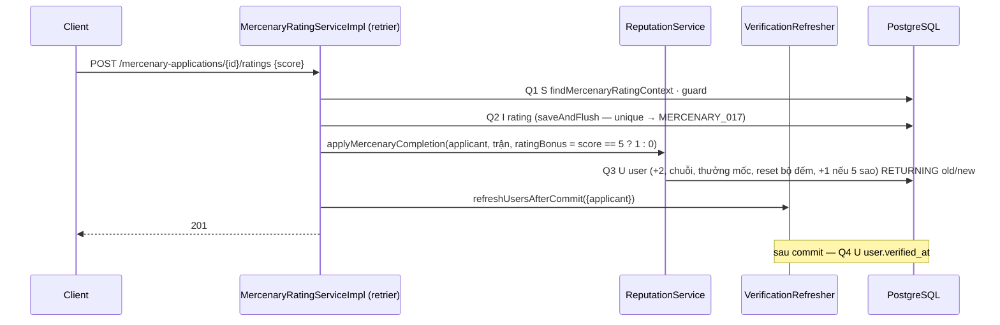
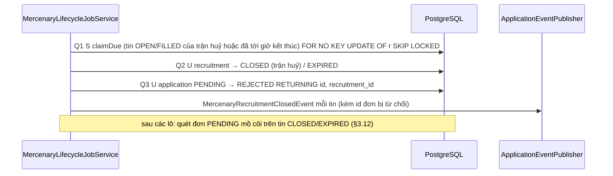
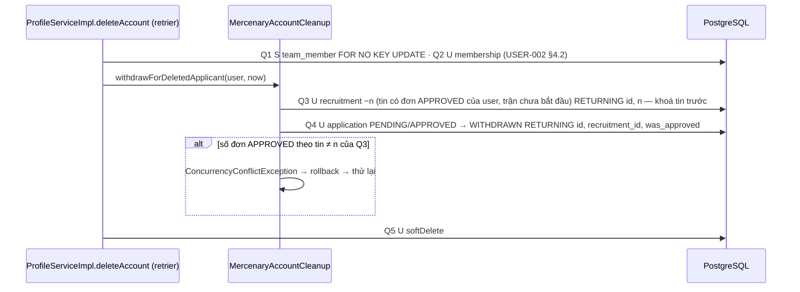

# Processing Flow — Tuyển mercenary, ứng tuyển, chat theo đơn, uy tín cá nhân

| Mục | Giá trị |
|---|---|
| Mã chức năng | `MERCENARY-001` |
| Phạm vi tầng | Backend (Spring Boot REST API). Frontend: ngoài phạm vi repo này |
| Repo/stack | ArenaFlow-be · Spring Boot 4.0.9 · PostgreSQL ≥ 18 · Flyway |
| Quy ước áp dụng | `docs/agent/non-functional-standards.md` (N_DETAIL=3, N_LIST=4, N_WRITE=6; §4.1 flush) · ADR-0003 (+ Sửa đổi 2026-11-10, 2026-11-12, 2026-11-14) · ADR-0007 (+ Sửa đổi 2026-11-14) · ADR-0011, ADR-0012, ADR-0013, ADR-0014 · retrier: VENUE-001 `Component_Class_Design.md` §4.9 |
| Ràng buộc dữ liệu | V1–V8 (V6 gồm `conversation`, `conversation_message` — MATCH-001 v2.4) + `V9__mercenary_recruitment_chat_reputation.sql` (`Component_Class_Design.md` §5.1) |
| Tác giả / Ngày / Phiên bản | solution-architect · 2026-11-13 · v1.0 (baseline) · hiện tại **v2.0** (solution-architect · 2026-11-15) — lịch sử thay đổi: `CHANGELOG.md` |

## 1. Tổng quan

33 endpoint + 1 tác vụ job (chạy trong job vòng đời kèo 5 phút) + mở rộng REPUTATION-001 (2.5 tranh chấp, 2.8 kiểm tồn tại, job huy hiệu) và USER-001 2.7 (xoá tài khoản). Số truy vấn tính cho **một lần thử**; JWT không truy vấn DB. Ký hiệu: **S** SELECT, **I** INSERT, **U** UPDATE. `now` lấy từ `Clock` một lần ở đầu mỗi lần thử. Không gọi HTTP ra ngoài.

**Trận của tin** = kèo trên hệ thống (`match`) **hoặc** trận ngoài hệ thống (`external_match` — BR-ME19). Mọi câu đọc / context lấy giờ bắt đầu, giờ kết thúc, trạng thái, sân, đội của trận qua biểu thức chung `MercenarySql.GAME_*` (`Component_Class_Design.md` §5.3); dưới đây viết tắt `g.start`, `g.end`, `g.cancelled`, `g.confirmed` (kèo `CONFIRMED` / trận ngoài `SCHEDULED`), `g.ended` (kèo `ARCHIVED`/`COMPLETED`; trận ngoài `SCHEDULED` và `g.end ≤ now`).

**Trạng thái hiệu lực:** mọi câu đọc / context tính trạng thái tin, đơn theo `MercenarySql` (§5.3 CCD). API ghi **không** chuyển trạng thái hệ thống (khác MATCH-001 lazy check) — chỉ từ chối theo trạng thái hiệu lực; job §3.12 ghi thật. Ngoại lệ: huỷ trận ngoài (2.32) và đóng tin (2.6) ghi ngay vì là thao tác của người dùng.

Thao tác ghi có CAS chạy trong `ConcurrencyConflictRetrier.execute(MATCH_014, …)`: mỗi lần thử một transaction; CAS 0 dòng → `ConcurrencyConflictException` → thử lại, lần sau guard trả mã đúng theo dữ liệu mới. Event phát trong transaction, giao sau commit (ADR-0011); frame realtime và refresh huy hiệu chạy sau commit.

### 1.1. Thứ tự guard (nguồn duy nhất)

Sau JWT (401; `/admin/**` → 403 `AUTH_004` ở filter). Người gọi đã xoá tài khoản (token còn hạn) → `USER_001` ngay sau Bean Validation ở 2.7, 2.18, 2.20 (2.15: sau `CHAT_002` — MATCH-001 `Processing_Flow.md` §1.1) (cột `caller_deleted` trong câu context — không thêm truy vấn). Tồn tại → đội (trạng thái rồi quyền) → trạng thái trận / tin → trạng thái đơn → điều kiện ứng viên → trùng lặp.

| Endpoint | Thứ tự |
|---|---|
| 2.1 | Bean Validation → `MATCH_001` → `TEAM_001` → `TEAM_016` → `TEAM_015` → `TEAM_002` (đội `teamId`) → `MATCH_009` (`teamId` không phải đội tạo kèo / đội đã ghép) → `MERCENARY_003` (trận chưa ghép: `OPEN`, `EXPIRED`) → `MERCENARY_004` (`CANCELLED`, `ARCHIVED`, `COMPLETED`, hoặc `now ≥ match_end_time`) → `MERCENARY_013` (`now ≥ match_start_time`) → `MERCENARY_023` (vị trí đã có tin `OPEN`/`FILLED` của đội cho trận; race → unique index) |
| 2.2 | Bean Validation → `TEAM_001` → `TEAM_016` → `TEAM_002` (`requireCaptainAllowInactive`) |
| 2.3 | Bean Validation (cặp `lat`/`lng`; `radiusKm` cần toạ độ) → không toạ độ: `USER_001` (tài khoản đã xoá) → `MERCENARY_018` (hồ sơ chưa có phường) |
| 2.4 | Bean Validation → `MERCENARY_001` |
| 2.5 | Bean Validation → `MERCENARY_001` → `TEAM_016` → `TEAM_015` → `TEAM_002` → `MERCENARY_007` (hiệu lực `CLOSED`/`EXPIRED`) → `MERCENARY_008` (`quantityNeeded < quantityApproved`) → `MERCENARY_013` (tăng số lượng khi `now ≥ g.start`) |
| 2.6 | `MERCENARY_001` → `TEAM_016` → `TEAM_002` (đội `INACTIVE` được) → `MERCENARY_007` |
| 2.7 | `USER_001` → `MERCENARY_001` → `MERCENARY_007` → `MERCENARY_013` (`now ≥ g.start`) → `MERCENARY_006` (`FILLED`) → `MERCENARY_005` (đội tuyển không `ACTIVE`) → `MERCENARY_010` (caller là thành viên ACTIVE của đội trong trận: kèo — một trong hai đội; trận ngoài — đội khai báo) → `MERCENARY_009` (đã có đơn `PENDING`/`APPROVED` ở tin; race → unique index) → `MERCENARY_011` (đơn `APPROVED` trùng giờ, gồm chính trận) |
| 2.8 | Bean Validation → `MERCENARY_001` → `TEAM_016` → `TEAM_002` (đội `INACTIVE` được) |
| 2.9 | Bean Validation |
| 2.10 | `MERCENARY_002` → `MERCENARY_014` (không phải ứng viên, không phải đội trưởng ACTIVE hiện tại của đội tuyển) |
| 2.11 | `MERCENARY_002` → `TEAM_016` → `TEAM_015` → `TEAM_002` → `MERCENARY_007` → `MERCENARY_012` (đơn hiệu lực ≠ `PENDING`) → `MERCENARY_013` (`now ≥ g.start`) → `MERCENARY_006` → `MERCENARY_010` (ứng viên) → `MERCENARY_011` (ứng viên — gồm đơn `APPROVED` khác của chính trận) |
| 2.12 | `MERCENARY_002` → `TEAM_016` → `TEAM_002` (đội `INACTIVE` được) → `MERCENARY_007` → `MERCENARY_012` |
| 2.13 | Bean Validation (`expectedStatus`) → `MERCENARY_002` → `MERCENARY_014` (caller ≠ ứng viên) → `MERCENARY_012` (đơn hiệu lực ≠ `expectedStatus`) → `APPROVED`: `MERCENARY_004` (`g.cancelled` hoặc trận đã kết thúc) → `MERCENARY_013` (`now ≥ g.start`) |
| 2.14–2.17 | Như MATCH-001 `Processing_Flow.md` §1.1 (2.19, 2.16, 2.17, 2.18 — cùng endpoint). Ngữ cảnh đơn: không có nhánh lazy; `CHAT_003` khi không phải ứng viên, đội trưởng ACTIVE của đội tuyển hay người đã giải tán đội tuyển; `CHAT_004` khi đơn hiệu lực ∉ {`PENDING`, `APPROVED`} **hoặc** người gọi là người đã giải tán đội tuyển (chỉ xem — user chốt 2026-11-15) |
| 2.18 | Bean Validation → `USER_001` → `MERCENARY_002` → `MERCENARY_019` (caller vừa là ứng viên vừa là đội trưởng) → `MERCENARY_014` → phía đội trưởng: `TEAM_015` (đội tuyển `INACTIVE`, BR-R10) → `MERCENARY_015` (`NOT g.ended` hoặc đơn ≠ `APPROVED`) → `MERCENARY_016` (phía mercenary gửi `isNoShow = true`) → `MERCENARY_017` (phía mình đã đánh giá; race → unique index) |
| 2.19 | `MERCENARY_002` → `MERCENARY_019` → `MERCENARY_014` → phía đội trưởng: `TEAM_015` |
| 2.20 | Bean Validation → `USER_001` → `MERCENARY_002` → `MERCENARY_019` → `TEAM_016` (caller không phải ứng viên, không phải đội trưởng ACTIVE, là người đã giải tán đội tuyển — v2.0, BR-R10) → `MERCENARY_014` → phía đội trưởng: `TEAM_015` → `MERCENARY_020` (không tham gia trận **và** chưa có tin nhắn) → `MERCENARY_021` (chỉ có ngữ cảnh tin nhắn và loại ≠ `BAD_COMMUNICATION`) → `MERCENARY_022` (đã report loại này; race → unique index) |
| 2.21 | Bean Validation → `TEAM_001` → `TEAM_016` → `TEAM_015` → `TEAM_002` (`requireActiveCaptain`, BR-R10) |
| 2.22 | Bean Validation |
| 2.23 | `USER_001` (không có / đã xoá tài khoản) |
| 2.24 | Bean Validation → `TEAM_001` |
| 2.25 | `AUTH_004` → Bean Validation |
| 2.26 | `AUTH_004` → `DISPUTE_001` (không có, hoặc không phải tranh chấp liên quan mercenary) |
| 2.27 | `AUTH_004` → Bean Validation → CAS 0 dòng: `DISPUTE_001` (không có tranh chấp **liên quan mercenary** với id này) / `DISPUTE_002` |
| 2.28 | Bean Validation → `TEAM_001` → `TEAM_016` → `TEAM_015` → `TEAM_002` (`requireActiveCaptain`) → `VENUE_001` → `VENUE_002` |
| 2.29 | Bean Validation → `TEAM_001` → `TEAM_016` → `TEAM_002` (`requireCaptainAllowInactive`) |
| 2.30 | `MERCENARY_024` → `TEAM_016` → `TEAM_002` (đội `INACTIVE` được) |
| 2.31 | Bean Validation → `MERCENARY_024` → `TEAM_016` → `TEAM_015` → `TEAM_002` → `MERCENARY_004` (`CANCELLED` hoặc `now ≥ g.end`) → (đổi sân / giờ / trình độ) `MERCENARY_013` (`now ≥ g.start`) → `MERCENARY_025` (đã có đơn `APPROVED` — kiểm trên dòng tin đã khoá) → `VENUE_001` → `VENUE_002` |
| 2.32 | `MERCENARY_024` → `TEAM_016` → `TEAM_002` (đội `INACTIVE` được) → `MERCENARY_004` → `MERCENARY_013` (`now ≥ g.start` — BR-ME19, như BR-M11) |
| 2.33 | Bean Validation → `MERCENARY_024` → `TEAM_016` → `TEAM_015` → `TEAM_002` → `MERCENARY_004` → `MERCENARY_013` → `MERCENARY_023` |

Phía đánh giá / report (2.18–2.20) xác định từ người gọi, không gửi lên: caller là ứng viên → phía mercenary; caller là đội trưởng ACTIVE hiện tại của đội tuyển → phía đội trưởng. Đội tuyển đã giải tán không còn đội trưởng → người gọi không phải ứng viên nhận `MERCENARY_014` ở 2.18, 2.19; ở 2.20 người đã giải tán đội tuyển nhận `TEAM_016` (vì vẫn là bên chỉ xem của cuộc trò chuyện — user chốt 2026-11-15), người khác `MERCENARY_014`.

Thứ tự guard của REPUTATION-001 2.5 (tranh chấp, gồm nhánh report nhắm vào cá nhân): nguồn duy nhất là REPUTATION-001 `Processing_Flow.md` §1.1 (v1.1).

## 2. Sequence

### 2.1. Ứng tuyển (2.7) và duyệt (2.11)



### 2.2. Rút lui (2.13, `APPROVED`)

```mermaid
sequenceDiagram
    participant C as Client
    participant S as Service (retrier)
    participant RP as ReputationService
    participant VR as VerificationRefresher
    participant DB as PostgreSQL
    C->>S: POST /mercenary-applications/{id}/withdraw {expectedStatus: APPROVED}
    S->>DB: Q1 S findContext · guard (expectedStatus, trận chưa bắt đầu)
    S->>DB: Q2 U recruitment −1 (FILLED → OPEN) — khoá tin trước
    S->>DB: Q3 U application APPROVED → WITHDRAWN (CAS; 0 dòng → thử lại)
    S->>RP: adjustUserReliability(applicant, −1/−3/−5, breaksCleanStreak)
    RP->>DB: Q4 U user
    S->>VR: refreshUsersAfterCommit({applicant})
    S-->>C: 200
    Note over VR,DB: sau commit — Q5 U user.verified_at (REQUIRES_NEW)
```

### 2.3. Gửi tin (2.15)

Như MATCH-001 `Processing_Flow.md` §2.4 (v2.0 — một luồng cho mọi cuộc trò chuyện); ngữ cảnh đơn đi nhánh không lazy: Q1 `findContext` (khối mercenary — `Component_Class_Design.md` §4.7) → `MercenaryApplicationConversationPolicy` → Q2 INSERT tin → frame `MESSAGE_CREATED` sau commit.

### 2.4. Đội trưởng đánh giá mercenary bằng sao (2.18) — tính hoàn thành (BR-ME15)



"Không đến": chỉ Q1, Q2 (không ghi điểm, không refresh). Phía mercenary đánh giá đội: Q1, Q2.

### 2.5. Job đóng / hết hạn tin (mỗi lô)



### 2.6. Xoá tài khoản ứng viên (USER-001 2.7 — BR-ME18)



## 3. Luồng chi tiết

### Bảng số truy vấn

| # | Endpoint | Truy vấn (một lần thử) | Tổng / Ngưỡng |
|---|---|---|---|
| 2.1 | `POST /matches/{id}/mercenary-recruitments` | S context, I tin (1 câu, mọi vị trí) RETURNING | 2 / W6 ✅ |
| 2.2 | `GET /teams/{id}/mercenary-recruitments` | S captain ctx, S trang, S count | 3 / L4 ✅ |
| 2.3 | `GET /mercenary-recruitments` — có GPS | S trang, S count | 2 / L4 ✅ |
| 2.3 | — không GPS | S khu vực hồ sơ, S trang, S count | 3 / L4 ✅ |
| 2.4 | `GET /mercenary-recruitments/{id}` | S chi tiết + cờ người xem | 1 / D3 ✅ |
| 2.5 | `PATCH /mercenary-recruitments/{id}` | S ctx, U CAS | 2 / W6 ✅ |
| 2.6 | `POST …/close` | S ctx, U tin CAS, U đơn `PENDING` → `REJECTED` RETURNING id | 3 / W6 ✅ |
| 2.7 | `POST …/applications` | S ctx, I đơn, I cuộc trò chuyện | 3 / W6 ✅ |
| 2.8 | `GET …/applications` | S ctx (quyền), S trang (kèm uy tín mỗi ứng viên, LATERAL), S count | 3 / L4 ✅ |
| 2.9 | `GET /profile/mercenary-applications` | S trang, S count | 2 / L4 ✅ |
| 2.10 | `GET /mercenary-applications/{id}` | S chi tiết + cờ | 1 / D3 ✅ |
| 2.11 | `POST …/approve` | S ctx, U tin CAS, U đơn CAS | 3 / W6 ✅ |
| 2.12 | `POST …/reject` | S ctx, U đơn CAS | 2 / W6 ✅ |
| 2.13 | `POST …/withdraw` — `PENDING` | S ctx, U đơn CAS | 2 / W6 ✅ |
| 2.13 | — `APPROVED` | S ctx, U tin, U đơn CAS, U user (điểm, chuỗi) · sau commit: U `verified_at` | 5 / W6 ✅ |
| 2.14 | `GET /conversations/{id}` | S ctx | 1 / D3 ✅ |
| 2.15 | `POST …/messages` | S ctx, I tin (MATCH-001 2.16 — retrier, ngữ cảnh đơn không lazy) | 2 / W6 ✅ |
| 2.16 | `GET …/messages` | S ctx, S cursor (khi có), S trang | 3 / L4 ✅ |
| 2.17 | `POST …/messages/read` | S ctx, U | 2 / W6 ✅ |
| 2.18 | `POST …/ratings` — đội trưởng chấm sao | S ctx, I rating, U user (hoàn thành + 5 sao, 1 câu) RETURNING · sau commit: U `verified_at` | 4 / W6 ✅ |
| 2.18 | — đội trưởng "Không đến"; phía mercenary | S ctx, I rating | 2 / W6 ✅ |
| 2.19 | `GET …/ratings` | S ctx + 0..2 đánh giá | 1 / D3 ✅ |
| 2.20 | `POST …/reports` | S ctx, I report, U bên bị report (trừ điểm) RETURNING, U `report.reliability_penalty` · sau commit: U `verified_at` | 5 / W6 ✅ |
| 2.21 | `GET /teams/{id}/mercenary-reports` | S captain ctx, S trang, S count | 3 / L4 ✅ |
| 2.22 | `GET /profile/mercenary-reports` | S trang, S count | 2 / L4 ✅ |
| 2.23 | `GET /users/{id}/reputation` | S thống kê (1 câu) | 1 / D3 ✅ |
| 2.24 | `GET /teams/{id}/mercenary-ratings` | S `existsById`, S trang, S count | 3 / L4 ✅ |
| 2.25 | `GET /admin/mercenary-disputes` | S trang, S count | 2 / L4 ✅ |
| 2.26 | `GET /admin/mercenary-disputes/{id}` | S chi tiết, S đánh giá của đơn | 2 / D3 ✅ |
| 2.27 | `PATCH …/resolve` — `REJECTED` | U dispute CAS, U report, U bên bị report (hoàn), S chi tiết, S đánh giá · sau commit: U `verified_at` | 6 / W6 ✅ (= ngưỡng) |
| 2.27 | — `CONFIRMED` | U dispute CAS, U report, S chi tiết, S đánh giá | 4 / W6 ✅ |
| 2.27 | CAS 0 dòng | U dispute CAS, S tồn tại theo phạm vi hàng chờ | 2 |
| 2.28 | `POST /teams/{id}/external-matches` | S captain ctx, S sân chọn được (+ phường/tỉnh), I trận ngoài, I tin (1 câu) RETURNING, U `venue.last_selected_at` (BC-V05) | 5 / W6 ✅ |
| 2.29 | `GET /teams/{id}/external-matches` | S captain ctx, S trang, S count | 3 / L4 ✅ |
| 2.30 | `GET /external-matches/{id}` | S chi tiết + cờ captain + `hasApprovedMercenary` | 1 / D3 ✅ |
| 2.31 | `PATCH /external-matches/{id}` | S ctx (+ sân, khu vực, `hasApprovedMercenary`), (S sân mới), U trận ngoài CAS `version` (khoá trận ngoài trước), (U khoá các tin của trận RETURNING số đã duyệt — khi đổi sân / giờ / trình độ), (U `venue.last_selected_at` khi đổi sân — BC-V05); response không đọc lại | 2–5 / W6 ✅ |
| 2.32 | `POST /external-matches/{id}/cancel` | S ctx, U trận ngoài CAS, U tin → `CLOSED` RETURNING id, U đơn `PENDING` → `REJECTED` RETURNING, U đánh dấu đã báo huỷ cho đơn `APPROVED` RETURNING | 5 / W6 ✅ |
| 2.33 | `POST /external-matches/{id}/mercenary-recruitments` | S ctx, I tin RETURNING | 2 / W6 ✅ |
| U-2.7 | USER-001 `DELETE /profile` (BR-ME18) | S khoá membership, U membership, U tin (bớt số đã duyệt) RETURNING, U đơn → `WITHDRAWN` RETURNING, U `softDelete` | 5 / W6 ✅ (trước: 3) |
| R-2.1 | REPUTATION-001 `POST /matches/{id}/ratings` | Không đổi (mercenary không còn được cộng điểm lúc trận `COMPLETED` — BR-ME15 sửa 2026-11-14) | 5 / W6 ✅ |
| R-2.5 | REPUTATION-001 `POST /reports/{id}/dispute` | S ctx (thêm cột, cùng câu), U report CAS, I dispute | 3 / W6 ✅ (không đổi) |
| R-2.8 | REPUTATION-001 `PATCH /admin/disputes/{id}/resolve` — CAS 0 dòng | U dispute CAS, S tồn tại theo phạm vi hàng chờ đội–đội | 2 (không đổi) |
| Job | đóng / hết hạn tin (mỗi lô) | S claim, U tin, U đơn RETURNING | 3 / lô |
| Job | đơn chờ mồ côi (mỗi lô) | U đơn RETURNING | 1 / lô |
| Job | báo mercenary trận bị huỷ (mỗi lô) | U đơn `APPROVED` (đánh dấu đã báo) RETURNING | 1 / lô |
| Job | huy hiệu cá nhân (mỗi lô) | S id lô, U `verified_at` RETURNING | 2 / lô |

**NFS gate:** 33/33 endpoint của mã này trong ngưỡng; truy vấn sau commit **được tính**. Chạm đúng ngưỡng: **2.27 `REJECTED` (6/W6)** — mọi truy vấn thêm phải gộp hoặc xin duyệt. USER-001 2.7: 5/W6. Đã gộp: tin + trận + đội + quyền + điều kiện ứng viên + cờ tài khoản đã xoá thành 1 câu context (2.7, 2.11, 2.15, 2.18, 2.20); mọi vị trí tạo bằng 1 câu `INSERT … SELECT unnest`; uy tín ứng viên trong câu trang (LATERAL, 2.8); điểm hoàn thành + thưởng 5 sao của mercenary trong 1 câu; refresh huy hiệu đội + cá nhân tối đa 1 câu mỗi loại mỗi request. MATCH-001 huỷ kèo (2.5, 2.10) và REPUTATION-001 2.1 **không** thêm truy vấn. Retry nhân số truy vấn tối đa 3 (ADR-0003).

### 3.1. `POST /matches/{matchId}/mercenary-recruitments` (retrier)
Q1 `findRecruitContext(matchId, teamId, callerId, now)` (gồm vị trí đã có tin `OPEN`/`FILLED` của đội cho trận) → guard §1.1 → Q2 `insertAll(matchId, null, teamId, callerId, positions[], quantities[], now)` (vi phạm `idx_mercenary_recruitment_match_position` khi tạo đồng thời → `MERCENARY_023`) → response từ ctx + dòng trả về (sắp theo thứ tự request). Không event.

### 3.2. `GET /teams/{teamId}/mercenary-recruitments` (readOnly)
Q1 `teamGuard.requireCaptainAllowInactive(teamId, callerId)` → Q2 `recruitmentRepository.findByTeam(teamId, matchId?, status?, now)` → Q3 count. Gồm tin của kèo và của trận ngoài. Lọc `status` trên trạng thái hiệu lực. Thứ tự: `g.start` tăng dần, cùng trận → `createdAt`, `id`.

### 3.3. `GET /mercenary-recruitments` (readOnly)
Cả hai chế độ chỉ lấy tin `OPEN` của trận `g.confirmed AND g.start > now` (BR-ME07, BR-ME19), đội tuyển `ACTIVE`. Có `lat`/`lng`: hộp giới hạn từ `radiusKm` (mặc định 3) → Q1 `searchNearby` → Q2 count. Không: Q1 `findProfileArea(callerId)` → không có / đã xoá → `USER_001`; `wardId` null → `MERCENARY_018` → Q2 `searchByProvince(provinceId, wardId)` → Q3 count. `distanceKm` làm tròn tới 0,5 km ở mapper (`ceil(d × 2) / 2`, tối thiểu 0,5). Không lưu / log toạ độ.

### 3.4. `GET /mercenary-recruitments/{id}` (readOnly)
Q1 `findView(id, callerId, now, lat?, lng?)` → rỗng → `MERCENARY_001` → mapper ẩn/hiện sân và đội trưởng (`Component_Class_Design.md` §7); `distanceKm` như §3.3.

### 3.5. `PATCH /mercenary-recruitments/{id}` (retrier)
Q1 `findWriteContext` → guard (tăng số lượng khi `now ≥ g.start` → `MERCENARY_013`) → Q2 `updateQuantity(id, q, ctx.approved, ctx.needed, now)` → 0 dòng → thử lại → response: `status = q == approved ? FILLED : OPEN`, `updatedAt = now`. `q == ctx.needed` → không ghi, trả 200 với dữ liệu ctx.

### 3.6. `POST /mercenary-recruitments/{id}/close` (retrier)
Q1 `findWriteContext` → guard → Q2 `closeIfActive` → 0 dòng → thử lại → Q3 `rejectPendingByRecruitment(id, now)` RETURNING id (số dòng = `rejectedApplicationCount`) → `MercenaryRecruitmentClosedEvent(cause = CAPTAIN, rejectedApplicationIds)`.

### 3.7. `POST /mercenary-recruitments/{id}/applications` (retrier)
Q1 `findApplyContext(recruitmentId, callerId, now)` → guard → Q2 `saveAndFlush(MercenaryApplication)` (bắt `idx_mercenary_application_active` → `MERCENARY_009`) → Q3 `save(Conversation)` (`matchId` / `externalMatchId` theo tin; flush lúc commit) → `MercenaryApplicationSubmittedEvent` → response (`conversationId` từ entity).

### 3.8. `POST /mercenary-applications/{id}/approve` · `/reject` (retrier)
Approve: Q1 `findContext(applicationId, callerId, now)` → guard → Q2 `incrementApproved(recruitmentId, ctx.approved, ctx.needed, now)` → Q3 `approveIfPending(id, now)` → bất kỳ 0 dòng → `ConcurrencyConflictException` (rollback cả Q2) → thử lại → frame `APPLICATION_UPDATED` → event → response (`quantityApproved = ctx.approved + 1`, `recruitmentStatus = +1 == needed ? FILLED : OPEN`).
Reject: Q1 → guard → Q2 `rejectIfPending` → 0 dòng → thử lại → frame → event → 204.

### 3.9. `POST /mercenary-applications/{id}/withdraw` (retrier)
Q1 `findContext` → guard (mọi lần thử so `expectedStatus` với trạng thái **hiệu lực**) →
- `PENDING`: Q2 `withdrawPending` (0 dòng → thử lại) → `reliabilityPenalty = 0`.
- `APPROVED`: Q2 `decrementApproved(recruitmentId, now)` → Q3 `withdrawApproved` (0 dòng → `ConcurrencyConflictException`, rollback Q2) → `delta = MERCENARY_WITHDRAWAL.penaltyFor(g.start, now)` (âm) → Q4 `adjustUserReliability(caller, new ReliabilityChange(delta, MERCENARY_WITHDRAWN_AFTER_APPROVED, applicationId, true))` → `refreshUsersAfterCommit({caller})` (Q5 sau commit). Response `reliabilityPenalty = −delta` (số dương — `API_Spec.md` §4.1).
→ frame → `MercenaryApplicationWithdrawnEvent(previousStatus, cause = APPLICANT)` → response (`recruitmentStatus` từ ctx: `FILLED` → `OPEN`, giữ `CLOSED`/`EXPIRED`; `quantityApproved − 1`).

**Bảng kiểm khung trừ điểm (test bắt buộc, `now` cố định):**

| `g.start − now` | `reliabilityPenalty` |
|---|---|
| 30 giờ / đúng 24 giờ | 1 |
| 23 giờ 59 phút / đúng 4 giờ | 3 |
| 3 giờ 59 phút / 1 phút | 5 |
| 0 (đúng giờ bắt đầu) / âm | Không rút được — `MERCENARY_013` |

Mọi trường hợp rút `APPROVED`: chuỗi trận sạch cá nhân = 0; điểm chặn [0, 100].

### 3.10. Cuộc trò chuyện (2.14–2.17)
MATCH-001 `Processing_Flow.md` §3.15–§3.20 (cùng endpoint, cùng số truy vấn; người đã giải tán đội tuyển không thêm câu). Test (v2.0): đội tuyển giải tán → người đã giải tán: 2.14 `canSend = false`, 2.16 / 2.17 / `SUBSCRIBE` thành công, 2.15 → `CHAT_004`, 2.20 → `TEAM_016`; thành viên khác của đội → 2.14–2.17 `CHAT_003`; ứng viên vẫn gửi được khi đơn `PENDING` / `APPROVED`. Riêng ngữ cảnh đơn: policy `MercenaryApplicationConversationPolicy` (`Component_Class_Design.md` §4.7) — bên A/B, `canSend` theo trạng thái hiệu lực của đơn, tên đội trưởng luôn hiện (BR-ME04 ngoại lệ chat); `send` qua retrier nhưng luôn `Done` (không lazy). Cuộc trò chuyện tạo ở 2.7 (`Conversation …MERCENARY_APPLICATION…`).

### 3.11. Đánh giá, report (2.18–2.22)
- 2.18: Q1 `findMercenaryRatingContext(applicationId, callerId, now)` → guard → Q2 `saveAndFlush(Rating)` (`matchId` / `externalMatchId` theo tin; bắt `idx_rating_mercenary_unique` → `MERCENARY_017`) → phía đội trưởng, **chấm sao**: Q3 `reputationService.applyMercenaryCompletion(applicantId, matchId, externalMatchId, ratingBonus = score == 5 ? 1 : 0, ratingId)` + `refreshUsersAfterCommit({applicant})` (Q4 sau commit); "Không đến": không ghi điểm, không refresh; phía mercenary: không ghi điểm, không refresh → `MercenaryRatingCreatedEvent`.
- 2.19: Q1 → side → `given` / `received` (BC-R03/R04).
- 2.20: Q1 `findMercenaryReportContext(applicationId, callerId, reportType, now)` → guard → Q2 `saveAndFlush(Report)` (bắt `idx_report_unique` / `idx_report_external_unique` → `MERCENARY_022`) → Q3 phía đội trưởng: `applyUserReportPenalty(applicant, type, reportId)`; phía mercenary: `applyReportPenalty(team, type, reportId)` (đội — B9) → `report.setReliabilityPenalty(points)` (Q4 lúc commit) → refresh bên bị report (Q5 sau commit) → `MercenaryReportCreatedEvent`.
- 2.21 / 2.22: (Q1 `teamGuard.requireActiveCaptain(teamId, callerId)` cho 2.21) → `findMercenaryReports(subjectType, subjectId, direction, limit, offset)` → `countMercenaryReports` → mapper (trạng thái hiệu lực + `canDispute` theo REPUTATION-001 §4.10, `now` từ `Clock`).

**Bảng kiểm `applyMercenaryCompletion` (test bắt buộc):**

| Trước (điểm, chuỗi, bộ đếm bùng) | Report cá nhân chưa bác trong trận | Sao | Sau |
|---|---|---|---|
| 80, 0, 0 | Không | 4 | 82, 1, 0 |
| 80, 4, 1 | Không | 4 | 87 (+2+5), 5, **0** (mọi bộ đếm về 0) |
| 80, 9, 0 | Không | 5 | 93 (+2+10+1), 10, 0 |
| 80, 3, 1 | Có | 5 | 83 (+2+1), **0**, 1 |
| 99, 4, 0 | Không | 3 | 100 (chặn), 5, 0 |
| — | — | "Không đến" | Không gọi |

**Bảng kiểm trận sạch của đội khi trận `COMPLETED`** (`applyCompletion` của REPUTATION-001 có mệnh đề mercenary — `Component_Class_Design.md` §4.12; test bắt buộc, chuyển từ REPUTATION-001 `Processing_Flow.md` §3.1):

| Trước (điểm, chuỗi, bộ đếm bùng) | Report đội chưa bác trong trận | Sau |
|---|---|---|
| 80, 2, 0 | Chỉ report "giao tiếp tệ" qua chat theo đơn của ứng viên bị từ chối (đơn `REJECTED`) | 82, **3**, 0 (không tính) |
| 80, 2, 0 | Chỉ report "giao tiếp tệ" qua chat theo đơn của ứng viên đã rút đơn chờ (`WITHDRAWN`) | 82, **3**, 0 (không tính) |
| 80, 2, 0 | Report của mercenary đơn `APPROVED` của trận | 82, **0**, 0 |

**Bảng kiểm ngữ cảnh report (2.20):**

| Trận | Đơn (hiệu lực) | Có tin nhắn | Loại được report |
|---|---|---|---|
| `g.ended` | `APPROVED` | bất kỳ | Cả 4 loại |
| `g.ended` | khác `APPROVED` | Có | Chỉ `BAD_COMMUNICATION` |
| Chưa kết thúc, hoặc huỷ | bất kỳ | Có | Chỉ `BAD_COMMUNICATION` |
| bất kỳ (trừ dòng 1) | bất kỳ | Không | Không — `MERCENARY_020` |

### 3.12. Job đóng / hết hạn tin (trong `MatchLifecycleScheduler`, sau `archiveFinishedMatches`)
1. Lặp tới khi lô < `batch-size` hoặc hết `max-batches-per-run`; mỗi lô một `TransactionTemplate`: Q1 `claimDue(now, batchSize)` (tin `OPEN`/`FILLED` mà `g.cancelled` hoặc `g.end ≤ now`) → tách id theo `cause` → Q2 `markClosedOrExpired(closedIds, expiredIds, now)` → Q3 `rejectPendingByRecruitmentIds(allIds, now)` RETURNING `id, recruitment_id` → `MercenaryRecruitmentClosedEvent(cause, rejectedApplicationIds)` mỗi tin → commit.
2. **Đơn chờ mồ côi** (MINOR 5 — ứng tuyển commit sau khi tin đã đóng / hết hạn, trạng thái hiệu lực đã là `REJECTED` nhưng chưa ai báo): lặp lô `rejectOrphanPending(now, batchSize)` — `UPDATE mercenary_application a SET status = 'REJECTED', responded_at = :now WHERE a.id IN (SELECT a2.id FROM mercenary_application a2 JOIN mercenary_recruitment r ON r.id = a2.recruitment_id WHERE a2.status = 'PENDING' AND r.status IN ('CLOSED','EXPIRED') ORDER BY a2.id LIMIT :limit FOR NO KEY UPDATE OF a2 SKIP LOCKED) RETURNING a.id, a.recruitment_id` → `MercenaryApplicationRejectedEvent(cause = RECRUITMENT_CLOSED)` mỗi đơn.
3. **Báo mercenary khi trận bị huỷ** (N-M2 — gồm cả tin đã `CLOSED` trước khi trận bị huỷ, mà bước 1 không thấy): lặp lô `markGameCancelNotified(now, lookbackStart, batchSize)` — **xuất phát từ phía trận** (huỷ chỉ xảy ra trước giờ bắt đầu → trận bị huỷ gần đây có giờ kết thúc gần `now`):
   ```sql
   UPDATE mercenary_application a SET game_cancel_notified_at = :now
   FROM mercenary_recruitment r
   WHERE a.recruitment_id = r.id
     AND a.id IN (
       SELECT a2.id FROM mercenary_application a2                        -- tầng khoá: không có UNION
       WHERE a2.id IN (
           SELECT a3.id FROM match m                                     -- nhánh kèo: chỉ join r3.match_id
           JOIN mercenary_recruitment r3 ON r3.match_id = m.id
           JOIN mercenary_application a3 ON a3.recruitment_id = r3.id
           WHERE m.status = 'CANCELLED' AND m.match_end_time > :lookbackStart
             AND r3.match_id IS NOT NULL                                   -- khớp predicate partial index
             AND a3.status = 'APPROVED' AND a3.game_cancel_notified_at IS NULL
           UNION ALL
           SELECT a3.id FROM external_match x                            -- nhánh trận ngoài: chỉ join r3.external_match_id
           JOIN mercenary_recruitment r3 ON r3.external_match_id = x.id
           JOIN mercenary_application a3 ON a3.recruitment_id = r3.id
           WHERE x.status = 'CANCELLED' AND x.match_end_time > :lookbackStart
             AND r3.external_match_id IS NOT NULL                          -- khớp predicate partial index
             AND a3.status = 'APPROVED' AND a3.game_cancel_notified_at IS NULL)
         AND a2.status = 'APPROVED' AND a2.game_cancel_notified_at IS NULL  -- kiểm lại sau khi khoá
       ORDER BY a2.id LIMIT :limit
       FOR NO KEY UPDATE OF a2 SKIP LOCKED)
   RETURNING a.id, r.match_id, r.external_match_id
   ```
   (`lookbackStart = now − cancel-notice-lookback-days`, 7 ngày — CCD §8). Mỗi nhánh `UNION ALL` join **đúng một** cột khoá trận (không `OR` giữa hai cột — planner dùng được index từng nhánh): kèo `idx_match_archived (status, match_end_time)` (V1) → `idx_mercenary_recruitment_match_all` → `idx_mercenary_application_cancel_notice (recruitment_id)`; trận ngoài `idx_external_match_cancelled` → `idx_mercenary_recruitment_external_all` → cùng chỉ mục đơn. `FOR NO KEY UPDATE OF a2 SKIP LOCKED` đặt ở tầng ngoài chọn từ `mercenary_application a2` (không có `UNION`) vì PostgreSQL không cho `FOR UPDATE` cùng tầng với `UNION`; điều kiện đơn lặp lại ở tầng khoá để loại dòng vừa bị luồng khác đánh dấu. `ORDER BY a2.id` sắp trên tập nhỏ đã lọc (cột đầu `recruitment_id` của chỉ mục không phục vụ thứ tự này). Vẫn 1 câu / lô → gom theo trận → `MercenaryGameCancelledEvent(matchId, externalMatchId, applicationIds)` mỗi trận. Kèo trên hệ thống chỉ đi đường này (MATCH-001 2.5/2.10 giữ 6/W6, không thêm truy vấn, không listener `MatchCancelledEvent`); trận ngoài đánh dấu ngay ở 2.32 nên bước này không gặp lại (chỉ còn đơn được duyệt đồng thời với lúc huỷ).
4. Log `INFO` số tin đóng / hết hạn, số đơn mồ côi, số mercenary được báo huỷ; lỗi một lô log `ERROR`, lô sau vẫn chạy.

### 3.13. Trận ngoài hệ thống (2.28–2.33, BR-ME19)
- **2.28** (retrier): Q1 `teamGuard.requireActiveCaptain(teamId, callerId)` → Q2 `venueSelectionService.requireSelectable({venueId})` (VENUE-001; `VENUE_001`/`VENUE_002`; trả tên, địa chỉ, toạ độ, phường/tỉnh) → Q3 `save(ExternalMatch)` → Q4 `insertAll(null, externalMatchId, teamId, callerId, positions[], quantities[], now)` (Hibernate tự flush INSERT trận ngoài trước câu native — comment tại chỗ) → Q5 `VenueSelectionService.markSelected({venueId}, now)` (BC-V05, user chốt 2026-11-14 — sân của trận ngoài tính là "được chọn"; reset cổng cảnh báo 180 ngày) → response từ dữ liệu đã nạp. Không event.
- **2.29**: Q1 `teamGuard.requireCaptainAllowInactive(teamId, callerId)` → Q2 `externalMatchRepository.findByTeam(teamId, statusFilter, now)` → Q3 count.
- **2.30**: Q1 `findDetail(id, callerId)` (trận + sân + khu vực + đội + cờ captain + `EXISTS` đơn `APPROVED` trên tin của trận).
- **2.31** (retrier): Q1 `externalMatchRepository.findContext(id, callerId, now)` → guard → đổi sân: Q2 `venueSelectionService.requireSelectable({venueIdMới})` → Q3 `externalMatchRepository.updateIfVersion(id, ctx.version, venueId, startTime, endTime, skillLevels, opponentName, now)` (CAS `version = :v AND status = 'SCHEDULED' AND match_end_time > :now`, `version + 1` — **khoá trận ngoài trước**, cùng thứ tự 2.32; 0 dòng → `ConcurrencyConflictException` → thử lại) → đổi sân / giờ / trình độ: Q4 `recruitmentRepository.lockByExternalMatch(id, now)` (`UPDATE mercenary_recruitment SET updated_at = :now WHERE external_match_id = :id RETURNING quantity_approved` — khoá mọi tin của trận; `sum > 0` → `MERCENARY_025`, rollback cả Q3) → đổi sân: Q5 `venueSelectionService.markSelected({venueIdMới}, now)` (BC-V05) → response dựng từ ctx + `SelectableVenueView` của sân mới + giá trị mới — không đọc lại. Chỉ đổi `opponentName` → bỏ Q2, Q4, Q5.
- **2.32** (retrier): Q1 `externalMatchRepository.findContext(id, callerId, now)` → guard → Q2 `cancelIfScheduled(id, now)` (CAS `status = 'SCHEDULED' AND match_start_time > :now`, `version + 1` — BR-ME19: chỉ trước giờ bắt đầu) 0 dòng → thử lại → Q3 `recruitmentRepository.closeActiveByExternalMatch(id, now)` RETURNING id → Q4 `applicationRepository.rejectPendingByRecruitmentIds(ids, now)` RETURNING `id, recruitment_id` (bỏ khi không có tin đang mở) → Q5 `applicationRepository.markGameCancelNotifiedByExternalMatch(id, now)` (đơn `APPROVED` của mọi tin của trận, `game_cancel_notified_at IS NULL` → `:now`, RETURNING id) → `MercenaryRecruitmentClosedEvent(cause = EXTERNAL_MATCH_CANCELLED, rejectedApplicationIds)` mỗi tin vừa đóng + `MercenaryGameCancelledEvent(null, id, approvedApplicationIds)` (BR-ME09 — báo mọi mercenary đã duyệt, kể cả tin đã đóng trước đó). Không ghi uy tín.
- **2.33** (retrier): Q1 `externalMatchRepository.findRecruitContext(id, callerId, now)` (trận ngoài + đội + captain + vị trí đang có tin) → guard → Q2 `recruitmentRepository.insertAll(null, id, teamId, callerId, …)`.
- Đánh giá / report / rút / chat / xoá tài khoản trên tin của trận ngoài: như kèo, dùng `g.*`. Đội **không** được cộng / trừ điểm vì trận ngoài, trừ report của mercenary (2.20 phía mercenary → `applyReportPenalty` đội). Report trận ngoài có `match_id = NULL` → không vào thống kê Completion Rate đội (REPUTATION-001 §5.3 chỉ quét `match`).

### 3.14. Admin tranh chấp mercenary (2.25–2.27)
Như REPUTATION-001 `Processing_Flow.md` §3.6–§3.7 với biến thể câu lọc `report.application_id IS NOT NULL`. 2.27: Q1 `resolveMercenaryIfPending` → rỗng → Q1b `existsMercenaryDispute(id)` (`EXISTS dispute d JOIN report r ON r.id = d.report_id WHERE d.id = :id AND r.application_id IS NOT NULL`) → `false` → `DISPUTE_001`; `true` → `DISPUTE_002` (M5). `REJECTED`: hoàn điểm theo `reportedType` (`INDIVIDUAL` → `refundUserReportPenalty`; `TEAM` → `refundReportPenalty`) + refresh bên đó; `adminAuditLog.afterCommit(...)`; đọc lại chi tiết (Q4) + đánh giá của đơn (Q5). REPUTATION-001 2.8 dùng biến thể `application_id IS NULL` (REPUTATION-001 §14).

### 3.15. Tranh chấp report bùng nhắm vào mercenary (REPUTATION-001 2.5 — sửa)
`findDisputeContext` trả thêm `reportedType`, `callerIsReportedUser` (cùng câu; không `JOIN match` bắt buộc — report của trận ngoài có `match_id = NULL`) → guard theo REPUTATION-001 `Processing_Flow.md` §1.1 dòng 2.5 → phần còn lại không đổi (CAS `markDisputed`, INSERT dispute).

### 3.16. Xoá tài khoản ứng viên (USER-001 2.7 — BR-ME18)
Trong lần thử của `ProfileServiceImpl.deleteAccount` (retrier, USER-001 `Processing_Flow.md` §2.2), **sau** Q2 (rời đội / từ chối lời mời) và **trước** `softDelete`: `MercenaryAccountCleanup.withdrawForDeletedApplicant(userId, now)` (`MANDATORY`):
- Q3 `recruitmentRepository.decrementApprovedOfApplicant(userId, now)` — **khoá tin trước** (cùng thứ tự tin → đơn như 2.11, 2.13): `UPDATE mercenary_recruitment r SET quantity_approved = r.quantity_approved - c.n, status = CASE WHEN r.status = 'FILLED' THEN 'OPEN' ELSE r.status END, updated_at = :now FROM (SELECT a.recruitment_id, count(*) AS n FROM mercenary_application a JOIN mercenary_recruitment r2 ON r2.id = a.recruitment_id <GAME_JOIN r2> WHERE a.applicant_id = :userId AND a.status = 'APPROVED' AND g.confirmed AND g.start > :now GROUP BY a.recruitment_id) c WHERE r.id = c.recruitment_id RETURNING r.id, c.n`.
- Q4 `applicationRepository.withdrawActiveOfApplicant(userId, now)`: `UPDATE mercenary_application a SET status = 'WITHDRAWN', withdrawn_at = :now FROM mercenary_recruitment r <GAME_JOIN r> WHERE a.recruitment_id = r.id AND a.applicant_id = :userId AND a.status IN ('PENDING','APPROVED') AND g.confirmed AND g.start > :now RETURNING a.id, a.recruitment_id, r.team_id, r.match_id, r.external_match_id, (a.responded_at IS NOT NULL) AS was_approved` — đơn `PENDING` không có `responded_at` nên `was_approved` phân biệt được trạng thái trước.
- Đếm `was_approved` theo `recruitment_id` từ Q4 ≠ `n` của Q3 (đơn vừa được duyệt / vừa rút giữa hai câu) → `ConcurrencyConflictException` → rollback cả lần thử → retrier thử lại (lần sau Q3 thấy dữ liệu mới).
- Không trừ điểm, không cắt chuỗi, không refresh huy hiệu. `MercenaryApplicationWithdrawnEvent(previousStatus, cause = ACCOUNT_DELETED)` mỗi đơn (thông báo đội trưởng). Không đẩy frame realtime.
- Đơn `APPROVED` của trận đã huỷ / đã bắt đầu / đã kết thúc giữ nguyên (BR-ME18 làm rõ 2026-11-14). Đơn `PENDING` của tin đã đóng / hết hạn là `REJECTED` hiệu lực; `g.confirmed AND g.start > now` loại trận huỷ / đã bắt đầu.
- Thứ tự khoá trong lần thử: `team_member` (Q1, ADR-0007) → `mercenary_recruitment` → `mercenary_application` (ADR-0007 Sửa đổi 2026-11-14). Duyệt (2.11) khoá tin → đơn, không khoá `team_member` → không vòng chờ.

## 4. Transaction Boundary

Như `Component_Class_Design.md` §4.13. Isolation mặc định (READ COMMITTED). Retrier: mỗi lần thử một `TransactionTemplate`; lần thử rollback không giao event, không đẩy frame, không refresh huy hiệu, không ghi audit.

## 5. Concurrency & Locking

**Thứ tự khoá** (chống vòng chờ): `mercenary_recruitment` → `mercenary_application` → `"user"` ở 2.11, 2.13 (`APPROVED`), 2.6, 2.32, job, xoá tài khoản (sau `team_member`); `mercenary_application` riêng ở 2.12, 2.13 (`PENDING`), quét đơn mồ côi; `external_match` → `mercenary_recruitment` → `mercenary_application` ở 2.31 (CAS trận ngoài trước, rồi khoá tin) và 2.32 (CAS trận ngoài, rồi tin → đơn) — cùng một thứ tự, không luồng nào khoá tin rồi mới khoá `external_match`; `mercenary_application` riêng ở job báo huỷ trận; `report` → `"user"`/`team` ở 2.20; `"user"` riêng ở 2.18; `dispute` → `report` → `"user"`/`team` ở 2.27. INSERT đơn / tin / cuộc trò chuyện lấy `KEY SHARE` trên dòng cha qua FK — tương thích `NO KEY UPDATE`. Không luồng nào khoá `mercenary_application` rồi mới khoá `mercenary_recruitment` [Inference — chưa tái hiện; deadlock nếu có được retrier thử lại].

| Tình huống | Xử lý |
|---|---|
| Hai đội trưởng / hai thiết bị duyệt hai đơn khác nhau cho chỗ cuối của tin | Q2 (CAS tin, ghim số đã duyệt) bên sau 0 dòng → thử lại → guard thấy `FILLED` → `MERCENARY_006` |
| Duyệt và ứng viên rút `PENDING` cùng lúc | Duyệt: Q3 0 dòng → rollback tăng số → thử lại → `MERCENARY_012`. Hoặc rút: 0 dòng → thử lại → `MERCENARY_012` (đơn đã `APPROVED`) |
| Đội trưởng giảm số lượng trong lúc duyệt | Hai CAS cùng ghim số → bên sau thử lại với số mới |
| Ứng tuyển trùng đồng thời | `idx_mercenary_application_active` → `MERCENARY_009` |
| Ứng tuyển commit ngay sau khi tin bị đóng / hết hạn | Đơn `PENDING` trên tin `CLOSED`/`EXPIRED` → hiển thị `REJECTED` ngay; job §3.12 bước 2 ghi `REJECTED` và báo ứng viên |
| Xoá tài khoản ứng viên cùng lúc đội trưởng duyệt đơn của người đó | Cùng thứ tự khoá tin → đơn; lệch số giữa Q3 và Q4 → thử lại (§3.16) |
| Đội trưởng sửa sân / giờ trận ngoài cùng lúc duyệt | 2.31 khoá trận ngoài rồi mọi tin của trận, đọc lại `quantity_approved`; duyệt commit trước → `MERCENARY_025`. 2.31 commit trước → duyệt (đã đọc ctx với giờ **cũ**) chờ khoá tin rồi vẫn thành công: kiểm trùng giờ / bắt đầu (BR-ME06, BR-ME07) đã chạy trên giờ cũ → mercenary có thể được duyệt cho giờ mới trùng một đơn `APPROVED` khác `[cần xác nhận #14]` (rủi ro chấp nhận, cùng loại #8) |
| Huỷ trận ngoài / kèo khi tin đã `CLOSED` từ trước | Mercenary `APPROVED` của tin đã đóng vẫn được báo: 2.32 đánh dấu và phát `MercenaryGameCancelledEvent` ngay; kèo: job bước 3 (§3.12) |
| Tạo tin cùng vị trí đồng thời (hai thiết bị) | `idx_mercenary_recruitment_match_position` / `idx_mercenary_recruitment_external_position` → bên sau `MERCENARY_023` |
| Hai đội trưởng duyệt **cùng một ứng viên** ở hai trận trùng giờ — hoặc ở **hai tin của cùng trận** (phá B2: hai đơn `APPROVED` một trận) — cùng lúc | Kiểm `OVERLAPPING_APPROVAL` trên snapshot riêng → cả hai có thể thành công `[cần xác nhận #8]` (đề xuất chấp nhận; ứng viên tự rút) |
| Tạo tin / duyệt trong lúc kèo bị huỷ | INSERT / UPDATE thành công; trạng thái hiệu lực `CLOSED` / `REJECTED` ngay; job ghi thật ở lần chạy kế (đơn `APPROVED` giữ nguyên — BR-ME09) |
| Đóng tin trong lúc job đóng cùng tin | CAS `status IN ('OPEN','FILLED')` / `SKIP LOCKED` → một bên thắng; bên kia 0 dòng (người dùng → thử lại → `MERCENARY_007`) |
| Rút lui sát giờ bắt đầu | Kiểm `now < g.start` với `now` của lần thử; lần thử lại tính lại |
| Report mercenary gần lúc đội trưởng chấm sao | `applyMercenaryCompletion` khoá dòng `"user"` rồi kiểm report bằng snapshot đầu câu → có thể chưa thấy report vừa commit → chuỗi +1 thay vì 0 (như REPUTATION-001 `[cần xác nhận #12]`); điểm trừ vẫn đúng |
| Đội trưởng chuyển quyền khi đang chat | Quyền tính lại mỗi request; kênh realtime đã subscribe vẫn nhận tới khi ngắt (ADR-0014) |

## 6. Error Handling

Như USER-001 §6. Bổ sung: `DataIntegrityViolationException` của `idx_mercenary_application_active` → `MERCENARY_009`; `idx_rating_mercenary_unique` → `MERCENARY_017`; `idx_report_unique` / `idx_report_external_unique` (report có `application_id`) → `MERCENARY_022`; `idx_mercenary_recruitment_match_position` / `…_external_position` → `MERCENARY_023`. Vi phạm CHECK khác (lỗi lập trình) → 500 `SYS_005`. `IllegalStateException` (`decrementApproved` 0 dòng, `applyMercenaryCompletion` 0 dòng) → 500, log `ERROR`. Refresh huy hiệu / đẩy frame lỗi → log `WARN` (chỉ id), không ảnh hưởng response. Không log nội dung tin, `reason`, `evidence`, `comment`, toạ độ.

## 7. Idempotency

- 2.7, 2.18, 2.20: unique index → gửi lặp trả `MERCENARY_009` / `017` / `022`, không trừ / cộng điểm hai lần. Không hỗ trợ `Idempotency-Key`.
- 2.6, 2.11–2.13, 2.32: CAS → gửi lặp nhận `MERCENARY_007` / `MERCENARY_012` / `MERCENARY_004`, không trừ điểm hai lần (2.13 so `expectedStatus`).
- 2.5, 2.31: gửi lặp cùng giá trị → 200, không đổi.
- 2.1, 2.28, 2.33: gửi lặp → `MERCENARY_023` cho vị trí đã tạo (2.28 lặp tạo thêm một trận ngoài — FE chặn bấm lặp).
- 2.15: không idempotent (mỗi lần một tin) — FE chặn bấm lặp.
- 2.17: gọi lặp → 204.
- 2.27: CAS → `DISPUTE_002`, không hoàn điểm hai lần.
- Job, refresh huy hiệu: chạy lặp không đổi kết quả.

## 8. Performance & Index

- Index: `Component_Class_Design.md` §5.1.
- Tìm kiếm (2.3): tập tin `OPEN` của trận chưa bắt đầu nhỏ — đọc qua hai index tin đang mở (`idx_mercenary_recruitment_match_position`, `…_external_position`) rồi join `match` / `external_match`, `venue` theo khoá chính; lọc hộp toạ độ / tỉnh trước Haversine. Đo `EXPLAIN ANALYZE` khi số tin đang mở > 10 000.
- 2.8: LATERAL thống kê cá nhân ≤ `pageSize` lần (≤ 100) trong một câu; mỗi lần quét đơn của một người qua `idx_mercenary_application_applicant`.
- Thống kê cá nhân (2.23, huy hiệu) theo số đơn của **một** người; job huy hiệu cá nhân 2 câu / lô × (số người / 500) — đo khi > 100 000 người dùng có đơn.
- Job đóng tin: ≤ 3 câu / lô, lô ≤ 200; quét đơn mồ côi 1 câu / lô.
- MATCH-001, REPUTATION-001 2.1 không đổi số truy vấn.

## 9. Danh sách [cần xác nhận]

Đánh số toàn thiết kế: 1–7 `Component_Class_Design.md` §12, 8–15 ở đây. Câu hỏi nghiệp vụ: `API_Spec.md` §6.

| # | Nội dung | Loại |
|---|---|---|
| 8 | Race duyệt cùng một ứng viên ở hai trận trùng giờ **hoặc ở hai tin của cùng trận** (hai transaction không thấy nhau) → ứng viên có thể có hai đơn `APPROVED` trùng giờ / cùng trận — phá BR-ME06 (B2). Đề xuất chấp nhận (cửa sổ vài ms; ứng viên tự rút). Chặn chặt cần khoá dòng `"user"` của ứng viên trong 2.11 → ngoại lệ ADR-0003 mới | Không chặn — đề xuất chấp nhận (user chốt chấp nhận 2026-11-14) |
| 9 | ~~Thông báo trễ tối đa một chu kỳ job (~5 phút)~~ — **đã chốt** (user, 2026-11-14 — BR-ME07) | Đã đóng |
| 10 | Bind `UUID[]` / `int[]` vào native query (`markClosedOrExpired`, `rejectPendingByRecruitmentIds`, `insertAll`) qua Hibernate 7.2 (cùng MATCH-001 `[cần xác nhận #1]`) | Không chặn |
| 11 | ~~Deadlock xoá tài khoản ↔ duyệt~~ — **đã đóng** (2026-11-14): đảo thứ tự khoá tin → đơn (§3.16), ADR-0007 Sửa đổi 2026-11-14 | Đã đóng |
| 12 | `lockByExternalMatch` (2.31) là `UPDATE … RETURNING` không `@Modifying` (MATCH-002 `[cần xác nhận #4]`) | Không chặn — cùng kiểm của MATCH-002 |
| 13 | `applyMercenaryCompletion`: CTE `FOR NO KEY UPDATE` + `UPDATE … RETURNING` trả điểm cũ sau khi chờ khoá (như REPUTATION-001 `[cần xác nhận #6]`) [Inference] | Không chặn |
| 14 | Race 2.31 (đổi giờ / sân trận ngoài) ↔ duyệt: duyệt đọc ctx với giờ cũ trước khi 2.31 commit rồi thành công sau → kiểm trùng giờ (BR-ME06) chạy trên giờ cũ; mercenary có thể bị trùng giờ với một đơn `APPROVED` khác (§5). Cửa sổ vài ms; đội trưởng chỉ sửa được khi chưa có ai được duyệt | Không chặn — rủi ro chấp nhận (cùng loại #8, user chốt sửa theo reviewer 2026-11-14) |
| 15 | ~~Câu báo huỷ quét `idx_mercenary_application_cancel_notice` tăng theo lịch sử~~ — **đã chọn phương án** (2026-11-14, review vòng 3): §3.12 bước 3 xuất phát từ trận bị huỷ có `match_end_time > now − 7 ngày` (huỷ chỉ trước giờ bắt đầu) rồi join tin → đơn; chỉ mục đơn chỉ dùng tra theo `recruitment_id` của các trận đó. Số truy vấn không đổi (1 / lô). Còn lại: trận bị huỷ mà job ngừng chạy quá 7 ngày → mercenary không được báo (đổi `cancel-notice-lookback-days` nếu cần); đo `EXPLAIN ANALYZE` khi dữ liệu thật lớn | Không chặn — theo dõi hiệu năng |
