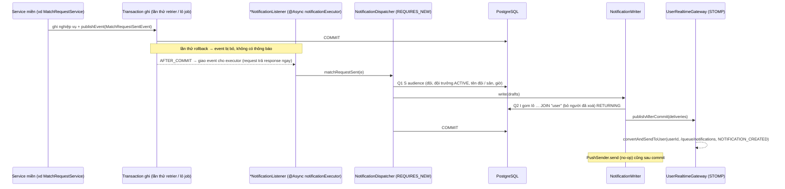

# Processing Flow — Thông báo in-app & tín hiệu realtime cá nhân

| Mục | Giá trị |
|---|---|
| Mã chức năng | `NOTIFICATION-001` |
| Phạm vi tầng | Backend (Spring Boot REST API + kênh STOMP của MATCH-001). Frontend: ngoài phạm vi repo này |
| Repo/stack | ArenaFlow-be · Spring Boot 4.0.9 · PostgreSQL ≥ 18 · Flyway |
| Quy ước áp dụng | `docs/agent/non-functional-standards.md` (N_DETAIL=3, N_LIST=4, N_WRITE=6; §4.1 flush; §5 tác vụ dài) · ADR-0011, ADR-0012, ADR-0014, ADR-0015 |
| Ràng buộc dữ liệu | V1–V10 + `V11__notification.sql` (`Component_Class_Design.md` §5.1) |
| Tác giả / Ngày / Phiên bản | solution-architect · 2026-11-16 · v1.0 (baseline) · hiện tại **v2.0** (solution-architect · 2026-11-21) — lịch sử thay đổi: `CHANGELOG.md` |

## 1. Tổng quan

4 endpoint REST + 1 destination STOMP (`/user/queue/notifications`) + listener của 28 event (`Component_Class_Design.md` §4.3) + tác vụ định kỳ (nhắc trước trận và nhắc mercenary đánh giá trận ngoài trong lần chạy 5 phút của `MatchLifecycleScheduler`; xoá hạn lưu hằng ngày). Mã lỗi: `API_Spec.md` §5; người nhận theo event: `Component_Class_Design.md` §4.3; cấu hình: §8 tài liệu đó. Ký hiệu: **S** SELECT, **I** INSERT, **U** UPDATE, **D** DELETE. `now` lấy từ `Clock` một lần ở đầu mỗi request / lần dispatch / lần chạy job. Không gọi HTTP ra ngoài (`PushSender` no-op).

### 1.1. Thứ tự kiểm (nguồn duy nhất)

| Endpoint | Thứ tự |
|---|---|
| 2.1 | Bean validation (`before` + `after` cùng lúc, `limit`, định dạng) → `400 VALIDATION_ERROR` → người gọi không tồn tại / đã xoá → `404 USER_001` → có con trỏ mà mốc không phải thông báo của người gọi trong 30 ngày → `422 NOTIFICATION_002` |
| 2.2, 2.4 | `404 USER_001` |
| 2.3 | `400 VALIDATION_ERROR` (path) → `404 USER_001` → `404 NOTIFICATION_001` → đã đọc → `204` (không ghi) |

## 2. Sequence

### 2.1. Event → thông báo → frame (mọi event của `Component_Class_Design.md` §4.3)



### 2.2. Nhắc trước trận (mỗi lô)

```mermaid
sequenceDiagram
    participant J as MatchLifecycleScheduler (5 phút)
    participant N as NotificationJobService
    participant DB as PostgreSQL
    participant W as NotificationWriter
    J->>N: sendDueStartReminders() (sau các tác vụ MATCH-001, MERCENARY-001; sendDueRatingReminders() cùng mẫu)
    loop tối đa max-batches-per-run, mỗi lô một TransactionTemplate
        N->>DB: Q1 INSERT match_reminder … SELECT trận đến hạn … ON CONFLICT DO NOTHING RETURNING
        alt không dòng nào
            N-->>J: dừng
        else
            N->>DB: Q2 S người nhận (đội trưởng hai đội + mercenary APPROVED)
            N->>W: write(drafts) → Q3 I gom lô RETURNING
            N->>DB: COMMIT → frame NOTIFICATION_CREATED
        end
    end
```

### 2.3. Gửi tin chat → `CONVERSATION_ACTIVITY` (MATCH-001 2.16 — sửa)

```mermaid
sequenceDiagram
    participant C as Client người gửi
    participant CS as ConversationService.send (retrier)
    participant DB as PostgreSQL
    participant RG as ChatRealtimeGateway
    participant UG as UserRealtimeGateway
    C->>CS: POST /conversations/{id}/messages
    CS->>DB: Q1 S findContext (+ id đội trưởng / người giải tán hai bên — cột mới)
    CS->>DB: Q2 I tin nhắn
    CS->>RG: publishAfterCommit(conversationId, MESSAGE_CREATED)
    CS->>UG: publishAfterCommit(người xem được − người gửi, CONVERSATION_ACTIVITY)
    CS-->>C: 201
    Note over RG,UG: chỉ sau commit; lần thử rollback không đẩy
```

## 3. Luồng chi tiết

### Bảng số truy vấn

| # | Endpoint / tác vụ | Truy vấn | Tổng / Ngưỡng |
|---|---|---|---|
| 2.1 | `GET /profile/notifications` | S người gọi (+ cờ đã xoá + mốc con trỏ, 1 câu), S trang (`limit + 1`) | 2 / L4 ✅ |
| 2.2 | `GET /profile/notifications/unread-count` | S cờ đã xoá + đếm chưa đọc (1 câu) | 1 / D3 ✅ |
| 2.3 | `POST /profile/notifications/{id}/read` | S ngữ cảnh (cờ đã xoá + thông báo của người gọi), U `is_read` (bỏ khi đã đọc) | 1–2 / W6 ✅ |
| 2.4 | `POST /profile/notifications/read` | S cờ đã xoá, U mọi thông báo chưa đọc (1 câu) | 2 / W6 ✅ |
| Listener | Mỗi event (`Component_Class_Design.md` §4.3) | S audience (bỏ với `UserRegisteredEvent`, `UserVerificationChangedEvent`, danh sách id rỗng, rút đơn `PENDING`), I gom lô `RETURNING` (bỏ khi không có người nhận) | 0–2 / event (W6 tham chiếu ✅) |
| Job | Nhắc trước trận (mỗi lô) | I claim `match_reminder` `RETURNING`, S người nhận, I thông báo gom lô | 3 / lô |
| Job | Nhắc mercenary đánh giá trận ngoài (mỗi lô) | I claim `match_reminder` (`AFTER_END`) `RETURNING`, S mercenary `APPROVED`, I thông báo gom lô | 3 / lô |
| Job | Xoá cuộc trò chuyện (mỗi lô) | D `conversation` (+ `CASCADE` tin) | 1 / lô |
| Job | Xoá thông báo (mỗi lô); xoá dấu nhắc | D | 1 / lô; 1 |
| MATCH-001 2.16 | Gửi tin (sửa) | Không đổi: S ctx (+4 cột), I tin | 2 / W6 ✅ (không đổi) |
| STOMP | `SUBSCRIBE /user/queue/notifications` | Không truy vấn | 0 |

**NFS gate:** 4/4 endpoint trong ngưỡng. Listener chạy sau commit trên executor riêng → **không** cộng vào số truy vấn của API nguồn (vd MATCH-001 2.8, 2.10 vẫn 6/W6; USER-001 2.12 vẫn 6/6). Đọc trang không có câu `count` (cursor — `api-convention.md` §7.2).

### 3.1. `GET /profile/notifications` (readOnly) — 2.1
`visibleFrom = now − 30 ngày`. Q1 `findCaller(callerId, before ?: after, visibleFrom)` → không dòng / `callerDeleted` → `USER_001`; có con trỏ mà `anchorCreatedAt = null` → `NOTIFICATION_002` (mốc của người khác, quá 30 ngày, đã xoá, hoặc id không tồn tại — cùng một mã, không tiết lộ). Q2 theo (`unreadOnly`, con trỏ) chọn 1 trong 6 câu cố định (`findLatest|Before|After` × `…Unread`), `LIMIT limit + 1` → `hasMore`; `after` trả cũ nhất trước. Mapper → `NotificationHistoryResponse`.

### 3.2. `GET /profile/notifications/unread-count` (readOnly) — 2.2
Q1 `countUnread(callerId, visibleFrom)` → rỗng / `callerDeleted` → `USER_001` → `{unreadCount}`. Đếm trên index partial `idx_notification_recipient_unread` (≤ số thông báo 30 ngày của một người).

### 3.3. `POST /profile/notifications/{id}/read` (`@Transactional`) — 2.3
Q1 `findReadContext` → `USER_001` → `!found` → `NOTIFICATION_001` → `isRead` → return (204, 1 truy vấn) → Q2 `markRead(callerId, id)` (`WHERE id = :id AND recipient_user_id = :callerId AND NOT is_read` — lọc người nhận cả ở câu ghi; 0 dòng khi request song song đã đánh dấu: vẫn 204).

### 3.4. `POST /profile/notifications/read` (`@Transactional`) — 2.4
Q1 `findCaller(callerId, null, visibleFrom)` → `USER_001` → Q2 `markAllRead(callerId, visibleFrom)`. Thông báo commit **sau** câu U (listener đồng thời) giữ chưa đọc — đúng hợp đồng `API_Spec.md` 2.4.

### 3.5. Dispatch event (listener → dispatcher, `REQUIRES_NEW`)
1. Listener nhận event trên `notificationExecutor` (sau commit của transaction phát). Hàng đợi đầy → chạy trên luồng phát (`CallerRunsPolicy`).
2. Dispatcher: Q1 audience theo bảng `Component_Class_Design.md` §4.3 → lọc theo cột "Bỏ qua khi", bỏ dòng `captainUserId = null` → `NotificationTexts` dựng `title`/`body` → `List<NotificationDraft>`.
3. `NotificationWriter.write`: khử trùng (người nhận, loại, đối tượng) → rỗng: return → Q2 `insertAllReturning` (người nhận đã xoá bị loại trong câu) → `publishAfterCommit` frame + `PushSender` sau commit.
4. Lỗi bất kỳ ở bước 2–3 → transaction dispatch rollback (không frame); listener log `ERROR` (tên event + id payload), **không** thử lại, không ném (thông báo của event đó bị mất — chấp nhận, ADR-0011 "không bền").

### 3.6. Job nhắc — `NotificationJobService.sendDueStartReminders()`, `sendDueRatingReminders()`
**Nhắc trước trận:** `now` cố định đầu lần chạy; `leadEnd = now + 2 giờ`. Mỗi lô một `TransactionTemplate`: Q1 `claimDueStart(now, leadEnd, 7200, batchSize)` → rỗng: dừng → Q2 `findGameAudience(matchIds, ['CONFIRMED'], externalMatchIds)` → drafts (`REMINDER_BEFORE_MATCH`; đội trưởng: `MATCH` / `matchId`; mercenary: `MERCENARY_APPLICATION` / `applicationId`) → Q3 `write` → commit. Dừng khi lô < `batch-size` hoặc hết `max-batches-per-run`. Lỗi một lô → rollback cả dấu nhắc lẫn thông báo của lô → log `ERROR`, dừng tác vụ; lần chạy sau (≤ 5 phút) claim lại (vẫn trong cửa sổ trừ khi trận đã bắt đầu). Log `INFO` số trận / số thông báo.
- Trận "đến hạn" (`Component_Class_Design.md` §4.7): khoảng `(now, now + 2h]` theo giờ bắt đầu; job chạy mỗi 5 phút → trận được nhắc khi còn từ ~2 giờ đến ~1 giờ 55 phút (trễ tối đa một chu kỳ + thời gian chạy).
- Kèo ghép lúc còn 1 giờ 59 phút: `responded_at` / `final_confirmed_at` > `start − 2h` → không bao giờ thoả → không nhắc (Q4). Trận ngoài khai báo lúc còn < 2 giờ: tương tự theo `created_at` (Q12).

**Nhắc mercenary đánh giá trận ngoài:** mỗi lô: Q1 `claimDueRating(now, now − 24h, batchSize)` (trận ngoài `SCHEDULED` đã qua giờ kết thúc trong 24 giờ, có đơn `APPROVED`, chưa có dấu `AFTER_END`) → rỗng: dừng → Q2 `findGameAudience([], [], externalMatchIds)` → drafts `MERCENARY_RATING_REMINDER` (`MERCENARY_APPLICATION` / `applicationId`) → Q3 `write` → commit. Kèo trên hệ thống: nhắc mercenary qua `MatchArchivedEvent` (dispatch §3.5), không qua job này.

### 3.7. Job xoá hạn lưu — `RetentionScheduler` (hằng ngày 03:30)
1. `purgeExpiredConversations`: `cutoff = now − 90 ngày`; mỗi lô một transaction: D `deleteExpiredConversations(cutoff, 200)` (subquery `FOR UPDATE OF c SKIP LOCKED`) → dừng khi < 200 hoặc hết lô. Ví dụ BR-N01: kèo hết hạn 12/11/2026 (`expires_at`) → cuộc trò chuyện xoá ở lần chạy đầu tiên sau 10/02/2027.
2. `purgeExpiredNotifications`: `cutoff = now − 30 ngày`; D theo lô 1000.
3. `purgeOldReminders`: D dấu nhắc `sent_at < now − 30 ngày`.
- Lỗi một tác vụ → log `ERROR`, tác vụ sau vẫn chạy; lần chạy sau làm tiếp (điều kiện thời gian là cổng tự nhiên, DELETE idempotent). Log `INFO` số dòng xoá mỗi loại.
- Cuộc trò chuyện đang mở trên màn hình bị xoá → API chat trả `404 CHAT_002` (MATCH-001 §1.6 đã công bố).

### 3.8. `CONVERSATION_ACTIVITY` (MATCH-001 2.16 — sửa `ConversationService.send`)
Sau `save` tin: `viewers` từ ctx — bên `TEAM`: `partyXCaptainUserId` (đội trưởng `ACTIVE` hiện tại), `partyXDisbandedBy` khi đội `DISBANDED`; bên `USER`: `partyBId` → bỏ `null`, bỏ `callerId`, khử trùng → `userRealtimeGateway.publishAfterCommit(viewers, ConversationActivity(conversationId, messageId, createdAt))`. Cùng điểm với `MESSAGE_CREATED` (sau commit của lần thử thành công). Không truy vấn thêm.

## 4. Transaction Boundary

Bảng: `Component_Class_Design.md` §4.10. Điểm chính:
- Transaction phát event (miền nguồn) và transaction tạo thông báo **tách rời**: dispatch lỗi không rollback thao tác nghiệp vụ; thao tác nghiệp vụ rollback không tạo thông báo.
- Dispatcher `REQUIRES_NEW`: chạy đúng cả trên `notificationExecutor` (không có transaction sẵn) lẫn trên luồng phát khi `CallerRunsPolicy` (đang ở pha sau commit của transaction cũ — ADR-0011 quy tắc 4).
- Frame và `PushSender` chỉ chạy trong `afterCommit` của transaction ghi thông báo (không gửi cho dòng bị rollback); giữ transaction ngắn, không I/O ngoài trong transaction (NFS §5).
- Isolation mặc định READ_COMMITTED.

## 5. Concurrency & Locking

| Tình huống | Xử lý |
|---|---|
| Hai thiết bị cùng đánh dấu một thông báo / tất cả | `UPDATE … WHERE NOT is_read` idempotent; không `@Version`, không retrier |
| Đánh dấu tất cả trong lúc listener ghi thông báo mới | Dòng commit sau câu U giữ chưa đọc (READ COMMITTED) — đúng `API_Spec.md` 2.4 |
| Hai instance chạy job nhắc cùng lúc | Unique `idx_match_reminder_match` / `…_external`: câu INSERT thứ hai chờ commit của câu thứ nhất rồi `DO NOTHING` → mỗi trận nhắc một lần `[cần xác nhận #6]` |
| Job nhắc và người dùng huỷ kèo đồng thời | Claim không khoá `match`; audience (Q2) lọc `status = 'CONFIRMED'` / `'SCHEDULED'` → huỷ commit trước Q2 thì không nhắc; huỷ commit sau Q2 → có thể vừa nhắc vừa báo huỷ (cửa sổ ms, chấp nhận) |
| Hai instance xoá hạn lưu | `FOR UPDATE … SKIP LOCKED` trong subquery → mỗi dòng xoá bởi một bên |
| Xoá cuộc trò chuyện khi có người đang gửi tin | `DELETE conversation` khoá dòng; `INSERT conversation_message` (FK `KEY SHARE`) chờ rồi lỗi FK → 2.16 trả lỗi hệ thống hiếm. Chỉ xảy ra với cuộc trò chuyện đã quá 90 ngày sau khi trận kết thúc (vẫn nhắn được với đội đã ghép — MATCH-001 §1.6) `[cần xác nhận #9]` |
| Chuyển quyền đội trưởng đúng lúc listener chạy | Người nhận = đội trưởng tại lúc Q1 audience (lúc tạo thông báo, vài giây sau sự kiện) — có thể là đội trưởng mới. Đúng ngữ nghĩa đã chốt (user 2026-11-16, đóng #11): "đội trưởng" = đội trưởng lúc tạo thông báo, không phải lúc sự kiện; event nguồn không mang id đội trưởng |

Thứ tự khoá: job xoá khoá `conversation` → `conversation_message` (cascade) — cùng chiều với `ON DELETE CASCADE`; không khoá `match`, `team`, `"user"`.

## 6. Error Handling

| Trường hợp | Xử lý |
|---|---|
| Mã lỗi API | `API_Spec.md` §5; thứ tự §1.1 |
| Lỗi trong dispatcher (SQL, dữ liệu thiếu) | Rollback dispatch, log `ERROR` (tên event + id), không thử lại, không ảnh hưởng thao tác gốc |
| Hàng đợi executor đầy | `CallerRunsPolicy` — chạy đồng bộ trên luồng phát |
| Gửi frame STOMP lỗi | Log `WARN` (loại frame + id), bỏ qua (đã commit) |
| `PushSender` lỗi (sau này) | Log `WARN`, không ảnh hưởng thông báo in-app đã lưu |
| Lỗi một lô job | Rollback lô, log `ERROR`, dừng tác vụ đó; lần chạy sau làm tiếp |

## 7. Idempotency

- 2.3, 2.4: idempotent theo bản chất (`is_read = TRUE`).
- Listener: mỗi event giao **một** lần trong process (ADR-0011 quy tắc 4) → không cần khoá chống trùng; không retry → không tạo trùng. Hệ quả: mất thông báo nếu crash giữa commit nguồn và dispatch (ADR-0011, ADR-0015).
- Nhắc trước trận: dấu `match_reminder` (unique) — claim và ghi thông báo cùng transaction lô → rollback lô thì cả dấu lẫn thông báo bị bỏ, lần sau nhắc lại; commit thì không nhắc lần hai.
- Xoá hạn lưu: DELETE theo điều kiện thời gian — chạy lại vô hại.

## 8. Performance & Index

| Bảng | Index | Dùng cho | Nguồn |
|---|---|---|---|
| `notification` | `(recipient_user_id, created_at DESC, id DESC)` | 2.1 không lọc (con trỏ row comparison), mốc con trỏ | V11 |
| `notification` | `(recipient_user_id, created_at DESC, id DESC) WHERE NOT is_read` | 2.1 `unreadOnly`, 2.2, 2.4 | V11 (thay `idx_notification_recipient` V1) |
| `notification` | `(created_at)` | Job xoá 30 ngày | V1 |
| `match_reminder` | unique `(match_id, kind)` / `(external_match_id, kind)` partial; `(sent_at)` | Chống nhắc trùng, `NOT EXISTS` khi claim; xoá dấu cũ | V11 |
| `match` | `(match_start_time) WHERE status = 'CONFIRMED'` | Claim nhắc: kèo đã ghép bắt đầu trong 2 giờ | V11 |
| `external_match` | `(match_start_time) WHERE status = 'SCHEDULED'` | Claim nhắc trận ngoài | V11 |
| `external_match` | `(match_end_time) WHERE status = 'SCHEDULED'` | Claim nhắc mercenary đánh giá trận ngoài | V11 |
| `"user"` | `(id) WHERE role = 'ADMIN' AND deleted_at IS NULL` | Danh sách Admin (cảnh báo địa điểm, tranh chấp) | V11 |
| `match_request` | unique `(match_id) WHERE status = 'ACCEPTED'`; `(match_id, status)` | Thời điểm ghép khi claim; audience yêu cầu `SUPERSEDED` / `EXPIRED` | V7, V1 |
| `pairing` | `(match_id, final_confirmed_at) WHERE status = 'CONFIRMED'`; `(match_id, status)` | Thời điểm ghép; audience thương lượng `SUPERSEDED` / `EXPIRED` | V1 |
| `team_member` | `(team_id, role, status)` | Đội trưởng `ACTIVE` của đội | V1 |
| `mercenary_recruitment` | `(match_id)`, `(external_match_id)` partial | Mercenary `APPROVED` của trận (nhắc) | V10 |
| `conversation` | `(match_id)`, `(external_match_id)` partial; PK | Job xoá: join trận theo khoá ngoại | V10 |
| `rating` | unique `(match_id, …)` / `(application_id, rater_type)` | `hasRated`, `ratedBy*` | V9, V10 |

- Mọi audience là một câu cố định, số dòng ≤ số người nhận của một event (đội trưởng hai đội, đội bị thay thế / hết hạn của một kèo, đơn của một tin / một trận, Admin) — không vòng lặp truy vấn.
- Ghi gom lô một câu bất kể số người nhận (`unnest`).
- Đo SQL thật bằng `NfsQueryCountTest` cho 2.1–2.4 và một dispatch tiêu biểu (`MatchConfirmedEvent` luồng A có yêu cầu bị thay thế) trước khi merge.

## 9. Rủi ro vận hành

| Rủi ro | Ảnh hưởng | Xử lý |
|---|---|---|
| Event không bền + executor bất đồng bộ | Crash / tắt máy sau commit nguồn mà chưa dispatch → mất thông báo; tắt máy chờ tối đa 30s cho hàng đợi | Chấp nhận MVP (ADR-0011, ADR-0015); mất thông báo gây khiếu nại → outbox |
| Kết nối DB do executor + scheduler + request | HikariCP mặc định 10; executor tối đa 4 + scheduler 5 + request → có thể chờ kết nối khi tải cao [Inference — chưa đo]. Hàng đợi đầy → `CallerRunsPolicy` chạy dispatcher trên luồng phát: luồng đó giữ **2 kết nối** cùng lúc (kết nối của transaction nguồn chưa trả về pool trong pha sau commit + kết nối `REQUIRES_NEW`) [Inference — chưa đo] | Đo khi load test; chỉnh `executor.max-size` hoặc pool Hikari `[cần xác nhận #12]` |
| Job 180 ngày (VENUE-001) phát nhiều `VenueAdminAlertEvent` một lúc | Nhiều việc trong hàng đợi; mỗi Admin nhận nhiều thông báo | Hàng đợi 1000 + `CallerRunsPolicy`; số Admin nhỏ |
| Xoá cuộc trò chuyện quét toàn bảng `conversation` mỗi ngày | Thời gian chạy tăng theo số cuộc trò chuyện còn trong hạn lưu [Inference — chưa đo] | Đo `EXPLAIN ANALYZE` khi > 100 000 cuộc; khi đó thêm cột "hết hạn lưu lúc" trên `conversation` ghi lúc trận kết thúc `[cần xác nhận #10]` |
| Một cuộc trò chuyện nhiều tin | `CASCADE` xoá nhiều dòng trong một lô | Lô 200 cuộc; tin ≤ 1000 ký tự |
| Nhiều instance (kênh realtime) | Frame chỉ tới client kết nối cùng instance (simple broker) | Một instance (ADR-0014); khi nhiều instance → broker relay |
| Mất frame | Badge / danh sách lệch | FE gọi 2.2 khi kết nối lại / foreground (`API_Spec.md` §1.4) |
| Job nhắc dừng > 2 giờ | Trận trong khoảng đó không được nhắc | Log mỗi lần chạy; chấp nhận |

## 10. Danh sách [cần xác nhận]

Đánh số toàn thiết kế: 1–8 ở `Component_Class_Design.md` §12, 9–12 ở đây. #11 đã đóng (user, 2026-11-16).

| # | Nội dung | Loại |
|---|---|---|
| 9 | Gửi tin đúng lúc job xoá cuộc trò chuyện (đã quá 90 ngày sau trận) → lỗi FK, 2.16 trả 500 hiếm; đề xuất: chấp nhận (BR-N01 coi cuộc trò chuyện đã hết hạn lưu) | Không chặn |
| 10 | Hiệu năng quét `conversation` hằng ngày [Inference] | Không chặn — đo khi dữ liệu lớn |
| 11 | ~~"Đội trưởng lúc xảy ra" (Q2) được hiểu là lúc listener chạy (vài giây sau) — chuyển quyền đúng khoảng đó thì đội trưởng mới nhận~~ — **Đã chốt (user, 2026-11-16):** "đội trưởng" = đội trưởng **tại lúc tạo thông báo** (lúc listener chạy), không phải đúng lúc sự kiện; không đổi event nguồn. Đã ghi ở `API_Spec.md` §1.2; §5 tài liệu này (bảng Concurrency); ADR-0015; SRS: `Component_Class_Design.md` §11 S6 | Đã đóng |
| 12 | Kích thước executor so với HikariCP pool; `CallerRunsPolicy` làm luồng phát giữ 2 kết nối DB cùng lúc (§9) — nhiều luồng request / job cùng rơi vào nhánh này có thể cạn pool (chờ / timeout lấy kết nối) [Inference] | Không chặn — đo khi load test (gồm kịch bản hàng đợi đầy); chỉ ghi rủi ro, chưa đổi thiết kế |
