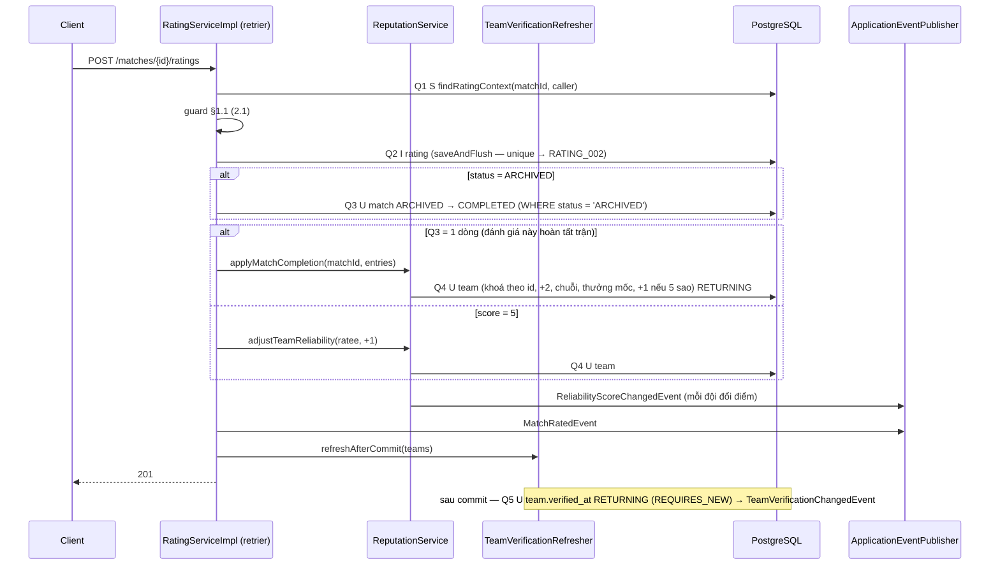
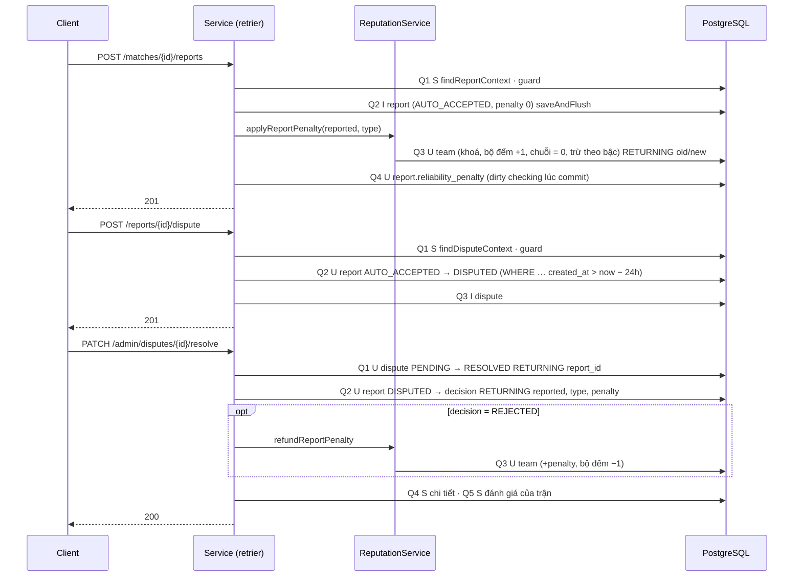

# Processing Flow — Đánh giá, report, tranh chấp & uy tín đội

| Mục | Giá trị |
|---|---|
| Mã chức năng | `REPUTATION-001` |
| Phạm vi tầng | Backend (Spring Boot REST API). Frontend: ngoài phạm vi repo này |
| Repo/stack | ArenaFlow-be · Spring Boot 4.0.9 · PostgreSQL ≥ 18 · Flyway |
| Quy ước áp dụng | `docs/agent/non-functional-standards.md` (N_DETAIL=3, N_LIST=4, N_WRITE=6; §4.1 flush) · ADR-0003 (+ Sửa đổi 2026-11-10, 2026-11-12) · ADR-0011, ADR-0012, ADR-0013 (+ Sửa đổi 2026-11-12) · retrier: VENUE-001 `Component_Class_Design.md` §4.9 |
| Ràng buộc dữ liệu | V1–V7 + `V8__reputation_rating_report_dispute.sql` (`Component_Class_Design.md` §5.1) |
| Tác giả / Ngày / Phiên bản | solution-architect · 2026-11-13 · v1.0 |

## 1. Tổng quan

Thao tác ghi (2.1, 2.3, 2.5, 2.8) chạy trong `ConcurrencyConflictRetrier.execute(MATCH_014, …)`: mỗi lần thử một transaction; ghi dữ liệu nghiệp vụ + điểm uy tín cùng transaction (ADR-0013); event phát trong transaction, giao sau commit (ADR-0011); refresh huy hiệu chạy sau commit trong transaction riêng (`Component_Class_Design.md` §4.8). API đọc `readOnly`.

### 1.1. Thứ tự guard (nguồn duy nhất)

| Endpoint | Thứ tự |
|---|---|
| 2.1 | Bean Validation → `MATCH_001` → `TEAM_002` (caller không captain ACTIVE phía nào — gồm đội đã giải tán, BR-T10) → `TEAM_015` (phía caller làm captain có `teamStatus = INACTIVE`) → `RATING_003` (captain cả hai) → `RATING_001` (status ∉ {`ARCHIVED`, `COMPLETED`}) → `RATING_002` (phía mình đã đánh giá; race → unique index) |
| 2.2 | Bean Validation → `MATCH_001` → `TEAM_001` → `TEAM_016` (DISBANDED) → `TEAM_015` (INACTIVE) → `TEAM_002` (`TeamGuard.requireActiveCaptain`) → `MATCH_009` (`teamId` không thuộc trận) |
| 2.3 | Bean Validation → `MATCH_001` → `TEAM_002` (như 2.1) → `TEAM_015` (như 2.1) → `REPORT_005` → `REPORT_002` (status ∉ {`ARCHIVED`, `COMPLETED`, `CANCELLED`} hoặc không có đội đã ghép) → `REPORT_003` (`CANCELLED` và loại ≠ `BAD_COMMUNICATION`) → `REPORT_004` (đã report loại này; race → unique index) |
| 2.4 | Bean Validation → `TEAM_001` → `TEAM_016` (DISBANDED) → `TEAM_015` (INACTIVE) → `TEAM_002` (`TeamGuard.requireActiveCaptain`) |
| 2.5 | Bean Validation → `REPORT_001` → `TEAM_016` (`reportedTeamStatus = DISBANDED`) → `TEAM_015` (`reportedTeamStatus = INACTIVE`) → `TEAM_002` (caller không captain ACTIVE đội bị report) → `REPORT_006` (≠ `NOSHOW`) → `REPORT_008` (status ≠ `AUTO_ACCEPTED` hoặc đã có tranh chấp) → `REPORT_007` (`now ≥ createdAt + 24h`) |
| 2.6 | `AUTH_004` (filter) → Bean Validation |
| 2.7 | `AUTH_004` → `DISPUTE_001` |
| 2.8 | `AUTH_004` → Bean Validation → CAS 0 dòng: `DISPUTE_001` (không tồn tại) / `DISPUTE_002` (đã `RESOLVED`) |
| 2.9 | `TEAM_001` |

## 2. Sequence

### 2.1. Đánh giá (2.1)

### 2.2. Report (2.3) và tranh chấp (2.5, 2.8)

## 3. Luồng chi tiết

### Bảng số truy vấn

| # | Endpoint | Truy vấn (một lần thử) | Tổng / Ngưỡng |
|---|---|---|---|
| 2.1 | `POST …/ratings` — hoàn tất trận | S context, I rating, U match `COMPLETED`, U team (2 đội, 1 câu) · sau commit: U `verified_at` | 5 / W6 ✅ |
| 2.1 | `POST …/ratings` — trận đã `COMPLETED` | S context, I rating, (U team +1 khi 5 sao) · sau commit: U `verified_at` | 3–4 / W6 ✅ |
| 2.2 | `GET …/ratings` | S trận + đánh giá, S captain ctx | 2 / D3 ✅ |
| 2.3 | `POST …/reports` | S context, I report, U team (trừ điểm), U report (`reliability_penalty`) · sau commit: U `verified_at` | 5 / W6 ✅ |
| 2.4 | `GET /teams/{id}/reports` | S captain ctx, S trang, S count | 3 / L4 ✅ |
| 2.5 | `POST /reports/{id}/dispute` | S context, U report CAS, I dispute | 3 / W6 ✅ |
| 2.6 | `GET /admin/disputes` | S trang, S count | 2 / L4 ✅ |
| 2.7 | `GET /admin/disputes/{id}` | S chi tiết, S đánh giá của trận | 2 / D3 ✅ |
| 2.8 | `PATCH …/resolve` — `REJECTED` | U dispute CAS, U report, U team (hoàn), S chi tiết, S đánh giá · sau commit: U `verified_at` | 6 / W6 ✅ (= ngưỡng) |
| 2.8 | `PATCH …/resolve` — `CONFIRMED` | U dispute CAS, U report, S chi tiết, S đánh giá | 4 / W6 ✅ |
| 2.8 | CAS 0 dòng | U dispute CAS, S `existsById` | 2 |
| 2.9 | `GET /teams/{id}/reputation` | S thống kê (1 câu) | 1 / D3 ✅ |
| Job | huy hiệu (mỗi lô) | S id lô, U `verified_at` RETURNING | 2 / lô |

**NFS gate:** 9/9 endpoint trong ngưỡng; truy vấn sau commit (refresh huy hiệu) **được tính** vào request. **2.8 `REJECTED` chạm đúng W6** — mọi truy vấn thêm phải gộp hoặc xin duyệt. Đã gộp: trận + quyền captain hai phía + đã đánh giá/report thành 1 câu context (2.1, 2.3); report + đội + quyền + tranh chấp thành 1 câu (2.5); điểm hai đội lúc hoàn tất thành 1 câu; refresh huy hiệu gom mọi đội của request thành 1 câu. Retry nhân số truy vấn tối đa 3 (ADR-0003).

### 3.1. `POST /matches/{id}/ratings` (retrier `MATCH_014`)

Lần thử: Q1 `findRatingContext` → guard §1.1 → rater = phía `callerXCaptain = true`, ratee = phía còn lại → Q2 `saveAndFlush(Rating)` → `status = ARCHIVED`: Q3 `completeIfArchived` → kết quả:

| Q3 | `isNoShow` | Ghi điểm (Q4) |
|---|---|---|
| 1 dòng | `false` | `applyMatchCompletion`: rater `(completes, bonus 0)`, ratee `(completes, bonus = score == 5 ? 1 : 0)` |
| 1 dòng | `true` | `applyMatchCompletion`: chỉ rater `(completes, bonus 0)`; đội vắng không đổi — điểm và chuỗi (user chốt B) |
| 0 dòng / trận đã `COMPLETED` | `false`, `score = 5` | `adjustTeamReliability(ratee, +1, FIVE_STAR_RATING, ratingId, false)` |
| 0 dòng / trận đã `COMPLETED` | khác | Không |

→ `MatchRatedEvent(matchCompleted = Q3 == 1)` → `refreshAfterCommit({ratee} ∪ {rater nếu Q3 == 1})` → response từ entity + `matchStatus = COMPLETED`.

**Bảng kiểm `applyCompletion` (test bắt buộc):**

| Trước (điểm, chuỗi, bộ đếm bùng) | Report chưa bác trong trận | Entry | Sau |
|---|---|---|---|
| 80, 0, 0 | Không | completes, bonus 0 | 82, 1, 0 |
| 80, 4, 2 | Không | completes, bonus 0 | 87 (+2+5), 5, **0** (mọi bộ đếm về 0) |
| 80, 9, 0 | Không | completes, bonus 1 | 93 (+2+10+1), 10, 0 |
| 80, 14, 0 | Không | completes, bonus 0 | 87 (+2+5), 15, 0 (Q10) |
| 80, 3, 1 | Có | completes, bonus 0 | 82 (+2), **0**, 1 |
| 99, 4, 0 | Không | completes, bonus 0 | 100 (chặn), 5, 0 |

### 3.2. `GET /matches/{id}/ratings` (readOnly)
Q1 `findMatchRatingRows(matchId)` → rỗng → `MATCH_001` → Q2 `requireActiveCaptain(teamId, caller)` → `MATCH_009` → `given`/`received` theo `Component_Class_Design.md` §4.1.

### 3.3. `POST /matches/{id}/reports` (retrier `MATCH_014`)
Lần thử: Q1 `findReportContext(matchId, caller, type)` → guard §1.1 → reporter = phía caller, reported = phía còn lại → Q2 `saveAndFlush(Report)` (bắt `idx_report_unique` → `REPORT_004`) → Q3 `applyReportPenalty(reported, type, reportId)` → `report.setReliabilityPenalty(points)` → `TeamReportedEvent` → `refreshAfterCommit({reported})` → Q4 `UPDATE report` lúc commit → response (`direction = SENT`, `reliabilityPenalty = null`).

**Bảng kiểm `applyReportPenalty`:**

| Trước (điểm, bộ đếm loại) | Loại | Sau (điểm, bộ đếm) | `points` |
|---|---|---|---|
| 80, 0 | `NOSHOW` | 75, 1 | 5 |
| 80, 3 | `NOSHOW` | 65, 4 | 15 |
| 80, 7 | `NOSHOW` | 65, 8 | 15 (bậc 4+) |
| 3, 0 | `NOSHOW` | 0, 1 | 3 (chặn 0) |
| 80, 1 | `BAD_PLAY` | 75, 2 | 5 |

Mọi trường hợp: `clean_streak = 0`.

### 3.4. `GET /teams/{id}/reports` (readOnly)
Q1 `requireActiveCaptain(teamId, caller)` → Q2 `findTeamReports(teamId, direction, limit, offset)` → Q3 `countTeamReports` → mapper (trạng thái hiệu lực, `canDispute` — `Component_Class_Design.md` §4.10, `now` từ `Clock`).

### 3.5. `POST /reports/{id}/dispute` (retrier `MATCH_014`)
Lần thử: Q1 `findDisputeContext(reportId, caller)` → guard §1.1 → Q2 `markDisputed(reportId, now, now − 24h)` → 0 dòng → `ConcurrencyConflictException` → thử lại (lần sau guard trả `REPORT_008` khi report đã đổi trạng thái, `REPORT_007` khi vừa quá hạn) → Q3 `save(Dispute)` (flush lúc commit) → `ReportDisputedEvent`. Không đổi điểm → không refresh huy hiệu.

### 3.6. `GET /admin/disputes`, `GET /admin/disputes/{id}` (readOnly)
2.6: Q1 `findAdminDisputes(status, oldestFirst = status == PENDING, …)` → Q2 `countAdminDisputes`. 2.7: Q1 `findAdminDisputeDetail` → `DISPUTE_001` → Q2 `findByMatchIdAndRaterTypeOrderByCreatedAtAsc(matchId, TEAM)`.

### 3.7. `PATCH /admin/disputes/{id}/resolve` (retrier `MATCH_014`)
Lần thử: Q1 `resolveIfPending(id, decision, note.trim(), adminId, now)` → rỗng → Q1b `existsById` → `DISPUTE_001`/`DISPUTE_002` (mã trực tiếp, không thử lại — trạng thái nguồn đã đổi là kết luận đủ, ADR-0003 Sửa đổi 2026-11-10) → Q2 `applyDecision(reportId, decision, now)` (rỗng → `IllegalStateException`: dispute `PENDING` luôn đi với report `DISPUTED`) → `REJECTED`: Q3 `refundReportPenalty(reportedTeamId, type, penalty, reportId)` + `refreshAfterCommit({reported})` → `DisputeResolvedEvent` → `adminAuditLog.afterCommit(...)` → Q4 `findAdminDisputeDetail` → Q5 đánh giá của trận → response.

### 3.8. `GET /teams/{id}/reputation` (readOnly)
Q1 `findReputation(teamId, now)` (thống kê `Component_Class_Design.md` §5.3) → rỗng → `TEAM_001` → mapper.

### 3.9. Huy hiệu sau commit, job
- `refreshAfterCommit` → `afterCommit()` → `refreshNow(ids)` (`REQUIRES_NEW`): 1 câu `refreshVerification` → event mỗi đội đổi.
- Không listener `MatchCancelledEvent` (user chốt A1): huỷ kèo / rút yêu cầu đã chấp nhận của MATCH-001 không thêm truy vấn; huy hiệu đội huỷ cập nhật ở job hằng ngày.
- Job 03:00: lặp `findIdsForVerification(afterId, 500)` → `refreshVerification` mỗi lô một transaction; log `INFO` số đội cấp/thu hồi; lỗi một lô log `ERROR`, lô sau vẫn chạy.

## 4. Transaction Boundary

Như `Component_Class_Design.md` §4.11. Isolation mặc định (READ COMMITTED). Retrier: mỗi lần thử một `TransactionTemplate`; lần thử rollback không giao event, không chạy refresh huy hiệu, không ghi audit.

## 5. Concurrency & Locking

**Thứ tự khoá** (chống vòng chờ): `match` → `team` (theo id tăng dần) ở 2.1 và ở huỷ kèo MATCH-001; `report` → `team` ở 2.3 (INSERT report lấy `KEY SHARE` trên `match` — tương thích `NO KEY UPDATE` của 2.1); `dispute` → `report` → `team` ở 2.8; `report` → `dispute` ở 2.5. Không luồng nào khoá `team` rồi mới khoá `match`/`report`/`dispute` → không thấy vòng chờ [Inference — chưa tái hiện; deadlock nếu có được retrier thử lại].

| Tình huống | Xử lý |
|---|---|
| Hai đội trưởng đánh giá cùng lúc trận `ARCHIVED` | Hai INSERT khác dòng; Q3 của bên sau chờ khoá `match` rồi đánh giá lại `status = 'ARCHIVED'` → 0 dòng → chỉ bên trước cộng điểm hoàn tất; bên sau chỉ cộng +1 (5 sao) |
| Cùng đội gửi đánh giá hai lần đồng thời | Bên sau đụng `idx_rating_unique` → `RATING_002` |
| Report trùng đồng thời | `idx_report_unique` → `REPORT_004` (bên sau rollback, không trừ điểm) |
| Report gửi gần như cùng lúc với đánh giá hoàn tất trận | `applyCompletion` khoá `team` rồi kiểm report bằng snapshot đầu câu → có thể chưa thấy report vừa commit → chuỗi +1 thay vì 0 cho trận đó `[cần xác nhận #12]`. Điểm trừ report vẫn đúng (cộng dồn nguyên tử) |
| Tranh chấp sát hạn 24h | Hạn kiểm trong chính câu CAS (`created_at > now − 24h`) |
| Hai Admin quyết định cùng tranh chấp | CAS `status = 'PENDING'` → bên sau `DISPUTE_002` |
| Hoàn điểm khi bộ đếm đã về 0 do mốc chuỗi | `GREATEST(0, count − 1)` |
| Đội sửa thông tin (`@Version`) cùng lúc điểm thay đổi | Cột uy tín `updatable = false`, `UPDATE` nguyên tử không tăng `version` (ADR-0013) → không xung đột |
| Refresh huy hiệu chạy đồng thời (request + job) | Câu có điều kiện "trạng thái đổi" → bên sau 0 dòng, không event trùng |

## 6. Error Handling

Như USER-001 §6. Bổ sung trong service: `DataIntegrityViolationException` của `idx_rating_unique` → `RATING_002`; `idx_report_unique` → `REPORT_004`. Vi phạm CHECK khác (lỗi lập trình) → 500 `SYS_005`. `IllegalStateException` (`applyCompletion` thiếu dòng, `applyDecision` rỗng, `adjustReliability` 0 dòng) → 500, log `ERROR`. Refresh huy hiệu lỗi → log `WARN` (id đội), không ảnh hưởng response. Không log `reason`, `evidence`, `comment`, `note`.

## 7. Idempotency

- 2.1, 2.3: unique index → gửi lặp trả `RATING_002` / `REPORT_004`, không cộng/trừ hai lần. Không hỗ trợ `Idempotency-Key`.
- 2.5: CAS + unique `idx_dispute_report` → gửi lặp `REPORT_008`.
- 2.8: CAS → gửi lặp `DISPUTE_002`, không hoàn điểm hai lần.
- Refresh huy hiệu, job: tính lại từ dữ liệu gốc, chạy lặp không đổi kết quả.

## 8. Performance & Index

- Index: `Component_Class_Design.md` §5.1.
- Thống kê đội (2.9, huy hiệu) quét mọi trận của một đội qua `idx_match_author_status` + `idx_match_opponent_status`, report qua tiền tố `match_id` của `idx_report_unique`, sao qua `idx_rating_ratee` — chi phí tăng theo số trận của **một** đội (hàng trăm), không theo toàn bảng; số câu cố định 1. Khi số trận/đội lớn (đo bằng `EXPLAIN ANALYZE` trên dữ liệu thật) → cân nhắc cột đếm có lại (ngược Q5) — ghi ở ADR-0013 §Cần theo dõi.
- Job huy hiệu: 2 câu/lô × (số đội / 500); mỗi câu `refreshVerification` tính thống kê cho 500 đội (LATERAL) — đo thời gian lô khi dữ liệu thật > 10 000 đội.
- MATCH-001 không đổi số truy vấn: 2.5 `CONFIRMED` 4–5, 2.10 `ACCEPTED` 6/W6 (không nghe `MatchCancelledEvent` — user chốt A1).

## 9. Danh sách [cần xác nhận]

Đánh số toàn thiết kế: 1–4 và 13 đã đóng (`Component_Class_Design.md` §13), 5–11 `Component_Class_Design.md` §12, 12 ở đây.

| # | Nội dung | Loại |
|---|---|---|
| 12 | Race report ↔ hoàn tất trận làm chuỗi trận sạch +1 cho trận đáng lẽ "không sạch" (cửa sổ vài ms). Phương án nếu cần chặt: 2.3 khoá `match` (`FOR KEY SHARE` → đổi thành `FOR NO KEY UPDATE`) trước khi khoá `team` để tuần tự hoá với 2.1 (+0 câu nếu gộp vào context) | Không chặn — đề xuất chấp nhận |
