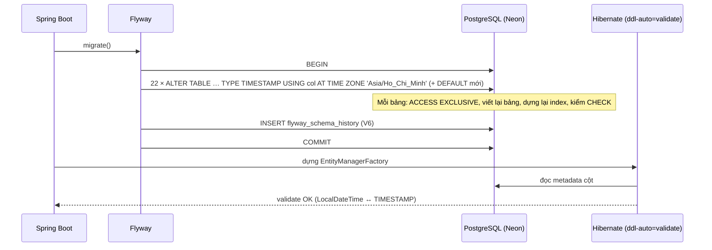
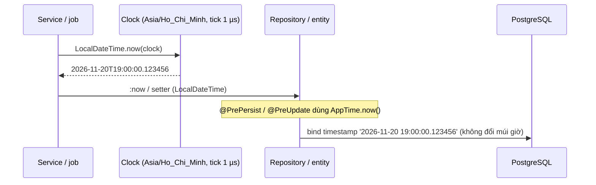

# Processing Flow — Ngày giờ theo giờ Việt Nam, không kèm múi giờ

| Mục | Giá trị |
|---|---|
| Mã chức năng | `SYSTEM-002` |
| Phạm vi tầng | Backend (Spring Boot REST API). Frontend: ngoài phạm vi repo này |
| Repo | ArenaFlow-be |
| Ràng buộc dữ liệu | `docs/agent/non-functional-standards.md` (3/4/6) — không đổi số truy vấn |
| Tác giả / Ngày / Phiên bản | solution-architect · 2026-11-21 · v1.0 (baseline) · hiện tại **v1.1** (solution-architect · 2026-11-21) — lịch sử thay đổi: `CHANGELOG.md` |

## 1. Tổng quan luồng

Không có endpoint mới. Thay đổi nằm ở (1) migration V6 chạy một lần khi ứng dụng khởi động, (2) kiểu dữ liệu trên đường ghi/đọc thời gian, (3) nguồn "bây giờ" của service/job. Thành phần, kiểu, cột: `Component_Class_Design.md`.

## 2. Số truy vấn

Không endpoint nào thêm/bớt câu SQL: chỉ đổi kiểu tham số bind (`LocalDateTime` thay `OffsetDateTime`) và kiểu cột. Số truy vấn của USER-001, USER-002, VENUE-001 và các mã chưa code giữ như `Processing_Flow.md` của từng mã. Kiểm bằng `NfsWriteQueryCountTest` hiện có (CCD §8 #8).

## 3. Luồng chi tiết

### 3.1. Khởi động ứng dụng có V6

- Flyway chạy V6 trong **một transaction** (DDL PostgreSQL có transaction) → lỗi bất kỳ (vd CHECK) → rollback toàn bộ, schema giữ V5, ứng dụng không khởi động.
- Thời gian khoá: bảng ghi lại toàn bộ; dữ liệu hiện nhỏ (DB dev). Production: đo số dòng các bảng lớn nhất trước khi deploy (bước 6 §4.1). Bảng lớn trong tương lai không áp dụng vì V6 chạy một lần.

### 3.2. Ghi thời điểm

- Giá trị trong response sau thao tác ghi trùng giá trị đọc lại (cùng độ chính xác micro giây).
- Câu native không dùng `now()` trần; DEFAULT DB chỉ dùng cho INSERT thủ công/test và tính bằng `now() AT TIME ZONE 'Asia/Ho_Chi_Minh'` — đúng giờ VN với mọi TimeZone phiên (CCD §2.3).

### 3.3. Đọc và trả JSON

DB `TIMESTAMP` → projection/entity `LocalDateTime` → DTO `LocalDateTime` (mapper gán thẳng) → Jackson `"2026-11-20T19:00:00.123456"`. Không chuyển múi giờ ở bước nào.

### 3.4. Request có thời điểm (mã chưa code: MATCH-001 2.1 `startsAt`, lọc `startsAtFrom`…)

1. Jackson / Spring converter parse chuỗi không offset → `LocalDateTime`.
2. Chuỗi có `Z`/offset → lỗi parse → `GlobalExceptionHandler` → `400 VALIDATION_ERROR` + `field` (CCD §2.5).
3. So với "bây giờ" (vd `startsAt ≥ now + 1 giờ`) dùng `LocalDateTime.now(clock)` — cùng hệ giờ VN.

### 3.5. Job theo lịch

- `@Scheduled(cron, zone = AppTime.ZONE_ID)`: 03:00 là 03:00 giờ VN bất kể timezone máy chủ.
- Mốc: `now = LocalDateTime.now(clock)`; ngưỡng `now.minusDays(180)` (cảnh báo địa điểm), `now.plusHours(2)` (nhắc trước trận), `now.minusDays(90)` (xoá chat), `now.minusDays(30)` (ẩn thông báo) — truyền vào câu native dạng tham số. Việt Nam không có giờ mùa hè → cộng/trừ giờ địa phương = cộng/trừ thời lượng thật.

## 4. Triển khai và rollback

### 4.1. Thứ tự (user chốt 2026-11-21)

**Môi trường hiện có:** chỉ có môi trường dev — Render dev (nhánh deploy `chore/docker-render-deploy`, chỉ để deploy, **không** merge vào `main`) chạy trên **DB Neon dev dùng chung**. **Chưa có production.** Quy trình "FE trước, BE sau" (`API_Spec.md` §6) và điểm khôi phục Neon áp **khi có production** (bước P1–P4).

| Bước | Việc | Ghi chú |
|---|---|---|
| 1 | Thiết kế SYSTEM-002 được duyệt (sau `architect-reviewer`) | — |
| 2 | Nhánh `chore/agent-framework-vietnam-local-datetime`: sửa quy ước (CCD §9 (a)) → PR | Trước khi code |
| 3 | PR #75 (VENUE-001, V5) merge vào `main`; rebase `feature/SYSTEM-002-local-datetime`; sửa USER-001, VENUE-001, `docs/database/` (CCD §9.1) | **Đã xong 2026-11-21** (`61aa100`) |
| 4 | Tạo Neon branch riêng cho SYSTEM-002 từ branch của DB dev (đã ở V5) | Xin phép user (tạo và xoá) |
| 5 | Developer code + test (TDD); integration test chạy trên Neon branch ở bước 4 (CCD §8) — V6 chỉ áp lên branch đó | **NEVER** chạy integration test SYSTEM-002 vào DB dev chung trước bước 7 |
| 6 | Báo trước các nhánh đang mở và người dùng Render dev / FE dev → **xin phép user ngay lúc merge** cho cả bước 7 và 8 → merge PR SYSTEM-002 | Merge chỉ khi user yêu cầu. Bước 6–8 làm **liền trong cùng một phiên** |
| 7 | Trong cùng phiên: chạy **một** lệnh từ `main` để áp V6 lên DB dev chung (vd một integration test đã có, nạp `.env.dev` như hub `CLAUDE.md` §8) | Thay đổi database dùng chung (`external-knowledge.md` mục Quy tắc). **Ngoại lệ:** từ lúc merge tới khi V6 áp xong, **không** chạy integration test nào từ `main` ngoài lệnh này — mọi integration test chạy từ `main` đều tự áp V6 (Flyway lúc khởi động). Từ lúc này nhánh chưa rebase không khởi động được trên DB dev (CCD §1.1) |
| 8 | Trong cùng phiên, **ngay sau bước 7:** rebase `chore/docker-render-deploy` lên `main` mới rồi deploy lại Render dev | Bản Render đang chạy là code cũ (`OffsetDateTime`) trên schema V6 — lần khởi động lại sau đó sẽ lỗi validate [Inference]. Push nhánh deploy (`--force-with-lease`) chỉ khi user yêu cầu (đã xin ở bước 6); không tạo PR, không merge vào `main` |
| 9 | Kiểm trên DB dev và Render dev: câu kiểm CCD §8 #2 (a) (`table_schema = current_schema()`, 0 cột `timestamp with time zone`); mẫu vài bản ghi cũ đã +7 giờ; response không còn `Z` | — |
| 10 | Các nhánh đang mở rebase lên `main` trước khi chạy integration test tiếp | — |
| 11 | Xoá Neon branch của bước 4 | Xin phép user |
| P1 | *(Khi có production)* FE phát hành bộ đọc nhận cả hai dạng (`API_Spec.md` §6 bước 1) | **FE trước, BE sau** — BE không deploy production trước bước này |
| P2 | *(Khi có production)* Tạo điểm khôi phục Neon (branch/snapshot của branch production); đo số dòng các bảng lớn nhất | Xin phép user **mỗi lần** |
| P3 | *(Khi có production)* Deploy BE (một artifact chứa V6 + code mới) | Flyway áp V6 lúc khởi động (§3.1) |
| P4 | *(Khi có production)* Kiểm như bước 9 | — |

Bản cũ và bản mới **không** chạy song song an toàn: code cũ (`OffsetDateTime`) gặp schema V6 → Hibernate validate lỗi khi khởi động; nên deploy kiểu dừng-rồi-chạy (một instance) [Inference — theo hành vi `ddl-auto=validate`, chưa chạy thử].

### 4.2. Rollback

| Tình huống | Cách xử lý |
|---|---|
| V6 lỗi khi khởi động | Flyway tự rollback (§3.1); deploy lại bản cũ — schema vẫn V5 |
| Lỗi logic sau khi V6 đã áp | **Sửa tiến** (hotfix trên code mới) |
| Bắt buộc quay về code cũ | Không có migration ngược tự động (Flyway forward-only). Phương án: (a) khôi phục điểm Neon (production: bước P2; DB dev: chưa có điểm khôi phục riêng — cần user cho phép tạo trước bước 7 nếu muốn) — mất dữ liệu ghi sau đó; hoặc (b) script đảo ngược đã thử trên Neon branch: `ALTER … TYPE TIMESTAMPTZ USING col AT TIME ZONE 'Asia/Ho_Chi_Minh'`, DEFAULT `NOW()`, xoá dòng V6 khỏi `flyway_schema_history`, rồi deploy bản cũ. Cả hai chỉ làm khi user yêu cầu rõ |

## 5. Transaction, đồng thời, idempotency

- Không đổi ranh giới transaction, khoá lạc quan, retrier của mã nào.
- V6 chạy đúng một lần theo version (Flyway). **NEVER** chạy tay V6: chạy lại trên schema đã V6 **không lỗi** mà **lệch −7 giờ âm thầm** — cột đã là `timestamp` nên `col AT TIME ZONE 'Asia/Ho_Chi_Minh'` hiểu giá trị là giờ VN và cho ra `timestamptz`, rồi phép ép kiểu gán về `timestamp` đổi theo TimeZone phiên (GMT) → mỗi giá trị lùi 7 giờ [Inference — theo quy tắc `AT TIME ZONE` và ép kiểu gán của PostgreSQL, chưa chạy thử].

## 6. Danh sách [cần xác nhận]

Không còn. Các điểm của luồng này đã chốt 2026-11-21 (user) — `Component_Class_Design.md` §10.
