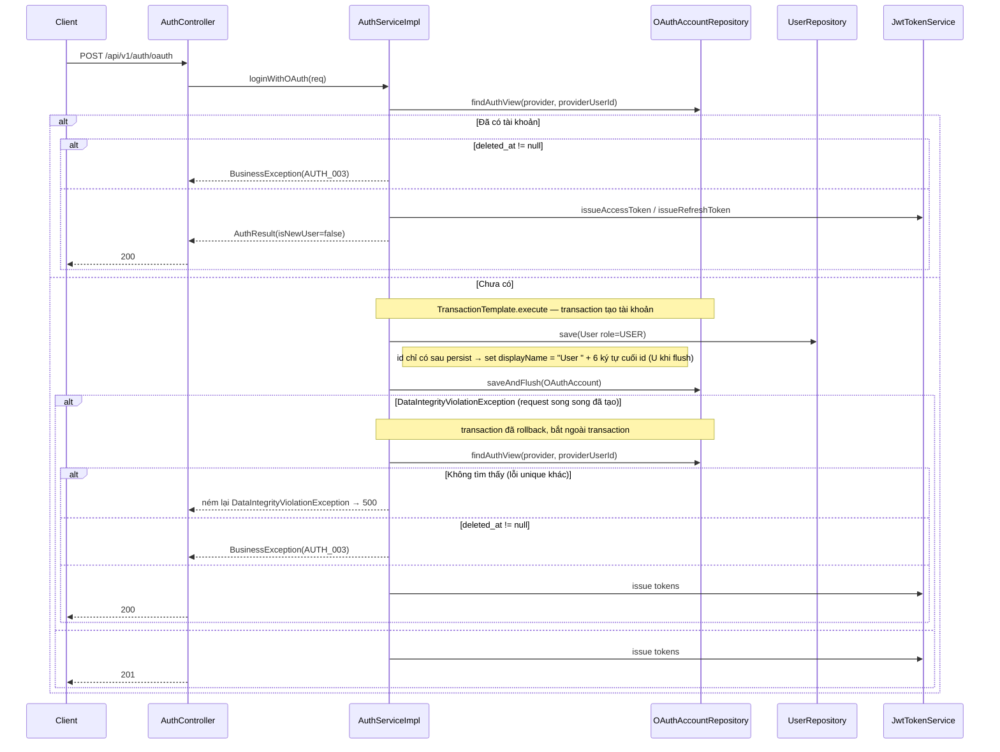
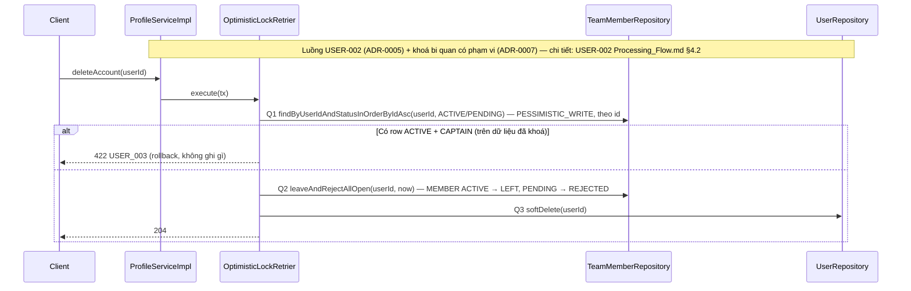
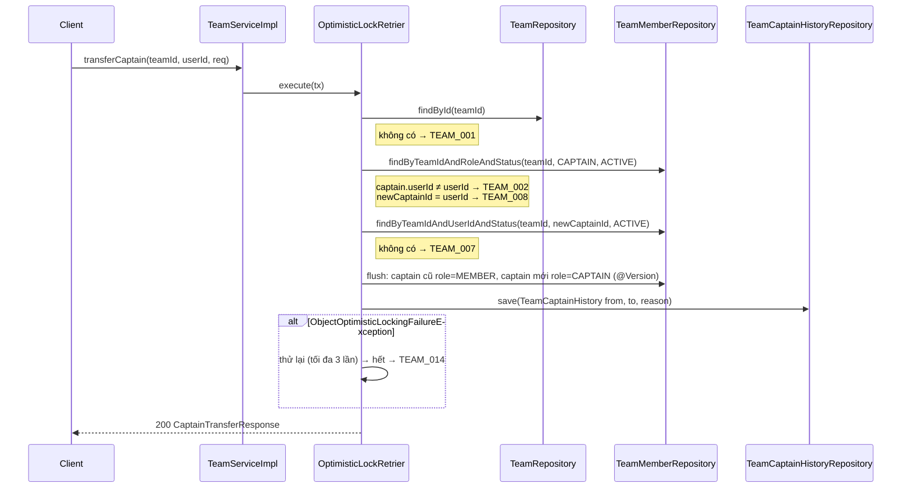

# Processing Flow — User & Team Management

| Mục | Giá trị |
|---|---|
| Mã chức năng | `USER-001` |
| Phạm vi tầng | Backend (Spring Boot REST API) |
| Repo/stack | ArenaFlow-be · Spring Boot 4.0.9 · PostgreSQL · Flyway |
| Quy ước áp dụng | `docs/agent/non-functional-standards.md` (N_DETAIL=3, N_LIST=4, N_WRITE=6) |
| Ràng buộc dữ liệu | `V1__initial_schema.sql` + V2/V3 (`Component_Class_Design.md` §6) · ADR-0001/0002/0003 |
| Tác giả / Ngày / Phiên bản | solution-architect · 2026-11-02 · v1.0 (baseline) · hiện tại **v3.3** (developer · 2026-11-06) — lịch sử thay đổi: `CHANGELOG.md` |

## 1. Tổng quan luồng

21 endpoint (`API_Spec.md` §2). Mã lỗi chỉ ghi mã — nghĩa ở `API_Spec.md` §4. Class/method: `Component_Class_Design.md` §4–§5.

**Thứ tự guard cho thao tác ghi:** nguồn duy nhất là USER-002 `API_Spec.md` §2.1a (theo từng endpoint; từ USER-002 thay thứ tự cũ "Bean Validation → JWT → tồn tại → quyền → trạng thái").

**Số truy vấn** tính cho **một lần thử**; retry optimistic lock (§5) chạy lại toàn bộ lần thử trong transaction mới. Xác thực JWT không truy vấn DB.

## 2. Sequence Diagrams

### 2.1. Đăng ký-hoặc-đăng nhập OAuth (mock) — `POST /auth/oauth`

### 2.2. Xoá tài khoản — `DELETE /profile`

### 2.3. Chuyển quyền đội trưởng — `POST /teams/{teamId}/captain/transfer`

## 3. Luồng chi tiết theo endpoint

Ký hiệu truy vấn: **S** = SELECT, **I** = INSERT, **U** = UPDATE. Loại: D = đọc chi tiết (≤3), L = danh sách (≤4), W = ghi (≤6).

| # | Endpoint | Guard & logic (theo thứ tự) | Truy vấn | Tổng / Ngưỡng |
|---|---|---|---|---|
| 2.1 | `POST /auth/oauth` | S tài khoản theo `(provider, providerUserId = email)` join user → có: `deleted_at` ≠ null → AUTH_003, ngược lại 200 · không có (trong `TransactionTemplate`): I user, I oauth_account (`saveAndFlush`), U user (tên mặc định cần id sinh lúc persist) → 201 · vi phạm unique (song song) → rollback, S lại ngoài transaction đã rollback → 200 (tài khoản đã xoá → AUTH_003; không thấy → ném lại → 500) | Tạo mới: S, I, I, U (đo ≤ 6 bằng `AuthServiceIntegrationTest`) · Đụng độ: ước tính S, I, I (lỗi), S — dựa vào thứ tự flush INSERT trước UPDATE của Hibernate, **chưa đo** | 4 / W6 ✅ |
| 2.2 | `POST /auth/send-otp` | Validate phone, trả `expiresIn=300` | — | 0 ✅ |
| 2.3 | `POST /auth/verify-otp` | Như 2.1 với `provider=phone`, `provider_user_id=phone`; user mới set `phone_number=phone` · đụng độ có thể đến từ `idx_user_phone_unique` (I user lỗi) hoặc unique oauth_account | Như 2.1 | ≤ 4 / W6 ✅ |
| 2.4 | `POST /auth/refresh` | Parse refresh token (AUTH_002) → S user theo id (không có/đã xoá → AUTH_003) → cấp cặp token mới với `role` hiện tại | S | 1 / D3 ✅ |
| 2.5 | `GET /profile` | S `ProfileView` (user LEFT JOIN ward LEFT JOIN province, `deleted_at IS NULL`) → USER_001 · S oauth_account theo user | S, S | 2 / D3 ✅ |
| 2.6 | `PATCH /profile` | S user chưa xoá (USER_001) → nếu có `wardId`: S ward+province (USER_002) → áp field ≠ null → U user (`saveAndFlush`) → S `ProfileView` (response qua `ProfileMapper`, khớp DB — đọc lại có chủ đích, lệch NFS §3 đã duyệt: `Component_Class_Design.md` §10) → S oauth_account (response) | S, (S ward), U, S, S | 4–5 / W6 ✅ |
| 2.7 | `DELETE /profile` | Xem §2.2 (luồng USER-002) · còn captain ACTIVE → `USER_003`, không đổi trạng thái đội · **membership MEMBER ACTIVE → LEFT, PENDING → REJECTED** · khoá membership ACTIVE/PENDING trước (`PESSIMISTIC_WRITE`, ADR-0007) rồi kiểm captain trên dữ liệu đã khoá · `softDelete` chỉ khi `deleted_at IS NULL` → gọi lại vẫn 204 · Access token còn hiệu lực tối đa 1h (JWT stateless, grace period chấp nhận cho MVP) | S (khoá), U, U | 3 / W6 ✅ |
| 2.8 | `POST /teams` | S user chưa xoá (USER_001; lấy `displayName` làm `captainName`) → I team (`skill_levels` JSON) → I team_member (CAPTAIN, ACTIVE, `joined_at=now`) → I history (`from=null`) · response dựng từ dữ liệu đã có (`memberCount=1`) | S, I, I, I | 4 / W6 ✅ |
| 2.9 | `GET /teams/{id}` | S `TeamDetailView` (team LEFT JOIN captain ACTIVE LEFT JOIN user, `memberCount` bằng subquery COUNT) → TEAM_001 | S | 1 / D3 ✅ |
| 2.10 | `GET /teams` | S `TeamSummaryView` trang (join như 2.9, lọc status) · S COUNT | S, S | 2 / L4 ✅ |
| 2.11 | `PATCH /teams/{id}` | *(retry)* S team (TEAM_001) → **DISBANDED (TEAM_016) → INACTIVE (TEAM_015)** → S captain ACTIVE, so `userId` (TEAM_002; đội vừa giải tán → TEAM_016) → áp field → U team (`@Version`) → S `TeamDetailView` (response) | S, S, U, S (đo: `NfsQueryCountTest`) | 4 / W6 ✅ |
| 2.12 | `POST /teams/{id}/invitations` | *(retry, từ USER-002)* S team kèm `OPTIMISTIC_FORCE_INCREMENT` (TEAM_001) → **DISBANDED (TEAM_016) → INACTIVE (TEAM_015)** → S captain (TEAM_002; đội vừa giải tán → TEAM_016) → S user mời chưa xoá (USER_001) → S tồn tại PENDING/ACTIVE (TEAM_003) → I team_member PENDING (`saveAndFlush`; vi phạm unique → TEAM_003) → U `team.version` lúc commit (lệch version → retry, hết retry → TEAM_014) | S, S, S, S, I, U (đo: `NfsWriteQueryCountTest`) | 6 / W6 ✅ (bằng ngưỡng) |
| 2.13 | `POST /invitations/{id}/accept` | *(retry)* S team_member theo id (TEAM_004) → `userId` ≠ caller (TEAM_005) → S team → **DISBANDED (TEAM_016) → INACTIVE (TEAM_015)** → member.status ≠ PENDING (TEAM_006) → U status=ACTIVE, `joined_at=now` (`@Version`) → S `MemberView` (response) | S, S, U, S | 4 / W6 ✅ |
| 2.14 | `POST /invitations/{id}/reject` | *(retry)* S team_member theo id (TEAM_004) → `userId` ≠ caller (TEAM_005) → S team → **DISBANDED (TEAM_016) → INACTIVE (TEAM_015)** → member.status ≠ PENDING (TEAM_006) → U status=REJECTED → 204 không body | S, S, U (đo: `NfsQueryCountTest`) | 3 / W6 ✅ |
| 2.15 | `POST /teams/{id}/captain/transfer` | Xem §2.3 · **sau S team: DISBANDED (TEAM_016) → INACTIVE (TEAM_015)** · captain/member mới không thấy vì đội vừa giải tán → đọc lại trạng thái → TEAM_016 (USER-002) | S, S, S, U, U, I | 6 / W6 ✅ (bằng ngưỡng) |
| 2.16 | `GET /teams/{id}/captain/history` | S tồn tại team (TEAM_001) → S trang history (LEFT JOIN user from/to, che tên đã xoá) → S COUNT | S, S, S | 3 / L4 ✅ |
| 2.17 | `GET /teams/{id}/members` | S tồn tại team (TEAM_001) → S trang member ACTIVE JOIN user → S COUNT | S, S, S | 3 / L4 ✅ |
| 2.18 | `POST /teams/{id}/members/leave` | *(retry)* S team (TEAM_001) → **DISBANDED (TEAM_016)**, INACTIVE vẫn rời được → S member ACTIVE của caller (TEAM_010; đội vừa giải tán → TEAM_016) → role CAPTAIN (TEAM_009) → U status=LEFT, `left_at=now` | S, S, U | 3 / W6 ✅ |
| 2.19 | `PATCH /admin/teams/{id}/mark-inactive` | *(retry)* S team (TEAM_001) → **DISBANDED (TEAM_016)** → đã INACTIVE (TEAM_011) → U status, `inactive_reason` (`@Version`) → S `TeamDetailView` | S, U, S | 3 / W6 ✅ |
| 2.20 | `PATCH /admin/teams/{id}/reactivate` | *(retry)* S team (TEAM_001) → **DISBANDED (TEAM_016)** → đang ACTIVE (TEAM_012) → S captain ACTIVE (TEAM_013; đội vừa giải tán → TEAM_016) → U status=ACTIVE, `inactive_reason=null` → S `TeamDetailView` | S, S, U, S | 4 / W6 ✅ |
| 2.21 | `GET /admin/teams` | Như 2.10, mặc định `ALL`, thêm `inactive_reason` | S, S | 2 / L4 ✅ |

**Kết luận:** 21/21 endpoint trong ngưỡng. Endpoint 2.12 (từ USER-002) và 2.15 dùng đủ 6/6 — mọi bổ sung truy vấn cho 2.12/2.15 (audit, notification…) phải gộp hoặc xin duyệt vượt ngưỡng. Thêm guard INACTIVE cho 2.11/2.12/2.13/2.14/2.15 không tăng truy vấn (dùng kết quả đã SELECT).

## 4. Transaction Boundary

| Nhóm | Ranh giới | Ghi chú |
|---|---|---|
| Đọc (2.5, 2.9, 2.10, 2.16, 2.17, 2.21, 2.4) | `@Transactional(readOnly = true)` trên method service | — |
| Đăng ký-hoặc-đăng nhập (2.1, 2.3) | Method service **không** có `@Transactional`; phần tạo tài khoản (I user, I oauth_account, U user) chạy trong `TransactionTemplate.execute` | Đụng độ unique (`oauth_account (provider, provider_user_id)`; 2.3 thêm `idx_user_phone_unique`) → transaction tạo tài khoản rollback → `DataIntegrityViolationException` bắt **ngoài** transaction đó → đọc lại bằng truy vấn riêng → 200 (đọc lại rỗng → ném lại exception → 500). Không dùng `@Transactional` cho cả method vì sau lỗi unique transaction bị rollback-only, không đọc lại được |
| Ghi không retry (2.6, 2.8) | `@Transactional` trên method service | — |
| Ghi có retry (2.7, 2.11, 2.12 — từ USER-002, 2.13, 2.14, 2.15, 2.18, 2.19, 2.20) | Mỗi lần thử = 1 transaction do `OptimisticLockRetrier` mở qua `TransactionTemplate` | Method service **không** có `@Transactional` |

Isolation: `READ_COMMITTED` (mặc định PostgreSQL). Không gọi dịch vụ ngoài trong transaction (OTP/OAuth đều mock).

## 5. Concurrency & Locking (ADR-0003)

- `@Version` trên `Team`, `TeamMember`. `User` không có version — cập nhật hồ sơ theo last-write-wins (chỉ chủ tài khoản sửa).
- `OptimisticLockRetrier.execute(Supplier<T>)`: bắt `ObjectOptimisticLockingFailureException` → thử lại ngay, không backoff, **tối đa 3 lần thử** (1 lần đầu + 2 lần retry) → hết → `BusinessException(TEAM_014)`. Lỗi nghiệp vụ (`BusinessException`) không retry.
- ~~**Tín hiệu "cập nhật thiếu dòng" của 2.7**~~ — bỏ ở USER-002: `deleteAccount` không còn `markInactiveByIds`; ~~race với chuyển quyền (R1) xử lý bằng kiểm captain lần 2~~ (v2.0). **v2.1:** race của xoá tài khoản xử lý bằng khoá bi quan có phạm vi — ngoại lệ của ADR-0003 theo ADR-0007 (USER-002 `Processing_Flow.md` §4.2).
- Bulk update (2.7) tự `SET version = version + 1` để các transaction đang giữ bản cũ phát hiện xung đột.

| Kịch bản song song | Kết quả |
|---|---|
| Captain chuyển quyền 2 lần cùng lúc | Cùng cập nhật dòng captain cũ → 1 thành công; lần thử lại của request kia thấy caller không còn là captain → TEAM_002 |
| Chuyển quyền cho X trong khi X rời đội | Cùng dòng `team_member` của X → 1 thắng; bên thua retry → TEAM_007 hoặc TEAM_010 |
| Accept 2 lần cùng lời mời | 1 thành công; lần sau → TEAM_006 |
| Mời trùng cùng lúc | Unique index `(team_id, user_id) WHERE status IN ('PENDING','ACTIVE')` → TEAM_003 |
| Captain xoá tài khoản khi có người vừa accept | Luôn `USER_003` bất kể thứ tự — captain ACTIVE bị chặn, không phụ thuộc số thành viên (USER-002, AC scenario 4) |
| Đăng ký cùng email/số điện thoại song song | Unique `(provider, provider_user_id)` (phone: thêm `idx_user_phone_unique`) → request sau trả 200 với tài khoản đã tạo |

## 6. Error Handling

`BusinessException(ErrorCode)` → `GlobalExceptionHandler` → envelope `error` (`api-convention.md` §4.4). Ánh xạ exception framework: `Component_Class_Design.md` §10. Không trả stack trace; log `WARN` cho 4xx nghiệp vụ, `ERROR` cho 5xx; **NEVER** log token/secret (`security-backend.md`).

## 7. Idempotency

| Endpoint | Cơ chế |
|---|---|
| 2.1, 2.3 | Khoá tự nhiên `(provider, provider_user_id)`: gọi lại → 200 cùng tài khoản |
| 2.12 | Unique index lời mời → gọi lại → TEAM_003 |
| 2.13, 2.14 | Chuyển trạng thái chỉ từ PENDING → gọi lại → TEAM_006 |
| 2.7 | `softDelete` có điều kiện `deleted_at IS NULL` → gọi lại → 204 |
| 2.19, 2.20 | Kiểm trạng thái → gọi lại → TEAM_011 / TEAM_012 |
| 2.8 | **Không idempotent** — trùng tên được phép; `Idempotency-Key` hoãn (`API_Spec.md` §6 #4) |

## 8. Performance Considerations

**N+1:** mọi danh sách/chi tiết dùng native query + projection, join user/ward trong cùng câu; `memberCount` bằng subquery COUNT trong câu chính; không lazy-load. Developer MUST đo số truy vấn thật bằng log SQL / Hibernate statistics trong integration test (NFS §3).

**Index:**

| Bảng | Index | Dùng cho | Nguồn |
|---|---|---|---|
| `team` | `(status, created_at DESC)` | 2.10, 2.21 lọc + sort | V2 (thay `idx_team_status`) |
| `team_member` | unique `(team_id, user_id) WHERE status IN ('PENDING','ACTIVE')` | 2.12, tra member theo team+user | V2 (thay `idx_team_member_active`) |
| `team_member` | `(team_id, role, status)` | captain, đếm ACTIVE, 2.17 | V1 |
| `team_member` | `(user_id, status)` | 2.7 | V1 |
| `team_captain_history` | `(team_id, transferred_at DESC)` | 2.16 | V1 |
| `oauth_account` | unique `(provider, provider_user_id)`, `(user_id)` | 2.1, 2.3, 2.5 | V1 |
| `"user"` | `(ward_id)` | FK | V2 (đổi tên từ `idx_user_district`) |
| `administrative_unit` | `(parent_id)` | join province | V1 |

## 9. Ghi chú thiết kế

- **Retry 3 lần thử:** 1 lần đầu + 2 lần retry (tổng 3 lần).
- **Membership khi xóa tài khoản:** Chuyển ACTIVE→LEFT, PENDING→REJECTED (để user đã xóa không xuất hiện trong danh sách thành viên/lời mời).
- **Grace period sau xóa tài khoản:** JWT stateless → access token còn hiệu lực tối đa 1h. Refresh bị chặn (`AUTH_003`); các API hồ sơ trả `USER_001`. Chấp nhận cho MVP (client tự xóa token local).
- **Dữ liệu Neon DB:** Trống — V2 migration chạy được (DROP `team_tag`, bỏ `district`).
