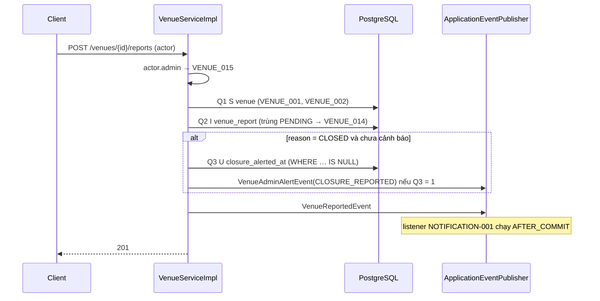
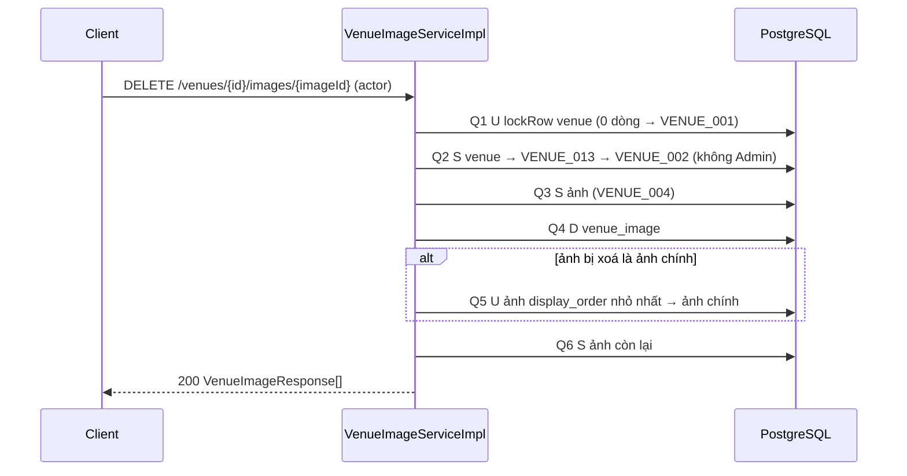

# Processing Flow — Quản lý địa điểm sân

| Mục | Giá trị |
|---|---|
| Mã chức năng | `VENUE-001` |
| Phạm vi tầng | Backend (Spring Boot REST API). Frontend: ngoài phạm vi repo này |
| Repo/stack | ArenaFlow-be · Spring Boot 4.0.9 · PostgreSQL · Flyway · Cloudinary |
| Quy ước áp dụng | `docs/agent/non-functional-standards.md` (N_DETAIL=3, N_LIST=4, N_WRITE=6; §4.1 flush; §5 tác vụ dài) · ADR-0003 (+ Sửa đổi 2026-11-09) · retrier: USER-001 `Processing_Flow.md` §5 + `Component_Class_Design.md` §4.9 |
| Ràng buộc dữ liệu | V1 + `V5__venue_management.sql` (`Component_Class_Design.md` §5.1) |
| Tác giả / Ngày / Phiên bản | solution-architect · 2026-11-09 · v1.0 (baseline) |

## 1. Tổng quan

13 endpoint + 2 scheduled job + 2 method port cho MATCH-001. Mã lỗi: `API_Spec.md` §4; thứ tự guard: `API_Spec.md` §2.0; giá trị cấu hình: `Component_Class_Design.md` §8. Số truy vấn tính cho **một lần thử**; JWT không truy vấn DB. Ký hiệu: **S** SELECT, **I** INSERT, **U** UPDATE, **D** DELETE. Không gọi HTTP ra ngoài trong request; Admin API Cloudinary chỉ trong job dọn (§3.16).

## 2. Sequence

### 2.1. Thêm ảnh (2.4 → Cloudinary → 2.5)

```mermaid
sequenceDiagram
    participant C as Client
    participant IS as VenueImageServiceImpl
    participant SG as ImageUploadSigner
    participant DB as PostgreSQL
    participant CL as Cloudinary
    C->>IS: POST /venues/{id}/image-upload-signatures (actor)
    IS->>SG: isConfigured (VENUE_012)
    IS->>DB: Q1 S venue (VENUE_001, VENUE_002 nếu không Admin) · Q2 S count ảnh (VENUE_003)
    IS->>SG: signUpload("venues/{id}", actor.userId) → publicId có tag người xin
    IS-->>C: 200 chữ ký
    C->>CL: POST multipart file + tham số đã ký (overwrite=false)
    CL-->>C: public_id, version, format, signature
    C->>IS: POST /venues/{id}/images
    IS->>SG: parsePublicId · isUploadedBy(actor) · hạn · verifyUploadResponse (VENUE_012, VENUE_005)
    Note over IS,DB: TransactionTemplate
    IS->>DB: Q1 U lockRow venue (chờ khoá; 0 dòng → VENUE_001)
    IS->>DB: Q2 S venue (VENUE_002 nếu không Admin)
    IS->>DB: Q3 S count + max(display_order) (VENUE_003)
    IS->>DB: Q4 U bỏ ảnh chính cũ (nếu cần)
    IS->>DB: Q5 I venue_image (trùng public_id → VENUE_006)
    IS-->>C: 201 VenueImageResponse
```

### 2.2. Report (2.7)



### 2.3. Xoá ảnh (2.13)



## 3. Luồng chi tiết

### Bảng số truy vấn

| # | Endpoint | Truy vấn | Tổng / Ngưỡng |
|---|---|---|---|
| 2.1 | `POST /venues` | S user, I venue | 2 / W6 ✅ |
| 2.2 | `GET /venues` | S trang, S count | 2 / L4 ✅ |
| 2.3 | `GET /venues/{id}` | S detail, S ảnh | 2 / D3 ✅ |
| 2.4 | `POST …/image-upload-signatures` | S venue, S count ảnh | 2 / D3 ✅ (không ghi) |
| 2.5 | `POST …/images` | U khoá, S venue, S thống kê, (U bỏ ảnh chính), I ảnh | 4–5 / W6 ✅ |
| 2.6 | `PATCH …/set-primary` | U khoá, S venue, U bỏ ảnh chính, U đặt ảnh chính, S ảnh | 5 / W6 ✅ |
| 2.7 | `POST …/reports` | S venue, I report, (U cổng) | 2–3 / W6 ✅ |
| 2.8 | `GET /admin/venue-reports` | S trang, S count | 2 / L4 ✅ |
| 2.9 | `PATCH …/resolve` | S report, U có điều kiện, (U mở cổng), S response | 3–4 / W6 ✅ |
| 2.10 | `PATCH …/mark-inactive` | S venue, U venue, U report bulk, S detail, S ảnh | 5 / W6 ✅ |
| 2.11 | `PATCH …/reactivate` | S venue, U venue, S detail, S ảnh | 4 / W6 ✅ |
| 2.12 | `PATCH /venues/{id}` | S venue, (U venue), S detail, S ảnh | 3–4 / W6 ✅ |
| 2.13 | `DELETE …/images/{imageId}` | U khoá, S venue, S ảnh, D ảnh, (U ảnh chính mới), S ảnh còn lại | 5–6 / W6 ✅ (= 6 khi xoá ảnh chính) |
| Port | `requireSelectable` / `markSelected` | S / U bulk | 1 / 1 (tính vào ngân sách MATCH-001) |
| Job | `alertStaleVenues` (mỗi lô) | U … RETURNING | 1 / lô |
| Job | `cleanupOrphanAssets` (mỗi trang asset) | S `public_id IN (…)` | 1 / trang |

**NFS gate:** 13/13 trong ngưỡng; 2.13 chạm đúng W6 khi xoá ảnh chính — mọi truy vấn thêm phải gộp hoặc xin duyệt. 2.10–2.12 đọc lại venue qua projection: lệch NFS §3 có chủ đích (`Component_Class_Design.md` §10). Không truy vấn trong vòng lặp.

### 3.1. `POST /venues`
Q1 `findByIdAndDeletedAtIsNull(callerId)` → `USER_001` (lấy `role`, `displayName`) → trim, `""` → `null` → `Venue.builder()` (`createdByType` theo role, `createdByUserId = callerId`) → Q2 `save`. Response từ entity, không đọc lại.

### 3.2. `GET /venues`
Bean Validation (`SearchVenueRequest` + mặc định ở compact constructor, `@ValidGeoQuery`) → chọn truy vấn: không toạ độ + `ACTIVE|INACTIVE` → `searchByStatus`; không toạ độ + `ALL` → `searchAll`; có toạ độ + `ACTIVE` → `searchNearbyActive`; có toạ độ + `INACTIVE|ALL` → `searchNearbyAny` (`Component_Class_Design.md` §5.2). Q1 trang + Q2 count.

### 3.3. `GET /venues/{venueId}`
Q1 `findDetailById` → `VENUE_001`; Q2 `findByVenueIdOrderByDisplayOrderAsc`.

### 3.4. `POST …/image-upload-signatures` (readOnly)
`isConfigured` → `VENUE_012` → Q1 `findVenue` (`VENUE_001`) → `requireWritable(venue, actor)` (`VENUE_002`) → Q2 `countByVenueId ≥ 5` → `VENUE_003` → `signUpload("venues/" + venueId, actor.userId())`. Không giữ chỗ; 2.5 kiểm lại.

### 3.5. `POST …/images`
**Không chạm DB, trước transaction:** `isConfigured` → `VENUE_012`. Các điều kiện sau sai → `VENUE_005`: `parsePublicId` hợp lệ và `scopePath = "venues/" + venueId`; `isUploadedBy(id, actor.userId())`; `signedAt ≤ now + clock-skew`; `now − signedAt ≤ confirm-window`; `verifyUploadResponse(publicId, version, signature)`. (`format` sai đã bị `@OneOf` chặn.)

**`TransactionTemplate`:**
1. Q1–Q2 `lockForImageWrite(venueId)`: `lockRow` (0 dòng → `VENUE_001`; chờ nếu request ghi ảnh khác đang giữ) → `findById`.
2. `requireWritable` → `VENUE_002`.
3. Q3 `findStatsByVenueId` → `imageCount ≥ 5` → `VENUE_003`.
4. `primary = imageCount == 0 || isPrimary`; nếu `primary && imageCount > 0` → Q4 `clearPrimary` (**trước** INSERT, giữ unique `idx_venue_image_primary`).
5. Q5 `VenueImage.builder()` (`displayOrder = max + 1`, `imageUrl = deliveryUrl(…)`, `uploadedBy = actor.userId()`) → `saveAndFlush`; `uq_venue_image_public_id` → `VENUE_006` (flush tường minh để đổi lỗi ràng buộc thành mã nghiệp vụ, comment tại chỗ).

### 3.6. `PATCH …/images/{imageId}/set-primary` (`@Transactional`)
Q1–Q2 `lockForImageWrite` (`VENUE_001`) → `requireWritable` (`VENUE_002`) → Q3 `clearPrimary` → Q4 `setPrimary`: 0 dòng → `VENUE_004` (exception → rollback hoàn tác Q3) → Q5 danh sách ảnh. Hai câu riêng vì PostgreSQL kiểm unique index theo từng dòng trong một `UPDATE`; gộp có thể vi phạm tạm thời.

### 3.7. `POST …/reports` (`@Transactional`)
`actor.admin()` → `VENUE_015` → Q1 `activeVenue` (`VENUE_001`, `VENUE_002`) → Q2 `saveAndFlush` report (`PENDING`); `uq_venue_report_pending` → `VENUE_014` (index là nguồn duy nhất, không SELECT kiểm trước) → nếu `reason = CLOSED` và `closureAlertedAt == null` (đọc ở Q1): Q3 `markClosureAlerted` (`WHERE status = 'ACTIVE' AND closure_alerted_at IS NULL`, `version + 1`); 1 dòng → `VenueAdminAlertEvent(CLOSURE_REPORTED)` → luôn `VenueReportedEvent`.

### 3.8. `GET /admin/venue-reports`
Q1 `findAdminReports` (JOIN venue, LEFT JOIN user reporter/handler) + Q2 count.

### 3.9. `PATCH …/resolve` (retrier `VENUE_011`)
Q1 `findById` → `VENUE_009`; ≠ `PENDING` → `VENUE_010` → Q2 `resolveIfPending`: 0 dòng → `VENUE_010` → nếu `CLOSED`: Q3 `reopenClosureAlertIfNoPending` → Q4 `findAdminViewById` → `adminAuditLog.afterCommit(RESOLVE_REPORT, …)` (ghi khi commit).

### 3.10. `PATCH …/mark-inactive` (retrier)
Q1 `findVenue` → `VENUE_001`; đã `INACTIVE` → `VENUE_007` → setter `status`, `adminVerifiedInactiveAt` → Q2 UPDATE CAS (Hibernate tự flush trước native Q3) → Q3 `verifyPendingClosureReports` → Q4–Q5 `getVenue` → `adminAuditLog.afterCommit(MARK_INACTIVE, …)`. Không đụng `match`.

### 3.11. `PATCH …/reactivate` (retrier)
Q1 `findVenue`; đang `ACTIVE` → `VENUE_008` → setter `ACTIVE`, `adminVerifiedInactiveAt = null`, cả hai `*_alertedAt = null` → Q2 CAS → Q3–Q4 `getVenue`. Địa điểm có `last_selected_at` > 180 ngày sẽ được cảnh báo lại ở lần chạy job sau `[cần xác nhận #2]`. `adminAuditLog.afterCommit(REACTIVATE, …)`.

### 3.12. `PATCH /venues/{venueId}` (retrier)
Q1 `findVenue` → `VENUE_001` → `requireOwnerOrAdmin` → `VENUE_013` → `requireWritable` → `VENUE_002` (BR-V06) → setter (`null` bỏ qua; trim; `""` → xoá `venueType`/`phone`/`website`) → Q2 UPDATE CAS khi flush (không đổi gì → không `UPDATE`) → Q3–Q4 `getVenue`. Không chặn theo kèo (BR-V10). Admin không phải người tạo → `adminAuditLog.afterCommit(ADMIN_UPDATE_VENUE, …)` trong lambda retrier.

### 3.13. `DELETE …/images/{imageId}` (`@Transactional`)
Q1–Q2 `lockForImageWrite` (`VENUE_001`) → `requireOwnerOrAdmin` (`VENUE_013`) → `requireWritable` (`VENUE_002`) → Q3 `findByIdAndVenueId` → `VENUE_004` → Q4 `delete` (Hibernate flush trước Q5/Q6) → nếu là ảnh chính: Q5 `promoteFirstAsPrimary` (BR-V08; 0 dòng khi hết ảnh) → Q6 danh sách còn lại. Không gọi Cloudinary (gọi HTTP trong transaction trái NFS §5; gọi trước commit mà rollback thì mất asset trong khi dòng còn) — asset do job §3.16 dọn. `display_order` có khoảng trống, chấp nhận. Admin không phải người tạo → `adminAuditLog.afterCommit(ADMIN_DELETE_IMAGE, …)` gọi trong method `@Transactional` — log chỉ ghi khi transaction commit, không ghi nếu rollback.

### 3.14. Job cảnh báo 180 ngày
`threshold = now − stale-days`; tối đa `max-batches-per-run` lô, mỗi lô một transaction: Q1 `markStaleAlerted(threshold, now, batch-size)` → mỗi dòng `VenueAdminAlertEvent(STALE_180_DAYS)` (vòng trong bộ nhớ) → commit; dừng khi < `batch-size`. Lỗi một lô → rollback, log `ERROR`, dừng; lần sau làm tiếp (cổng `stale_alerted_at` chống trùng). Log `INFO` số lượng.

**Dự phòng** nếu `UPDATE … RETURNING` không chạy qua Spring Data `[cần xác nhận #11]`: S id/name cùng điều kiện + U `WHERE id IN (:ids)` lặp điều kiện. Đánh đổi: cảnh báo thừa nếu địa điểm vừa thoát điều kiện giữa hai câu. Báo lại trước khi dùng.

### 3.15. Port MATCH-001
`requireSelectable`: Q1 `findStatusesByIdIn` → thiếu → `VENUE_001`; có `INACTIVE` → `VENUE_002`; rỗng → không truy vấn. `markSelected`: Q1 bulk; tăng `version` vì Hibernate ghi **mọi cột** `Venue` khi flush — luồng admin giữ bản cũ sẽ lệch CAS và retry thay vì ghi đè `last_selected_at`. **Ghi chú cho MATCH-001:** `UPDATE … WHERE id IN (…)` khoá nhiều dòng `venue`; hai kèo luồng B cùng chọn các địa điểm chung theo thứ tự khác nhau có thể khoá chéo → `markSelected` sắp `venueIds` theo thứ tự cố định (UUID tăng dần) trước khi gọi và khoá theo thứ tự đó (vd `SELECT … ORDER BY id FOR NO KEY UPDATE` hoặc bảo đảm thứ tự quét) [Inference — PostgreSQL không bảo đảm thứ tự khoá theo danh sách `IN`; MATCH-001 kiểm bằng test đồng thời].

### 3.16. Job dọn asset Cloudinary (`cleanupOrphanAssets`)

Xoá asset trong `rootPrefix("venues")` không còn dòng `venue_image` tham chiếu (ảnh đã xoá ở 2.13; upload không xác nhận / thua race / `VENUE_005`), **không** xoá ảnh còn xác nhận được. Tham số và lý do: `Component_Class_Design.md` §8. Mặc định tắt; điều kiện bật + fail-fast: `Component_Class_Design.md` §4.12.

1. Lặp trang: `listAssets(prefix, cursor, page-size)` (1 request).
2. Lọc trong bộ nhớ: `parsePublicId` hợp lệ, `signedAt ≤ now + clock-skew`, `now − signedAt > grace`. Sai mẫu hoặc `signedAt` ở tương lai → **không xoá**, đếm + log (an toàn với asset không do hệ thống tạo).
3. Có ứng viên → Q1 `findExistingPublicIds` trong transaction read-only riêng, đóng trước khi gọi Admin API. Mồ côi = ứng viên − kết quả.
4. Lô ≤100 → `deleteAssets` (1 request/lô); id không `deleted` → đếm, lần sau thử lại.
5. Dừng khi hết `nextCursor` hoặc đạt `max-admin-calls-per-run`. Không lưu cursor (giới hạn: §9).
6. Log `INFO`: quét / ứng viên / đã xoá / sai mẫu / lỗi; không log thông tin xác thực.

**Đua:** ứng viên luôn cũ hơn `grace`, 2.5 chỉ nhận trong `confirm-window` (< `grace` − 1h) → không có 2.5 nào chèn `public_id` đó giữa bước 3 và 4; không cần khoá. Asset của môi trường khác: chặn bằng thư mục riêng mỗi môi trường (§9).

**Lỗi:** 420/429 → dừng, log `WARN` kèm `X-FeatureRateLimit-Reset`; timeout/5xx/mạng → dừng, log `WARN`; 401/403 → log `ERROR`, dừng; lỗi DB ở bước 3 → dừng, không xoá khi chưa đối chiếu. Không retry trong cùng lần chạy.

## 4. Transaction Boundary

| Nhóm | Ranh giới |
|---|---|
| Đọc (2.2, 2.3, 2.4, 2.8, `requireSelectable`) | `@Transactional(readOnly = true)` |
| Ghi thường (2.1, 2.7) | `@Transactional` |
| Ghi ảnh (2.5, 2.6, 2.13) | 1 transaction (2.5: `TransactionTemplate` sau bước kiểm không DB); khoá dòng `venue` đầu transaction; không retrier |
| Ghi có retry (2.9–2.12) | Mỗi lần thử một transaction do retrier mở; hết lượt → `VENUE_011` |
| `markSelected` | `MANDATORY` (transaction của MATCH-001) |
| Job 180 ngày | 1 transaction mỗi lô |
| Job dọn asset | 1 transaction read-only ngắn mỗi trang; Admin API ngoài transaction |

`READ_COMMITTED`. Event phát trong transaction, listener `AFTER_COMMIT`. Audit log đăng ký trong transaction và chỉ ghi ở `afterCommit` (`AdminAuditLog`, `Component_Class_Design.md` §4.13) — áp như nhau cho method `@Transactional` (2.13) và lambda retrier (2.9–2.12).

## 5. Concurrency & Locking (ADR-0003 + Sửa đổi 2026-11-09)

- `@Version` mới trên `Venue`. `VenueImage`, `VenueReport` không version.
- **Ghi ảnh khoá dòng `venue` ở đầu transaction** (`lockRow`: `UPDATE … SET version = version + 1 WHERE id = ?`, không so version): request sau **chờ** request trước commit rồi đọc dữ liệu mới, không thất bại, không retry. Lý do bỏ CAS: nếu chỉ phát hiện xung đột lúc commit (`OPTIMISTIC_FORCE_INCREMENT`), hai request cùng thêm ảnh chính đều đã INSERT trước điểm tuần tự hoá → `clearPrimary` của bên sau không thấy ảnh chính chưa commit của bên trước → vi phạm `idx_venue_image_primary` → 500. Khoá trước khi đọc số ảnh / ảnh chính loại bỏ tình huống này. [Inference — từ hành vi READ COMMITTED của PostgreSQL; test race bắt buộc bên dưới.]
- Bulk `@Modifying` trên `venue` tự `version + 1`; luồng CAS (2.10–2.12) giữ bản cũ sẽ lệch → retry.

| Race | Kết quả bất biến |
|---|---|
| Hai user cùng thêm ảnh thứ 5 | Bên sau chờ khoá, đọc lại thấy 5 ảnh → `VENUE_003`. Luôn ≤5. Asset bên thua → job dọn |
| Hai thao tác ảnh bất kỳ (thêm chính / đổi chính / xoá) cùng địa điểm | Tuần tự theo khoá dòng `venue` → đúng 1 ảnh chính khi còn ảnh |
| Hai request xoá cùng ảnh | Bên sau chờ khoá → Q3 không thấy → `VENUE_004` |
| Ghi ảnh vs mark-inactive | Mark-inactive commit trước → ghi ảnh chờ khoá, Q2 thấy `INACTIVE` → người thường `VENUE_002`, Admin tiếp tục. Ghi ảnh commit trước → mark-inactive lệch version → retry, vẫn ngừng hoạt động |
| Sửa địa điểm (2.12) vs ghi ảnh / mark-inactive / `markSelected` / cổng cảnh báo | Mọi luồng đều tăng `venue.version` → 2.12 lệch → retry trên bản mới (thấy `INACTIVE`: người tạo `VENUE_002`, Admin sửa tiếp); không mất `last_selected_at`, `*_alerted_at` |
| Người tạo và Admin cùng sửa | CAS → bên sau áp field mình gửi lên bản mới |
| Report `CLOSED` vs mark-inactive | Report commit trước → mark-inactive retry, verify luôn report mới. Mark-inactive commit trước Q1 → `VENUE_002`; sau Q1 → không cảnh báo, report có thể nằm `PENDING` trên địa điểm vừa `INACTIVE` (admin xử lý bằng 2.9) |
| Double-submit report | INSERT thứ hai chờ entry index chưa commit → vi phạm `uq_venue_report_pending` → `VENUE_014` |
| Hai report `CLOSED` khác user | Cổng `closure_alerted_at IS NULL` → 1 `VenueAdminAlertEvent` |
| Resolve vs report `CLOSED` mới chưa commit | Cổng có thể mở trong khi report mới không phát `CLOSURE_REPORTED` (vẫn có `VenueReportedEvent`); chấp nhận |
| Hai admin resolve / resolve vs mark-inactive | `resolveIfPending … WHERE status = 'PENDING'` → bên sau `VENUE_010`; bulk verify bỏ qua report đã xử lý |
| `markSelected` vs mark-inactive / reactivate | Bulk tăng version → admin retry; kèo đã qua `requireSelectable` trước đó vẫn tham chiếu địa điểm vừa `INACTIVE` (như kèo cũ) |
| Job 180 ngày vs `markSelected` | Cùng dòng, bên sau đánh giá lại điều kiện; tệ nhất cảnh báo thừa 1 lần |
| Job dọn vs 2.5 | Không giao nhau (§3.16) |

**Deadlock** [Inference — suy từ thứ tự khoá, chưa tái hiện]: ghi ảnh khoá `venue` (`FOR NO KEY UPDATE`) rồi `venue_image`; INSERT con lấy `FOR KEY SHARE` trên `venue` (tương thích). Mark-inactive: `venue` → `venue_report`; resolve: `venue_report` → có thể `venue` (thứ tự ngược với mark-inactive → có thể deadlock; cả hai trong retrier, bên bị huỷ `40P01` thử lại, hết lượt `VENUE_011` `[cần xác nhận #16]`). Ghi ảnh không chạm `venue_report` → không khép vòng với hai luồng trên; nếu quan sát thấy deadlock ở ghi ảnh → bọc retrier (`VENUE_011`).

**Test bắt buộc** (integration, commit thật, không `@Transactional` mức test): thêm ảnh thứ 5 song song (đúng 5, `VENUE_003`, không retry); hai ảnh chính song song và thêm ảnh chính vs xoá ảnh chính (đúng 1 ảnh chính, không 500); xoá cùng ảnh song song (`VENUE_004`); ghi ảnh vs mark-inactive (người thường `VENUE_002`, Admin 201); 2.12 vs ghi ảnh (retry, không mất dữ liệu); double-submit report (`VENUE_014`); hai report `CLOSED` (1 event); hai resolve (`VENUE_010`); resolve `CLOSED` vs mark-inactive (không 500); quyền (người tạo / Admin / user khác) cho 2.4–2.7, 2.12, 2.13 trên `ACTIVE` và `INACTIVE`; 2.5: caller khác người xin chữ ký, quá `confirm-window`, `signedAt` tương lai → `VENUE_005`; job dọn với `ImageAssetAdmin` giả lập (không xoá asset trẻ hơn `grace` / còn trong DB / sai mẫu / `signedAt` tương lai; dừng khi 420; tôn trọng ngân sách); fail-fast khởi động khi bật job với `folder` trống / `arenaflow`; không đặt `VENUE_IMAGE_CLEANUP_CRON` → placeholder `${VENUE_IMAGE_CLEANUP_CRON:-}` resolve ra `-` (job tắt, scheduler không chạy); `folder` chứa ký tự đặc biệt regex (vd `arenaflow.dev`) → `parsePublicId` dùng `Pattern.quote`, không khớp nhầm thư mục khác (vd `arenaflowXdev`); audit log admin ghi đúng một lần khi commit và không ghi khi rollback (2.13, 2.10); `NfsQueryCountTest`: 2.5 = 5 (có ảnh chính cũ), 2.6 = 5, 2.10 = 5, 2.12 = 4, 2.13 = 6 (xoá ảnh chính).

## 6. Error Handling

Như USER-001 §6. Bổ sung: `DataIntegrityViolationException` bắt trong service: `uq_venue_image_public_id` → `VENUE_006`, `uq_venue_report_pending` → `VENUE_014`; vi phạm khác (kể cả `idx_venue_image_primary` — chỉ khi có lỗi lập trình) → handler hiện có → 500 `SYS_005`. Log `WARN` cho `VENUE_005` chỉ `venueId` + URI; **NEVER** log `signature`, `apiSecret`, tag/HMAC.

## 7. Idempotency

| Endpoint | Gọi lặp |
|---|---|
| 2.1 | Không idempotent (`Idempotency-Key` hoãn); trùng địa điểm `[cần xác nhận #17]` |
| 2.4 | An toàn — mỗi lần `publicId` mới |
| 2.5 | `public_id` unique → `VENUE_006` (lặp đúng ảnh thứ 5 → `VENUE_003`); client `GET` để xác định |
| 2.6, 2.12 | Kết quả idempotent |
| 2.7 | Khoá tự nhiên khi `PENDING` → `VENUE_014`; sau 2.9 tạo mới được |
| 2.9 / 2.10 / 2.11 | `VENUE_010` / `VENUE_007` / `VENUE_008` |
| 2.13 | Lặp → `VENUE_004` |
| Job / cổng cảnh báo | `*_alerted_at IS NULL` → một event mỗi đợt; job dọn xoá lặp vô hại |
| `markSelected` | `GREATEST` → không lùi thời điểm |

## 8. Performance & Index

Native projection + JOIN, ảnh chính bằng `LEFT JOIN … AND is_primary`, không N+1.

| Bảng | Index | Dùng cho | Nguồn |
|---|---|---|---|
| `venue` | `(status, name, id)` | `searchByStatus` | V5 |
| `venue` | `(latitude, longitude, status) WHERE status = 'ACTIVE'` | `searchNearbyActive` (literal `'ACTIVE'`) | V1 |
| `venue_image` | unique `(venue_id, is_primary) WHERE is_primary` | ảnh chính, bất biến 1 ảnh chính | V1 |
| `venue_image` | `(venue_id, display_order)` | 2.3, 2.6, 2.13, thống kê | V1 |
| `venue_image` | unique `(public_id)` | 2.5, job dọn | V5 |
| `venue_report` | `(status, created_at DESC)` | 2.8 | V5 |
| `venue_report` | `(venue_id, created_at DESC)` | 2.8 lọc venue, 2.9, 2.10 | V1 |
| `venue_report` | unique `(reporter_id, venue_id, reason) WHERE status = 'PENDING'` | 2.7 (BR-V09) | V5 |

`q` dùng `ILIKE` → quét các dòng cùng status `[cần xác nhận #8]`. Đo SQL thật bằng `NfsQueryCountTest` trước khi merge.

## 9. Rủi ro vận hành

| Rủi ro | Ảnh hưởng | Xử lý |
|---|---|---|
| **Nhiều môi trường dùng chung một cloud Cloudinary** | Job dọn môi trường A xoá asset môi trường B (không có trong DB của A) | `CLOUDINARY_FOLDER` bắt buộc, riêng mỗi môi trường, không mặc định; job mặc định tắt; fail-fast nếu bật với thư mục trống / `arenaflow`. Hai môi trường cấu hình **cùng** thư mục thì không phát hiện được → quy tắc vận hành (ADR-0009) |
| Gói free 25 credit/tháng; hành vi khi vượt **chưa xác minh** | Upload/hiển thị có thể lỗi phía Cloudinary | API backend không phụ thuộc Cloudinary khi chạy; theo dõi dashboard |
| Asset đã xoá / mồ côi còn trên Cloudinary | Tốn dung lượng; ảnh đã xoá mở được qua URL tới khi job chạy (sau `grace`) và cache CDN hết hạn (`invalidate` tắt) | Job dọn §3.16 |
| **Giới hạn quét của job dọn** | Mỗi lần chạy tối đa `max-admin-calls-per-run` request × `page-size` asset (≈50 000 asset nếu không xoá gì), luôn bắt đầu lại từ đầu (sắp theo `public_id`) → thư viện lớn hơn thì phần cuối không bao giờ được quét | Chấp nhận cho MVP; khi gần ngưỡng → lưu cursor giữa các lần chạy hoặc tăng ngân sách |
| Job dọn vượt 500 request/giờ | Dọn chậm | Ngân sách mỗi lần chạy; dừng khi 420 |
| Dùng lại chữ ký upload trong 1 giờ | Ghi đè asset cùng `public_id` | Ký `overwrite=false` `[cần xác nhận #9]`; vẫn phải qua 2.5 (đúng người, đúng hạn) mới hiển thị |
| Xoay vòng `api_secret` | Upload chưa xác nhận → `VENUE_005` (cả chữ ký response và tag HMAC đổi) | Đổi ngoài giờ cao điểm; client upload lại |
| Thiếu cấu hình Cloudinary | 2.4/2.5 → `503 VENUE_012`; job không bật được | Log `WARN` khi khởi động |
| User spam địa điểm/ảnh/report | Rác, tốn credit | Chưa có rate limit `[cần xác nhận #18]` |

**Rủi ro đã chấp nhận:**
- Cổng cảnh báo 1 lần có thể bị dùng trước khi NOTIFICATION-001 có listener (event phát ra không ai nhận, cổng đã đóng) — user chấp nhận 2026-11-09, chưa có môi trường thật.

## 10. Danh sách [cần xác nhận]

Đánh số toàn thiết kế: 1–7 ở `API_Spec.md` §6, 8–15 ở `Component_Class_Design.md` §12, 16–18 ở đây.

| # | Nội dung | Loại |
|---|---|---|
| 16 | Deadlock resolve vs mark-inactive (§5): chọn cho `resolveReport` chạy qua retrier thay vì đổi thứ tự khoá | Không chặn (đã có mặc định) |
| 17 | Trùng địa điểm: không khoá tự nhiên, spec không có quy tắc | Không chặn |
| 18 | Rate limit cho 2.1, 2.5, 2.7 (AC §3.2 chỉ nêu endpoint public) | Không chặn |
