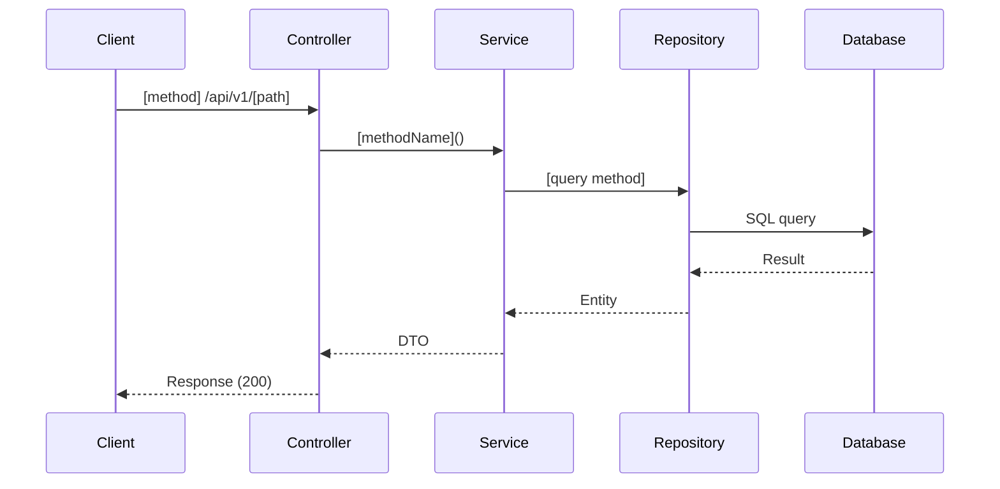

# Processing Flow — [TÊN CHỨC NĂNG]

| Mục | Giá trị |
|---|---|
| Mã chức năng | `[MÃ]` |
| Phạm vi tầng | Backend (Spring Boot REST API) |
| Repo | ArenaFlow-be |
| Ràng buộc dữ liệu | `docs/agent/non-functional-standards.md` (3/4/6) |
| Tác giả | [Agent/User] |
| Ngày | [YYYY-MM-DD] |
| Phiên bản | v1.0 (baseline) |

## 1. Tổng quan luồng

[Mô tả tổng quan luồng xử lý từ request đến response]

## 2. Sequence Diagram

## 3. Luồng chi tiết

### 3.1. [TÊN ENDPOINT 1]

**Bước 1: Validation**
- Kiểm tra request body
- Validation: [liệt kê]

**Bước 2: Authorization**
- Kiểm tra quyền: [role/permission]

**Bước 3: Business Logic**
- [Mô tả logic]

**Bước 4: Database Interaction**
- **Query 1:** `[mô tả]` (SELECT/INSERT/UPDATE)
- **Query 2:** [nếu có]
- **Tổng số truy vấn dự kiến:** [N] (ngưỡng: ≤[3|4|6])

**Bước 5: Response**
- Map entity → DTO
- Return response

---

## 4. Transaction Boundary

**Phạm vi transaction:**
- Bắt đầu: `[ServiceImpl].[methodName]()`
- Kết thúc: khi method return
- Rollback khi: exception xảy ra

**Isolation level:** [READ_COMMITTED | mặc định]

---

## 5. Concurrency & Locking

**Thao tác đọc:**
- Không cần lock

**Thao tác ghi:**
- **Optimistic locking:** `@Version` trên entity
- Xung đột → throw `OptimisticLockException` → 409 Conflict

---

## 6. Error Handling

| Trường hợp | Exception | HTTP Status | Action |
|---|---|---|---|
| [Trường hợp 1] | `[ExceptionType]` | [Status] | [Action] |
| Validation fail | `MethodArgumentNotValidException` | 400 | Return validation errors |
| Entity not found | `EntityNotFoundException` | 404 | Return error message |

---

## 7. Idempotency (cho thao tác ghi)

**Cơ chế:**
- [Mô tả cách đảm bảo idempotent, vd: unique constraint, idempotency key]

**Retry behavior:**
- [Mô tả hành vi khi retry]

---

## 8. Performance Considerations

**Số truy vấn:**
- API chi tiết: [N] ≤ 3 ✅ / ❌
- API danh sách: [N] ≤ 4 ✅ / ❌
- API ghi: [N] ≤ 6 ✅ / ❌

**N+1 prevention:**
- [Cách tránh N+1, vd: `@EntityGraph`, JOIN FETCH]

**Index needed:**
- `[table].[column]` [lý do]

---

## 9. Danh sách [cần xác nhận]

1. [Điểm chưa rõ 1]
2. [Điểm chưa rõ 2]
